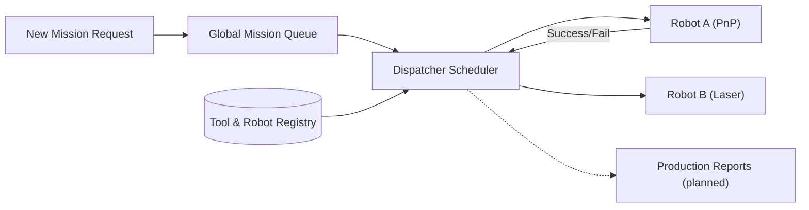

<!-- =============================================================================
HYDRA-UMC-JOB-DISPATCHER - Priority job dispatcher
Copyright (C) JuanenRac (Electro Hobby 3D) <electrohobby3d@gmail.com>
GPL-3.0-or-later - see LICENSE
============================================================================= -->

<p align="center">
  
</p>

# 🗂️ HYDRA-UMC-JOB-DISPATCHER

<p align="center">🇺🇸 <b>English</b> | <a href="README_spa.md">🇪🇸 Español</a> | <a href="README_fra.md">🇫🇷 Français</a> | <a href="README_ita.md">🇮🇹 Italiano</a> | <a href="README_deu.md">🇩🇪 Deutsch</a> | <a href="README_zho.md">🇨🇳 简体中文</a> | <a href="README_jpn.md">🇯🇵 日本語</a> | <a href="README_por.md">🇵🇹 Português</a></p>

### ⚙️ Priority-Based Mission Queue for Heterogeneous Robot Fleets

<p align="center">
  
  
  
  
  
  
</p>

---

> **Safety and security status:** this ecosystem is not a certified safety system. There is no hardware E-STOP path, no firmware-enforced limits or interlocks and no verified motion command yet; firmware images are checked with CRC-32 and an Ed25519 signature, and a release build refuses the published development keys (the tool heads and expansion boards behind the relay still run URTC bootloaders, which take a shared-key HMAC-SHA256 instead of a signature); TLS and mutual TLS are optional and off by default; no custom board has been populated or tested yet. Read the [security baseline](https://github.com/JuanenRac/HYDRA-UMC-DOCS/blob/main/docs/SECURITY_BASELINE.md) and the [threat model](https://github.com/JuanenRac/HYDRA-UMC-DOCS/blob/main/docs/THREAT_MODEL.md) before relying on any statement here for the safety of a person.

---

## 📋 At a glance

| | |
|---|---|
| Version | `0.2.5` |
| Maturity | Functional |
| Tests | 188 (`go test ./...`) |
| Stack | Go / priority queue / HTTP API / SQLite (modernc.org/sqlite, pure Go) |
| Target | The Raspberry Pi CM5 of a HYDRA-UMC cell |
| On real hardware | Not yet: no run on real hardware is recorded for this version |

**Jump to:** [Overview](#-overview) · [Architecture](#-architecture) · [Features](#-features) · [Security & Safety](#-security--safety) · [Interfaces](#-interfaces) · [Configuration](#-configuration) · [Quick start](#-quick-start) · [Testing](#-testing) · [Troubleshooting](#-troubleshooting) · [Repository Structure](#-repository-structure) · [Related Projects](#-related-projects)

## 🚦 Project status

Each line is one part of this repository and the light says how far it is today. It is written from what the repository can show (tests, builds, runs), not from what is planned.

🟢 Done and verified · 🟡 Works, with known limits · 🟠 Partly done or not verified yet · 🔴 Not done or not working

| Area | State | What it means here |
|---|---|---|
| Software | 🟡 | Works for its main purpose; the honesty check above lists what is still missing |
| Tests | 🟢 | 188 automated tests, run on every change |
| Real hardware | 🔴 | Not yet: no run on real hardware is recorded for this version |
| Documentation | 🟢 | README in eight languages, checked against the manifest on every change |

## 🎯 Overview

**HYDRA-UMC-JOB-DISPATCHER** is the task allocation engine of the Orchestrator. it manages a global mission queue, distributing jobs to individual robots based on their current availability, location, and attached tool (URTC).

It ensures that high-priority tasks (e.g., "Emergency Defect Fix") bypass the normal production flow, and coordinates multi-step assembly sequences that require different robots to work in tandem.

## 🧩 Role in HYDRA-UMC

**HYDRA-UMC-JOB-DISPATCHER** decides which robot gets which job. Clients submit jobs, robots register the tools they carry and ask for work, and the dispatcher hands out the highest-priority job that fits. It does not move a robot: what a robot does with a job is its own business and the job gate of the SDK.

## 🏛️ Architecture

<p align="center">
  
</p>

<details>
<summary>Text version of the diagram (Mermaid)</summary>



</details>

**Why it is built this way**

* **Why the real logic lives under `src/`, not at the repo root.** `src/dispatcher` (the scheduling engine) and `src/api` (the HTTP handlers) hold the actual implementation; `main.go`/`version.go` stay at the repo root as the entry point that wires them together.
* **Why job assignment checks tool availability via URTC.** A job that needs a specific tool head is only dispatchable to a robot whose URTC-controlled tool head is actually present and idle - checking this before dispatch (not after a failed pick) avoids a robot arriving at a station it can't actually use. `src/dispatcher.Engine.DispatchOnce` enforces this today by exact `RequiredTool`/`Robot.Tool` match; it doesn't yet talk to a real URTC over CAN to confirm the tool head is physically attached (this engine only knows what a robot registration claims - see `src/api`'s `POST /robots`).
* **The scheduler, and now persistence too, are both real.** `src/dispatcher` implements the actual algorithm the README's "DISPATCHER FLOW" diagram describes: a priority-ordered global queue, tool-aware routing, and multi-stage dependencies (a job stays `blocked` until every job it `DependsOn` reaches `done`). `Engine`'s state always lived behind exported methods precisely so a real backing store could replace what's behind them later without changing every caller - `NewEngineWithStore` (`src/sqlitestore`) is that store: opt-in, pure-Go SQLite, verified end-to-end against a real killed-and-relaunched binary. See [`docs/API.md`](docs/API.md#persistence).
* **Why the HTTP API is plain JSON/HTTP, not gRPC.** This is a human/ops-facing control surface (submit a job, register a robot, ask what happened) - `hydra.common.v1` (the ecosystem's shared gRPC contract, see `HYDRA-UMC-ORCHESTRATOR/proto/`) stays reserved for node-to-node traffic, per that proto's own documented scope.
* **How this fits the rest of the ecosystem.** A sibling service under HYDRA-UMC-ORCHESTRATOR - turns mission-level decisions into concrete per-robot job assignments. (Checking assignments against URTC tool availability and HYDRA-UMC-PATH-PLANNER-3D routes is planned, not implemented.)
* **Why `POST /jobs/submit` is a new route instead of changing `POST /jobs`.** `AddJob()`/`POST /jobs` always insert and error on an ID collision - that low-level contract is untouched. `SubmitJob()`/`POST /jobs/submit` layers real, opt-in deduplication on top via `Job.DedupKey`: same pattern used across the ecosystem (a safety-gated entry point added alongside an unchanged low-level primitive, not a behavior change bolted onto it).
* **Why a retry-after-failure reuses the same job ID instead of creating a new job.** The alternative - minting a fresh job on every retry - would scatter one logical unit of work's history across several IDs and give a caller no way to tell "this failed once and is being retried" from "this is unrelated new work". Resetting the original job back to `Pending` keeps its whole lifecycle (including the failed attempt) under one ID.

**Jobs from an Operation.** `POST /jobs/submit` also takes the common Operation of the SDK (a body with `operation_id`), which is what the semantic planner hands over: the id of the operation is the id of the job and also its dedup key, so posting the same operation again is the same job, and the `priority`, `required_tool`, `location` and `depends_on` of its `params` are the ones of the job. Only an operation in the state `received` is taken; anything else is a `400`.

## ✨ Features

* 📋 **Dynamic Queueing:** Intelligent mission prioritization and scheduling.
* ⚖️ **Tool-Aware Routing:** Automatically routes jobs to the robot with the correct URTC head.
* 🧰 **Configurable tool catalog (warns only):** `-tools-file` (a JSON list of the TOOL_* profile names of the tool heads) and/or `-tools` declare the tools the installation knows. A job whose `RequiredTool`, or a robot whose `Tool`, is not in the catalog is accepted all the same and logged once as a warning (with a hint when only the case differs, because tools match exactly). Without a catalog nothing changes. *(implemented)*
* 🔄 **Multi-Stage Missions:** Manages dependencies between tasks (e.g., "Pick" must happen before "Place").
* 📡 **Persistence:** real, opt-in SQLite-backed mission state (`-db PATH`, `src/sqlitestore`, pure Go - no CGO) - the queue survives a real process restart, verified end-to-end; unset, it stays purely in-memory. `GET /health` reports a degraded store instead of failing silently. See [`docs/API.md`](docs/API.md#persistence).
* 🔁 **Idempotent Submission (v0):** Real, opt-in `DedupKey`-based deduplication via `POST /jobs/submit` - a retried submission of an in-flight or already-done job is returned unchanged, and a retry after a real failure reuses the same job ID instead of running the work twice. Priority ordering is deterministic across repeated runs, covered by an explicit regression test.
* 🧯 **Safe by default, and a robot that stops answering gets no work (v0):** the API listens on `127.0.0.1:8090` unless told otherwise, and another address needs a bearer token (`-token` / `JOB_DISPATCHER_TOKEN`; everything but `GET /health` then demands it) or an explicit `-allow-anonymous`; the HTTP server has timeouts, and request bodies over 64 KB are refused with `413`. A robot silent for longer than `-robot-timeout` (default 2 minutes) is not offered new work, a job can name a preferred `location` (`POST /jobs`, `POST /jobs/submit`; robots in that location are preferred, never required), and the last heartbeat of every robot is persisted (a database from the previous version is migrated in place), so a restart no longer hides a robot that went silent. *(implemented)*
* 🗂️ **Atomic writes, paging and traceable jobs:** a completion, cancellation, requeue or stale sweep is written to SQLite in one transaction (the database runs in WAL mode); `GET /jobs` can be filtered and paged (`status`, `limit`, `offset`, `X-Total-Count`); every job carries `SubmittedAtMs`, `AssignedAtMs`, `CompletedAtMs` and an `Attempt` counter that a completion report may send back (`attempt`) so the late report of an abandoned assignment is refused; `DELETE /robots/{id}` forgets a robot that has no job; a robot heartbeat dated in the future is not trusted. A machine-readable description is in `docs/openapi.yaml`. *(implemented)*
* 🕒 **Why a job waits:** `GET /dispatch/waiting` lists the pending jobs in dispatch order with the reason each has no robot (no robots registered, no robot with the tool, matching robots busy, matching robots silent, or a robot free for the next pass). It is read-only; `POST /dispatch` still answers the plain list of assignments.
* ⏱️ **Estimated time of each job (off by default):** with `-eta`, `GET /dispatch/eta` estimates when every unfinished job starts and ends, on which robot, and when the queue will be empty, from how long the recent finished jobs of the same tool took (a configurable default until there are some). A job that cannot be estimated says why. Without `-eta` the route does not exist and nothing else changes; it is read-only and tested with an injected clock.
* 🧾 **A production event for every job that ends (off by default):** with `-production-events` and a destination (`-production-events-file` for one JSON line per event, `-production-events-url` for a JSON `POST`), each report that a job ended hands over a `ProductionEvent` of the shared contract of HYDRA-UMC-SDK (robot, end time, good or not, cycle time, job), which the production reports turn into OEE. The event is checked against the contract first; a cycle it cannot describe is skipped and logged, never invented, and a sink that fails never fails the completion. Without the switch nothing changes; tested with an injected clock.
* 🧭 **Closest robot, replanning and ranges (all off by default):** a configuration file (`-config`) holds the tuned values and each section is off unless it says so: `location_costs` sends a job that names a location to the robot with the lowest declared cost to it, `replan` (`POST /jobs/replan`, or by itself for a robot that went silent or faulted) sends the jobs of a failed robot back to the queue in order without duplicating or losing any, and `eta_interval` adds a low-to-high range (quartiles of the recent durations of the same tool) next to every estimate, or says why it cannot. Without the file nothing changes; tested with an injected clock and seeded random scenarios.

## 🔒 Security & Safety

| Threat | Defence | Where |
|---|---|---|
| An API open to the network | It listens on `127.0.0.1:8090`; any other address needs a Bearer token (`-token` or `JOB_DISPATCHER_TOKEN`) unless `-allow-anonymous` is given; every route except `GET /health` asks for it, compared in constant time, and a refusal is `401` with `WWW-Authenticate: Bearer` | `main.go`, `src/api/api.go` |
| Big bodies and slow connections | A body is at most 64 KiB; the header must arrive in 5 s, the request in 15 s, the answer is written within 30 s and an idle connection closes after 60 s | `src/api/api.go`, `main.go` |
| Work given to a robot that went silent, or to a tool that does not exist | A robot silent for longer than `-robot-timeout` (2 minutes by default, `0` turns it off) gets no work and its jobs become unknown; a job or robot that names a tool outside `-tools-file` / `-tools` is refused | `main.go`, `src/dispatcher/tools.go` |
| A duplicate submission and a restart that loses the queue | Submission is idempotent through the `DedupKey`; with `-db PATH` the queue is kept in a pure-Go SQLite file and survives a killed and restarted process, without it the queue lives in memory | `src/dispatcher`, `src/sqlitestore` |

**What it never does:** it does not move a robot, and tool routing compares the strings a robot says about itself: a robot that lies about its tool cannot be told apart, because URTC is not asked over CAN.

## 🔌 Interfaces

HTTP on `127.0.0.1:8090` by default; the full reference is `docs/API.md` and `docs/openapi.yaml`.

| Topic or route | What it carries |
|---|---|
| `/jobs`, `/jobs/submit`, `/jobs/{id}` | list, submit and read jobs |
| `/jobs/replan` | send the jobs of a failed robot back to the queue (only when the configuration file turns replanning on; otherwise 404) |
| `/jobs/complete`, `/jobs/cancel`, `/jobs/requeue`, `/jobs/detect-stale` | finish, cancel or requeue a job; find the jobs of silent robots |
| `/robots`, `/robots/{id}`, `/dispatch` | register a robot and its tools; ask for the next job that fits |
| `GET /health` | is the service alive (open without a token) |

## ⚙️ Configuration

| Variable | Default | What it sets |
|---|---|---|
| `-addr` | `127.0.0.1:8090` | where the service listens |
| `-token`, `JOB_DISPATCHER_TOKEN` | empty | the Bearer token of the API |
| `-allow-anonymous` | `false` | allow a non-loopback address without a token |
| `-robot-timeout` | `2m` | silence after which a robot gets no work (`0` = off) |
| `-eta`, `JOB_DISPATCHER_ETA=1`, `-eta-default-duration`, `-eta-window` | off, `1m`, `20` | switch on `GET /dispatch/eta` (estimated start and end of every unfinished job and of the queue); the duration assumed until a job of the tool has finished (`0` = no guess) and how many recent finished jobs per tool are averaged |
| `-config`, `JOB_DISPATCHER_CONFIG` | empty | a JSON file with the tuned values of three optional behaviours, each off unless the file turns it on: `location_costs` (a table of costs between locations; the job goes to the robot with the lowest cost), `replan` (the jobs of a failed or silent robot go back to the queue) and `eta_interval` (a range next to every estimate, needs `-eta`) |
| `-production-events`, `JOB_DISPATCHER_PRODUCTION_EVENTS=1`, `-production-events-file`, `-production-events-url`, `-production-events-token` | off, empty, empty, empty | hand over a `ProductionEvent` of the shared contract for every job that ends: one JSON line per event in the file and/or a JSON `POST` to the URL (with the bearer token); the switch needs at least one destination |
| `-db` | empty (memory) | path of the SQLite file that keeps the queue |
| `-tools-file`, `JOB_DISPATCHER_TOOLS_FILE`, `-tools`, `JOB_DISPATCHER_TOOLS` | empty | the list of tools a job or robot may name |
| `-max-body-bytes`, `-read-header-timeout`, `-read-timeout`, `-write-timeout`, `-idle-timeout` | `65536`, `5s`, `15s`, `30s`, `60s` | largest request body in bytes (a larger one gets `413`) and the time limits of the HTTP server; none of them accepts zero |

## 🚀 Quick start

Requires Go 1.21 or newer (the SQLite driver is pure Go, no C compiler) and Python 3 only for the project tools.

```bash
bash run.sh        # Linux, macOS (run.bat on Windows)
go run . -addr 127.0.0.1:8090 -db jobs.sqlite3
curl http://127.0.0.1:8090/health
```

## 🧪 Testing

188 Go tests run with `go test ./...`; they sit next to the code (`src/api`, `src/dispatcher`, `src/sqlitestore` and `main_test.go`) and include a process that is killed and started again over a SQLite file. No hardware and no outside network.

The CI runs `HYDRA_UMC_CI=1 python tools/ci_validate.py`, which checks the manifest, the documents, the eight READMEs and the pictures.

## 🏗️ Build & Release

A real priority mission queue with an HTTP API, not just a skeleton that compiles.

```bash
# Windows
build.bat
run.bat -addr 127.0.0.1:8090

# Linux / macOS
./build.sh
./run.sh -addr 127.0.0.1:8090
```

`build.sh`/`build.bat` never change the version (only `python tools/hydra_project_tool.py bump` raises it) and then run `go build`. `run.sh`/`run.bat`
execute the resulting binary directly.

```bash
# Register a robot, submit a job, dispatch it, then mark it done
curl -X POST localhost:8090/robots -d '{"id":"robot-a","tool":"PnP","available":true}'
curl -X POST localhost:8090/jobs   -d '{"id":"job-1","priority":5,"requiredTool":"PnP"}'
curl -X POST localhost:8090/dispatch -d '{}'
curl -X POST localhost:8090/jobs/complete -d '{"id":"job-1","success":true,"robotId":"robot-a"}'
curl localhost:8090/jobs
curl localhost:8090/robots
```

```bash
# Idempotent submission: a retried request with the same dedupKey never
# runs the same job twice, even if the client used a different job id.
curl -X POST localhost:8090/jobs/submit -d '{"id":"job-2","priority":5,"requiredTool":"PnP","dedupKey":"req-abc"}'
# -> {"ID":"job-2", ..., "result":"created"}
curl -X POST localhost:8090/jobs/submit -d '{"id":"job-2-retry","priority":5,"requiredTool":"PnP","dedupKey":"req-abc"}'
# -> {"ID":"job-2", ..., "result":"duplicate"} - same job, untouched

# After a real failure, a retry with the same dedupKey reuses job-2's ID:
curl -X POST localhost:8090/jobs/complete -d '{"id":"job-2","success":false,"robotId":"robot-a"}'
curl -X POST localhost:8090/jobs/submit -d '{"id":"job-2-retry-2","priority":5,"requiredTool":"PnP","dedupKey":"req-abc"}'
# -> {"ID":"job-2", "Status":"pending", ..., "result":"retried"}
```

```bash
go test ./...   # src/dispatcher (scheduling algorithm) +
                 # src/api (real HTTP round-trips via httptest)
```

## 🩺 Troubleshooting

| You see | Because | Do |
|---|---|---|
| the service refuses to start | The address is not loopback and no token was given | Give `-token` (or `JOB_DISPATCHER_TOKEN`), or `-allow-anonymous` if you accept it |
| `401` | The request has no Bearer token or a wrong one | Send `Authorization: Bearer <token>` |
| a job stays queued | No registered robot carries the tool the job names, or the robot is silent | Register a robot with that tool and keep it asking `/dispatch`; check `-robot-timeout` |
| the queue is empty after a restart | The service ran without `-db` | Start it with `-db` pointing at a SQLite file |

## 📂 Repository Structure

<p align="center">
  
</p>

<details>
<summary>Text version of the tree</summary>

```text
HYDRA-UMC-JOB-DISPATCHER/
├── src/
│   ├── dispatcher/                              the queue, routing by tool, stages, recovery
│   ├── api/                                     the HTTP surface, token, limits
│   └── sqlitestore/                             optional durable queue (pure Go SQLite)
├── docs/                                        the API reference and the OpenAPI file
├── systemd/                                     service unit for the CM5
├── tools/                                       build and test runner, version bump, CI validator, README and picture generators and checks
├── images/                                      banner and the pictures of the README
├── .github/                                     CI workflow and issue templates
├── hydra-umc.project.json                       manifest: version, maturity, family
├── CHANGELOG.md                                 what changed in each version
├── build.sh build.bat                           build scripts (they never change the version)
├── build-test.sh build-test.bat                 build scripts (they never change the version)
├── test.sh test.bat                             run the tests
├── main.go / version.go                         entry point, flags and the version
├── main_test.go                                 tests of the entry point
├── server_limits.go / server_limits_test.go     the time and size limits of the HTTP server, and their tests
├── go.mod / go.sum                              Go module and checksums
├── bump_version.py / bump_manifest_version.py   explicit version bump
├── run.sh run.bat                               start the service
└── SECURITY.md SUPPORT.md CONTRIBUTING.md CODE_OF_CONDUCT.md LICENSE LICENSE.md
```

</details>

## 🗺️ Roadmap & Known limits

**Known limits today**

* **Phase 1:** Deterministic swarm synchronization over TSN and sub-ms jitter reduction.
* **Phase 2:** 3D Path planning with dynamic obstacle avoidance in multi-robot cells.
* **Phase 3:** Multi-robot job dispatching optimization using real-time resource availability.
* **Phase 4:** AI-driven job duration estimation for better scheduling and heterogeneous robot fleet coordination.

## 🌍 Languages

This README and the documents of the repository exist in eight languages: English, Spanish, German, French, Italian, Japanese, Chinese and Portuguese (Portugal). They are written together and checked in the CI so that the eight files have the same sections and the same links. This repository has no screen or message catalogue of its own, so there are no interface strings to translate.

## 🔗 Related Projects

This project is part of the HYDRA-UMC robotics ecosystem by the same author (JuanenRac / Electro Hobby 3D). Worth knowing about, since a request might actually be about one of these rather than this repository.

**Parent Project**
- **[HYDRA-UMC-ORCHESTRATOR](https://github.com/JuanenRac/HYDRA-UMC-ORCHESTRATOR)** — integration hub with a real gRPC/Protobuf health-report contract and mission state machine; the parent this repo is one specific orchestration service of, within its own swarm-coordination layer.

**Sibling Projects** — the other orchestration services of HYDRA-UMC-ORCHESTRATOR's own swarm-coordination layer
- **[HYDRA-UMC-SWARM-SYNC](https://github.com/JuanenRac/HYDRA-UMC-SWARM-SYNC)** — real CRDT LWW-Element-Map state sync, property-tested for multi-cell convergence.
- **[HYDRA-UMC-PATH-PLANNER-3D](https://github.com/JuanenRac/HYDRA-UMC-PATH-PLANNER-3D)** — real RRT-based 3D path planner with real obstacle/workspace collision validation.
- **[HYDRA-UMC-NODE-HEALING](https://github.com/JuanenRac/HYDRA-UMC-NODE-HEALING)** — real gRPC-based fleet health watchdog with retry/backoff and identity-mismatch detection.

**Directly Related**
- **[URTC](https://github.com/JuanenRac/URTC)** — firmware for the physical Universal Robot Tool Controller PCB, 25+ tool profiles over CAN bus — assigns jobs based on which of URTC's own tool heads is actually available.
- **[HYDRA-UMC-PRODUCTION-REPORTS](https://github.com/JuanenRac/HYDRA-UMC-PRODUCTION-REPORTS)** — real OEE/availability calculation over DATALAKE history, with reproducible CSV export — the diagrammed target for mission-completion logs; this dispatcher is the intended real source of its own OEE `production_event` data once completions are wired to write it (not implemented yet, tracked on that project's own side).

**Also Part of the Ecosystem**

*Core Hardware & Platform*
- **[HYDRA-UMC](https://github.com/JuanenRac/HYDRA-UMC)** — the robot-arm motherboard design: CM5 host + dual-core STM32H745, meant to orchestrate up to 8 tool arms over CAN-OTA/SPI-OTA (firmware at an early stage; no populated board yet).
- **[HYDRA-UMC-OS](https://github.com/JuanenRac/HYDRA-UMC-OS)** — reproducible Raspberry Pi OS product layer for the CM5: read-only agent, validated config/profiles, WiFi first-contact provisioning.
- **[HYDRA-UMC-SDK](https://github.com/JuanenRac/HYDRA-UMC-SDK)** — the shared JSON-Schema contract and software job-gate boundary every bridge validates its commands against (not a certified safety function).
- **[HYDRA-UMC-CONNECTOR-HUB](https://github.com/JuanenRac/HYDRA-UMC-CONNECTOR-HUB)** — declarative adapter-manifest registry and validator for external-machine connectors; extends the SDK's own contract idea to external machines without replacing the industrial-gateway projects.

*Core Backend & Clients*
- **[HYDRA-UMC-SERVER](https://github.com/JuanenRac/HYDRA-UMC-SERVER)** — the real headless backend (REST/WebSocket) every control client actually talks to.
- **[HYDRA-UMC-STUDIO](https://github.com/JuanenRac/HYDRA-UMC-STUDIO)** — web control dashboard with real-time multi-robot 3D visualization.
- **[HYDRA-UMC-SUITE](https://github.com/JuanenRac/HYDRA-UMC-SUITE)** — desktop (PySide6) swarm command center for multiple servers at once, packaged as a standalone executable.
- **[HYDRA-UMC-ANDROID-CONTROL](https://github.com/JuanenRac/HYDRA-UMC-ANDROID-CONTROL)** — native Android control app with biometric login and a paired Wear OS companion.
- **[HYDRA-UMC-IOS-CONTROL](https://github.com/JuanenRac/HYDRA-UMC-IOS-CONTROL)** — iOS/iPadOS control app (Flutter) with real-time WebSocket sync.
- **[HYDRA-UMC-DSI](https://github.com/JuanenRac/HYDRA-UMC-DSI)** — native touch UI for the onboard 7" DSI touchscreen, embedded on the CM5 itself.
- **[HYDRA-UMC-EDITOR-URDF](https://github.com/JuanenRac/HYDRA-UMC-EDITOR-URDF)** — desktop graphical URDF creator/editor that pushes finished models into STUDIO's own catalog.
- **[HYDRA-UMC-EDITOR-STL](https://github.com/JuanenRac/HYDRA-UMC-EDITOR-STL)** — desktop STL model editor, transforming/replacing/removing/adding real parts in the same model catalog HYDRA-UMC-EDITOR-URDF also edits.
- **[HYDRA-UMC-BRIDGE-AMR](https://github.com/JuanenRac/HYDRA-UMC-BRIDGE-AMR)** — coordination boundary for AGV/AMR fleets via a VDA 5050 MQTT publisher (tested against an emulated fleet only).
- **[HYDRA-UMC-BRIDGE-CNC](https://github.com/JuanenRac/HYDRA-UMC-BRIDGE-CNC)** — high-level CNC-cell coordinator with GRBL status/control-byte access (tested against an emulator only).
- **[HYDRA-UMC-BRIDGE-DROIDS](https://github.com/JuanenRac/HYDRA-UMC-BRIDGE-DROIDS)** — coordination boundary for legged/humanoid droids, with a Boston Dynamics Spot command sender (tested against an emulator only).
- **[HYDRA-UMC-BRIDGE-LASER](https://github.com/JuanenRac/HYDRA-UMC-BRIDGE-LASER)** — laser-cell coordinator reading 3 key/enclosure/interlock GPIO signals (tested against a fake chip only; it cannot arm or fire a laser).
- **[HYDRA-UMC-BRIDGE-OPENPNP](https://github.com/JuanenRac/HYDRA-UMC-BRIDGE-OPENPNP)** — safe high-level board-flow coordinator for OpenPnP pick-and-place.
- **[HYDRA-UMC-BRIDGE-PRINTER3D](https://github.com/JuanenRac/HYDRA-UMC-BRIDGE-PRINTER3D)** — safe coordination boundary for Moonraker/Klipper 3D printers, with real gated job commands.
- **[HYDRA-UMC-BRIDGE-ROS2](https://github.com/JuanenRac/HYDRA-UMC-BRIDGE-ROS2)** — coordinator with a lazily imported rclpy ROS 2 transport (not yet run against a ROS 2 installation).
- **[HYDRA-UMC-BRIDGE-UAV](https://github.com/JuanenRac/HYDRA-UMC-BRIDGE-UAV)** — coordination boundary for camera-equipped UAVs, with a MAVLink command sender (tested against an emulator only).

*URTC Tool Platform*
- **[URTC-FLASHER](https://github.com/JuanenRac/URTC-FLASHER)** — desktop GUI flashing tool for URTC boards, CAN-OTA plus full-chip SWD/JTAG.
- **[URTC-TESTER](https://github.com/JuanenRac/URTC-TESTER)** — desktop live CAN-bus diagnostic tool for URTC boards, one panel per tool profile.
- **[URTC-WEB-STUDIO](https://github.com/JuanenRac/URTC-WEB-STUDIO)** — browser-based alternative to URTC-TESTER via the Web Serial API, no local install needed.
- **[URTC-GATEWAY](https://github.com/JuanenRac/URTC-GATEWAY)** — gateway in front of the URTC CAN bus: an allowed list of identifiers, a rate limit and a session key; software tested on a computer, not yet on a real bus.

*Vision AI Node (Hailo-8)*
- **[HYDRA-UMC-VISION-NODE](https://github.com/JuanenRac/HYDRA-UMC-VISION-NODE)** — integration hub for the Hailo-8 vision pipeline, with a real per-stage hardware-readiness check.
- **[HYDRA-UMC-DETECTION-HEF](https://github.com/JuanenRac/HYDRA-UMC-DETECTION-HEF)** — real compiled-model registry with Hailo-architecture/checksum safe-load verification.
- **[HYDRA-UMC-VISION-STREAMER](https://github.com/JuanenRac/HYDRA-UMC-VISION-STREAMER)** — real GStreamer pipeline + MediaMTX config generator with a real HailoRT integration boundary.
- **[HYDRA-UMC-VISUAL-SERVOING-API](https://github.com/JuanenRac/HYDRA-UMC-VISUAL-SERVOING-API)** — Position-Based Visual Servoing correction law with authorisation gated on the zone state; no camera pose estimation yet.
- **[HYDRA-UMC-SAFETY-ZONES](https://github.com/JuanenRac/HYDRA-UMC-SAFETY-ZONES)** — v0 zone-breach, calibration-freshness and E-STOP-request logic that takes object positions from a file; no detector feeds it and no physical E-STOP is wired to it yet.

*Cognitive AI Node (Hailo-10)*
- **[HYDRA-UMC-COGNITIVE-NODE](https://github.com/JuanenRac/HYDRA-UMC-COGNITIVE-NODE)** — integration hub for the Hailo-10 cognitive pipeline (LLM/VLA/voice orchestration).
- **[HYDRA-UMC-VLA-ENGINE](https://github.com/JuanenRac/HYDRA-UMC-VLA-ENGINE)** — real action-token encoding/decoding and trajectory generation for a Vision-Language-Action model.
- **[HYDRA-UMC-VOICE-UI](https://github.com/JuanenRac/HYDRA-UMC-VOICE-UI)** — real voice front-end (VAD + intent parser) with a bounded, confirmation-gated Watch relay.
- **[HYDRA-UMC-SEMANTIC-PLANNER](https://github.com/JuanenRac/HYDRA-UMC-SEMANTIC-PLANNER)** — real rule-based task decomposition and semantic error recovery over MCU error codes.
- **[HYDRA-UMC-DOCS-QA](https://github.com/JuanenRac/HYDRA-UMC-DOCS-QA)** — real stdlib-only TF-IDF document search over this ecosystem's own Markdown docs.
- **[HYDRA-UMC-LOCAL-TECHNICIAN](https://github.com/JuanenRac/HYDRA-UMC-LOCAL-TECHNICIAN)** — local, policy-gated AI maintenance technician for the ecosystem itself - observes, diagnoses and proposes fixes; the two highest risk levels are deliberately not implemented yet.

*Digital Twin & Simulation*
- **[HYDRA-UMC-TWIN](https://github.com/JuanenRac/HYDRA-UMC-TWIN)** — integration hub for the digital-twin engine, with a real version-compatibility sync contract.
- **[HYDRA-UMC-HIL-BRIDGE](https://github.com/JuanenRac/HYDRA-UMC-HIL-BRIDGE)** — hardware-in-the-loop router with a software collision interlock between simulation and real hardware (tested without real hardware).
- **[HYDRA-UMC-PHYSICS-REPLICA](https://github.com/JuanenRac/HYDRA-UMC-PHYSICS-REPLICA)** — real forward kinematics and joint-limit validation over a real URDF subset.
- **[HYDRA-UMC-SYNTHETIC-DATA-GEN](https://github.com/JuanenRac/HYDRA-UMC-SYNTHETIC-DATA-GEN)** — real procedural 2D scene generator with YOLO/COCO annotation export.

*Data & Analytics*
- **[HYDRA-UMC-DATALAKE](https://github.com/JuanenRac/HYDRA-UMC-DATALAKE)** — real sqlite3-backed time-series store with a real ingest/query HTTP API.
- **[HYDRA-UMC-ANOMALY-DETECTOR](https://github.com/JuanenRac/HYDRA-UMC-ANOMALY-DETECTOR)** — real FFT + statistical baseline anomaly detector with drift monitoring.
- **[HYDRA-UMC-TELEMETRY-COLLECTOR](https://github.com/JuanenRac/HYDRA-UMC-TELEMETRY-COLLECTOR)** — real CAN/WebSocket ingestion pipeline into DATALAKE, with sequence deduplication.

*Industrial Gateway*
- **[HYDRA-UMC-GATEWAY-INDUSTRIAL](https://github.com/JuanenRac/HYDRA-UMC-GATEWAY-INDUSTRIAL)** — integration hub relaying to industrial protocols, with a real command allowlist/backpressure layer.
- **[HYDRA-UMC-OPCUA-SERVER](https://github.com/JuanenRac/HYDRA-UMC-OPCUA-SERVER)** — real OPC-UA address space, verified with a real binary-protocol client session.
- **[HYDRA-UMC-MQTT-BROKER](https://github.com/JuanenRac/HYDRA-UMC-MQTT-BROKER)** — real MQTT broker with optional per-client authentication and topic ACLs.
- **[HYDRA-UMC-MTCONNECT-ADAPTER](https://github.com/JuanenRac/HYDRA-UMC-MTCONNECT-ADAPTER)** — real MTConnect `/probe` and `/current` XML endpoints with degraded-mode output.

*Complementary Tools & Ecosystem Operations*
- **[HYDRA-UMC-DASHBOARD-AI](https://github.com/JuanenRac/HYDRA-UMC-DASHBOARD-AI)** — Smart Summaries and Anomaly Highlighting panels over DATALAKE/ANOMALY-DETECTOR, with an honest statistical fallback.
- **[HYDRA-UMC-TOOL-CLI](https://github.com/JuanenRac/HYDRA-UMC-TOOL-CLI)** — fleet CLI with a real, stable exit-code contract, a genuine live client of HYDRA-UMC-SERVER's own API.
- **[HYDRA-UMC-WATCH](https://github.com/JuanenRac/HYDRA-UMC-WATCH)** — WearOS companion app with haptic alert patterns and a paired-phone voice relay (not yet run on a physical watch).
- **[URTC-SMART-RACK](https://github.com/JuanenRac/URTC-SMART-RACK)** — firmware for a board-mounting rack with real tool-ID decoding and Smart Idle pre-heating logic.
- **[URTC-VISION-TOOL](https://github.com/JuanenRac/URTC-VISION-TOOL)** — firmware plus a real Python vision companion for a thermal/RGB inspection tool head.
- **[HYDRA-UMC-UPDATER](https://github.com/JuanenRac/HYDRA-UMC-UPDATER)** — administrative desktop tool that discovers, clones and updates every repo in this ecosystem.
- **[HYDRA-UMC-OS-REBUILDER](https://github.com/JuanenRac/HYDRA-UMC-OS-REBUILDER)** — Windows/Linux desktop tool that builds a ready-to-flash CM5 image pre-loaded with the ecosystem's most current versions, with Raspberry-Pi-Imager-style first-boot Wi-Fi/user/SSH configuration.
- **[HYDRA-UMC-OPS-AGENT](https://github.com/JuanenRac/HYDRA-UMC-OPS-AGENT)** — maintenance-incident coordinator: a low-privilege edge role collects a sanitized inventory/health snapshot, a control-plane role renders it read-only and asks an AI provider to suggest a diagnosis - never applies a patch or deploys anything.
- **[HYDRA-UMC-DEV-SERVER](https://github.com/JuanenRac/HYDRA-UMC-DEV-SERVER)** — reproducible development host (Raspberry Pi 5 / CM5) that stores the ecosystem's source and runs bounded build/test tasks under a durable queue; a dedicated dev role, explicitly not an operational CM5.

## 📚 Documentation

Where to read more:

* [docs/API.md](docs/API.md) - every route, its fields and its errors
* [docs/openapi.yaml](docs/openapi.yaml) - the same API as an OpenAPI file
* [Security baseline of the ecosystem](https://github.com/JuanenRac/HYDRA-UMC-DOCS/blob/main/docs/SECURITY_BASELINE.md)
* [Threat model of the ecosystem](https://github.com/JuanenRac/HYDRA-UMC-DOCS/blob/main/docs/THREAT_MODEL.md)
* [Changelog of this repository](CHANGELOG.md)
* [License of this repository](LICENSE.md)

## 🤝 Contributing & Community

* Before a pull request run `HYDRA_UMC_CI=1 py -3 tools/ci_validate.py` (or `HYDRA_UMC_CI=1 python3 tools/ci_validate.py`): it must print `CI_VALIDATION=PASS`. Do not run `build.sh` or `build.bat` for this check; building is not a check.
* The eight READMEs are written from one source in HYDRA-UMC-DOCS; do not edit them by hand. Change the source and write them again with `tools/make_readmes.py`.
* Do not state in a README what has not run: say "simulated" or "not tried on hardware" where that is the truth.
* See [CONTRIBUTING.md](CONTRIBUTING.md), the [code of conduct](CODE_OF_CONDUCT.md), [SECURITY.md](SECURITY.md) and [SUPPORT.md](SUPPORT.md).

## 👤 AUTHOR

**JuanenRac (Electro Hobby 3D)** · electrohobby3d@gmail.com

## 📜 LICENSE

GPL-3.0-or-later - [LICENSE](LICENSE).
