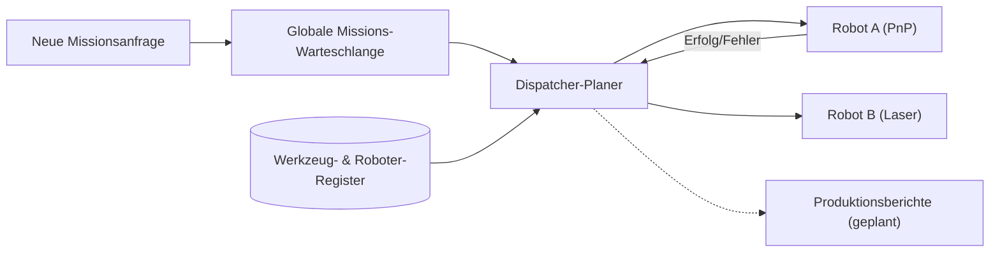

<!-- =============================================================================
HYDRA-UMC-JOB-DISPATCHER - Priority job dispatcher
Copyright (C) JuanenRac (Electro Hobby 3D) <electrohobby3d@gmail.com>
GPL-3.0-or-later - see LICENSE
============================================================================= -->

<p align="center">
  
</p>

# 🗂️ HYDRA-UMC-JOB-DISPATCHER

<p align="center"><a href="README.md">🇺🇸 English</a> | <a href="README_spa.md">🇪🇸 Español</a> | <a href="README_fra.md">🇫🇷 Français</a> | <a href="README_ita.md">🇮🇹 Italiano</a> | 🇩🇪 <b>Deutsch</b> | <a href="README_zho.md">🇨🇳 简体中文</a> | <a href="README_jpn.md">🇯🇵 日本語</a> | <a href="README_por.md">🇵🇹 Português</a></p>

### ⚙️ Prioritätsbasierte Missions-Warteschlange für heterogene Roboterflotten

<p align="center">
  
  
  
  
  
  
</p>

---

> **Stand von Sicherheit (Safety) und Security:** Dieses Ökosystem ist kein zertifiziertes Sicherheitssystem. Es gibt noch keinen Hardware-E-STOP-Pfad, keine von der Firmware durchgesetzten Grenzen oder Verriegelungen und keinen verifizierten Bewegungsbefehl; Firmware-Images werden mit CRC-32 und einer Ed25519-Signatur geprüft, und ein Release-Build verweigert die veröffentlichten Entwicklungsschlüssel (die Werkzeugköpfe und Erweiterungsplatinen hinter dem Relais laufen noch mit URTC-Bootloadern, die statt einer Signatur ein HMAC-SHA256 mit gemeinsamem Schlüssel verwenden); TLS und gegenseitiges TLS sind optional und standardmäßig aus; noch keine eigene Platine wurde bestückt oder getestet. Lesen Sie die [Sicherheitsbasis](https://github.com/JuanenRac/HYDRA-UMC-DOCS/blob/main/docs/SECURITY_BASELINE.md) und das [Bedrohungsmodell](https://github.com/JuanenRac/HYDRA-UMC-DOCS/blob/main/docs/THREAT_MODEL.md), bevor Sie sich für die Sicherheit einer Person auf eine Aussage hier verlassen.

---

## 📋 Auf einen Blick

| | |
|---|---|
| Version | `0.2.4` |
| Reifegrad | Funktionsfähig |
| Tests | 153 (`go test ./...`) |
| Technik | Go / priority queue / HTTP API / SQLite (modernc.org/sqlite, pure Go) |
| Ziel | Der Raspberry Pi CM5 einer HYDRA-UMC-Zelle |
| Auf echter Hardware | Noch nicht: für diese Version ist kein Lauf auf echter Hardware vermerkt |

**Springe zu:** [Überblick](#-überblick) · [Architektur](#-architektur) · [Funktionen](#-funktionen) · [Sicherheit und Schutz](#-sicherheit-und-schutz) · [Schnittstellen](#-schnittstellen) · [Konfiguration](#-konfiguration) · [Schnellstart](#-schnellstart) · [Tests](#-tests) · [Fehlerbehebung](#-fehlerbehebung) · [Struktur des Repositorys](#-struktur-des-repositorys) · [Verwandte Projekte](#-verwandte-projekte)

## 🚦 Projektstatus

Jede Zeile ist ein Teil dieses Repositorys, und die Ampel sagt, wie weit er heute ist. Sie beruht auf dem, was das Repository zeigen kann (Tests, Builds, Läufe), nicht auf dem, was geplant ist.

🟢 Fertig und überprüft · 🟡 Funktioniert, mit bekannten Grenzen · 🟠 Teilweise fertig oder noch nicht überprüft · 🔴 Nicht gemacht oder funktioniert nicht

| Bereich | Stand | Was das hier bedeutet |
|---|---|---|
| Software | 🟡 | Funktioniert für seinen Hauptzweck; die Ehrlichkeitsprüfung oben nennt, was noch fehlt |
| Tests | 🟢 | 153 automatische Tests, bei jeder Änderung ausgeführt |
| Echte Hardware | 🔴 | Noch nicht: für diese Version ist kein Lauf auf echter Hardware vermerkt |
| Dokumentation | 🟢 | README in acht Sprachen, bei jeder Änderung gegen das Manifest geprüft |

## 🎯 Überblick

**HYDRA-UMC-JOB-DISPATCHER** ist die Engine zur Aufgabenverteilung des Orchestrators. Sie verwaltet eine globale Missions-Warteschlange und verteilt Aufgaben an einzelne Roboter basierend auf deren aktueller Verfügbarkeit, Standort und angebautem Werkzeug (URTC).

Er stellt sicher, dass hochpriore Aufgaben (z. B. "Notfall-Defektbehebung") den normalen Produktionsfluss umgehen, und koordiniert mehrstufige Montage-Sequenzen, die die Zusammenarbeit verschiedener Roboter erfordern.

## 🧩 Rolle in HYDRA-UMC

**HYDRA-UMC-JOB-DISPATCHER** entscheidet, welcher Roboter welchen Auftrag bekommt. Clients reichen Aufträge ein, Roboter melden die Werkzeuge an, die sie tragen, und fragen nach Arbeit, und der Dispatcher gibt den passenden Auftrag mit der höchsten Priorität aus. Er bewegt keinen Roboter: Was ein Roboter mit einem Auftrag tut, ist seine Sache und die des Auftragstors des SDK.

## 🏛️ Architektur

<p align="center">
  
</p>

<details>
<summary>Textversion des Diagramms (Mermaid)</summary>



</details>

**Warum es so gebaut ist**

* **Warum die echte Logik unter `src/` liegt, nicht im Repo-Root.** `src/dispatcher` (die Planungs-Engine) und `src/api` (die HTTP-Handler) enthalten die eigentliche Implementierung; `main.go`/`version.go` bleiben im Repo-Root als der Einstiegspunkt, der sie verbindet.
* **Warum die Auftragszuweisung die Werkzeugverfügbarkeit über URTC prüft.** Ein Auftrag, der einen bestimmten Werkzeugkopf benötigt, ist nur einem Roboter zuweisbar, dessen URTC-gesteuerter Werkzeugkopf tatsächlich vorhanden und untätig ist - dies vor der Zuweisung zu prüfen (nicht nach einem gescheiterten Griff) verhindert, dass ein Roboter an einer Station ankommt, die er tatsächlich nicht nutzen kann. `src/dispatcher.Engine.DispatchOnce` setzt das heute bereits per exaktem Abgleich von `RequiredTool` und `Robot.Tool` durch; es spricht noch nicht mit einem echten URTC über CAN, um zu bestätigen, dass der Werkzeugkopf physisch angebracht ist (die Engine kennt nur, was die Roboter-Registrierung über `POST /robots` behauptet).
* **Der Scheduler, und jetzt auch die Persistenz, sind beide echt.** `src/dispatcher` implementiert den echten Algorithmus, den das "DISPATCHER FLOW"-Diagramm des READMEs beschreibt: eine global nach Priorität sortierte Warteschlange, werkzeugbewusstes Routing und mehrstufige Abhängigkeiten (ein Auftrag bleibt `blocked`, bis jeder Auftrag in seinem `DependsOn` `done` erreicht). Der Zustand von `Engine` lebte schon immer hinter exportierten Methoden, genau damit ein echter Speicher später das ersetzen kann, was hinter diesen Methoden steckt, ohne jeden Aufrufer zu ändern - `NewEngineWithStore` (`src/sqlitestore`) ist dieser Speicher: optional, reines Go SQLite, Ende-zu-Ende gegen einen echten abgebrochenen und neu gestarteten Prozess verifiziert. Siehe [`docs/API.md`](docs/API.md#persistence).
* **Warum die HTTP-API einfaches JSON/HTTP ist, kein gRPC.** Dies ist eine mensch-/betriebsorientierte Kontrollfläche (einen Auftrag einreichen, einen Roboter registrieren, nachfragen was passiert ist) - `hydra.common.v1` (der geteilte gRPC-Vertrag des Ökosystems, siehe `HYDRA-UMC-ORCHESTRATOR/proto/`) bleibt für Knoten-zu-Knoten-Verkehr reserviert, gemäß dem bereits dokumentierten Geltungsbereich dieses Protos.
* **Wie sich das ins restliche Ökosystem einfügt.** Ein Geschwisterdienst unter HYDRA-UMC-ORCHESTRATOR - verwandelt Entscheidungen auf Missionsebene in konkrete Auftragszuweisungen pro Roboter. (Die Prüfung der Zuweisungen gegen die Werkzeugverfügbarkeit von URTC und die Routen von HYDRA-UMC-PATH-PLANNER-3D ist geplant, nicht umgesetzt.)
* **Warum `POST /jobs/submit` eine neue Route ist, statt `POST /jobs` zu ändern.** `AddJob()`/`POST /jobs` fügen immer ein und schlagen bei einer ID-Kollision fehl - dieser Low-Level-Vertrag bleibt unangetastet. `SubmitJob()`/`POST /jobs/submit` legt darüber echte, optionale Deduplizierung via `Job.DedupKey` - dasselbe Muster, das im gesamten Ökosystem verwendet wird (ein abgesicherter Einstiegspunkt neben einer unveränderten Low-Level-Primitive, keine Verhaltensänderung, die ihr aufgepfropft wird).
* **Warum ein Wiederholungsversuch nach einem Fehler dieselbe Job-ID wiederverwendet, statt eine neue anzulegen.** Die Alternative - bei jedem Versuch einen neuen Job anzulegen - würde die Historie einer einzigen logischen Arbeitseinheit über mehrere IDs verstreuen und einem Aufrufer keine Möglichkeit geben, "das ist einmal fehlgeschlagen und wird wiederholt" von "das ist neue, unabhängige Arbeit" zu unterscheiden. Den ursprünglichen Job auf `Pending` zurückzusetzen hält seinen gesamten Lebenszyklus (einschließlich des fehlgeschlagenen Versuchs) unter einer einzigen ID.

**Jobs aus einer Operation.** `POST /jobs/submit` nimmt auch die gemeinsame Operation des SDK an (ein Body mit `operation_id`), die der semantische Planer übergibt: Die Id der Operation ist die Id des Jobs und zugleich sein Dedup-Schlüssel, sodass dieselbe Operation erneut zu senden derselbe Job ist; `priority`, `required_tool`, `location` und `depends_on` aus ihren `params` sind die des Jobs. Nur eine Operation im Zustand `received` wird angenommen; alles andere ist ein `400`.

## ✨ Funktionen

* 📋 **Dynamisches Queueing:** Intelligente Missionspriorisierung und -planung.
* ⚖️ **Werkzeugbewusstes Routing:** Leitet Aufgaben automatisch an den Roboter mit dem richtigen URTC-Kopf weiter.
* 🧰 **Konfigurierbarer Werkzeugkatalog (warnt nur):** `-tools-file` (eine JSON-Liste der TOOL_*-Profilnamen der Werkzeugköpfe) und/oder `-tools` legen fest, welche Werkzeuge die Anlage kennt. Ein Auftrag, dessen `RequiredTool`, oder ein Roboter, dessen `Tool` nicht im Katalog steht, wird trotzdem angenommen und einmal als Warnung protokolliert (mit Hinweis, wenn sich nur die Groß-/Kleinschreibung unterscheidet, da Werkzeuge exakt übereinstimmen). Ohne Katalog ändert sich nichts. *(implementiert)*
* 🔄 **Mehrstufige Missionen:** Verwaltet Abhängigkeiten zwischen Aufgaben (z. B. muss "Pick" vor "Place" erfolgen).
* 📡 **Persistenz:** echter, optionaler SQLite-gestützter Missionsstatus (`-db PATH`, `src/sqlitestore`, reines Go - kein CGO) - die Warteschlange uebersteht einen echten Prozessneustart, Ende-zu-Ende verifiziert; ohne Angabe bleibt alles rein im Speicher. `GET /health` meldet einen degradierten Speicher statt stillschweigend zu versagen. Siehe [`docs/API.md`](docs/API.md#persistence).
* 🔁 **Idempotente Einreichung (v0):** Echte, optionale `DedupKey`-basierte Deduplizierung über `POST /jobs/submit` - eine erneute Einreichung eines laufenden oder bereits abgeschlossenen Jobs wird unverändert zurückgegeben, und ein Wiederholungsversuch nach einem echten Fehler nutzt dieselbe Job-ID weiter, statt die Arbeit zweimal auszuführen. Die Prioritätsreihenfolge ist über wiederholte Läufe hinweg deterministisch, abgedeckt durch einen expliziten Regressionstest.
* 🧯 **Standardmäßig sicher, und ein Roboter, der nicht mehr antwortet, bekommt keine Arbeit (v0):** Die API lauscht auf `127.0.0.1:8090`, sofern nichts anderes angegeben ist, und eine andere Adresse verlangt ein Bearer-Token (`-token` / `JOB_DISPATCHER_TOKEN`; dann verlangt alles außer `GET /health` es) oder ein ausdrückliches `-allow-anonymous`; der HTTP-Server hat Zeitlimits, und Anfragekörper über 64 KB werden mit `413` abgelehnt. Ein Roboter, der länger als `-robot-timeout` (Standard 2 Minuten) schweigt, bekommt keine neue Arbeit, ein Job kann eine bevorzugte `location` nennen (`POST /jobs`, `POST /jobs/submit`; Roboter an diesem Ort werden bevorzugt, nie verlangt), und der letzte Herzschlag jedes Roboters wird gespeichert (eine Datenbank der Vorversion wird an Ort und Stelle migriert), sodass ein Neustart einen verstummten Roboter nicht mehr verbirgt. *(implementiert)*
* 🗂️ **Atomare Schreibvorgänge, Seitenabruf und nachvollziehbare Aufträge:** Abschluss, Abbruch, Wiedereinreihung oder Sweep veralteter Heartbeats werden in einer Transaktion in SQLite geschrieben (die Datenbank läuft im WAL-Modus); `GET /jobs` lässt sich filtern und seitenweise abrufen (`status`, `limit`, `offset`, `X-Total-Count`); jeder Auftrag trägt `SubmittedAtMs`, `AssignedAtMs`, `CompletedAtMs` und einen Zähler `Attempt`, den eine Abschlussmeldung zurücksenden darf (`attempt`), damit die späte Meldung einer aufgegebenen Zuweisung abgelehnt wird; `DELETE /robots/{id}` entfernt einen Roboter ohne Auftrag; ein Heartbeat mit Datum in der Zukunft wird nicht beachtet. Eine maschinenlesbare Beschreibung steht in `docs/openapi.yaml`. *(implementiert)*
* 🕒 **Warum ein Auftrag wartet:** `GET /dispatch/waiting` listet die wartenden Aufträge in Verteilreihenfolge mit dem Grund, warum jeder keinen Roboter hat (kein Roboter registriert, kein Roboter mit dem Werkzeug, passende Roboter belegt, passende Roboter still oder ein Roboter frei für den nächsten Durchlauf). Es ist schreibgeschützt; `POST /dispatch` antwortet weiter mit der einfachen Liste der Zuweisungen.

## 🔒 Sicherheit und Schutz

| Bedrohung | Abwehr | Wo |
|---|---|---|
| Eine zum Netz offene API | Er lauscht auf `127.0.0.1:8090`; jede andere Adresse braucht ein Bearer-Token (`-token` oder `JOB_DISPATCHER_TOKEN`), außer `-allow-anonymous` ist gesetzt; jede Route außer `GET /health` verlangt es, in konstanter Zeit verglichen, und die Ablehnung ist `401` mit `WWW-Authenticate: Bearer` | `main.go`, `src/api/api.go` |
| Große Bodys und langsame Verbindungen | Ein Body hat höchstens 64 KiB; der Header muss in 5 s ankommen, die Anfrage in 15 s, die Antwort wird in 30 s geschrieben und eine leere Verbindung schließt nach 60 s | `src/api/api.go`, `main.go` |
| Arbeit für einen verstummten Roboter oder für ein nicht existierendes Werkzeug | Ein Roboter, der länger als `-robot-timeout` schweigt (standardmäßig 2 Minuten, `0` schaltet es ab), bekommt keine Arbeit und seine Aufträge werden unbekannt; ein Auftrag oder Roboter mit einem Werkzeug außerhalb von `-tools-file` / `-tools` wird abgelehnt | `main.go`, `src/dispatcher/tools.go` |
| Eine doppelte Einreichung und ein Neustart, der die Warteschlange verliert | Die Einreichung ist über den `DedupKey` idempotent; mit `-db PFAD` liegt die Warteschlange in einer reinen Go-SQLite-Datei und überlebt einen beendeten und neu gestarteten Prozess, ohne bleibt sie im Speicher | `src/dispatcher`, `src/sqlitestore` |

**Was er nie tut:** er bewegt keinen Roboter, und die Weiterleitung nach Werkzeug vergleicht die Zeichenketten, die ein Roboter über sich sagt: Ein Roboter, der über sein Werkzeug lügt, ist nicht zu erkennen, weil URTC nicht über CAN gefragt wird.

## 🔌 Schnittstellen

HTTP standardmäßig auf `127.0.0.1:8090`; die vollständige Referenz sind `docs/API.md` und `docs/openapi.yaml`.

| Topic oder Route | Was es trägt |
|---|---|
| `/jobs`, `/jobs/submit`, `/jobs/{id}` | Aufträge auflisten, einreichen und lesen |
| `/jobs/complete`, `/jobs/cancel`, `/jobs/requeue`, `/jobs/detect-stale` | einen Auftrag abschließen, abbrechen oder neu einreihen; die Aufträge verstummter Roboter finden |
| `/robots`, `/robots/{id}`, `/dispatch` | einen Roboter und seine Werkzeuge anmelden; den nächsten passenden Auftrag anfordern |
| `GET /health` | lebt der Dienst (ohne Token offen) |

## ⚙️ Konfiguration

| Variable | Standard | Was sie festlegt |
|---|---|---|
| `-addr` | `127.0.0.1:8090` | wo der Dienst lauscht |
| `-token`, `JOB_DISPATCHER_TOKEN` | leer | das Bearer-Token der API |
| `-allow-anonymous` | `false` | eine Nicht-Loopback-Adresse ohne Token erlauben |
| `-robot-timeout` | `2m` | Stille, nach der ein Roboter keine Arbeit bekommt (`0` = aus) |
| `-db` | leer (Speicher) | Pfad der SQLite-Datei, die die Warteschlange hält |
| `-tools-file`, `JOB_DISPATCHER_TOOLS_FILE`, `-tools`, `JOB_DISPATCHER_TOOLS` | leer | die Liste der Werkzeuge, die ein Auftrag oder Roboter nennen darf |
| `-max-body-bytes`, `-read-header-timeout`, `-read-timeout`, `-write-timeout`, `-idle-timeout` | `65536`, `5s`, `15s`, `30s`, `60s` | größter Anfrage-Body in Bytes (ein größerer bekommt `413`) und die Zeitlimits des HTTP-Servers; keines akzeptiert null |

## 🚀 Schnellstart

Benötigt Go 1.21 oder neuer (der SQLite-Treiber ist reines Go, kein C-Compiler) und Python 3 nur für die Projektwerkzeuge.

```bash
bash run.sh        # Linux, macOS (run.bat on Windows)
go run . -addr 127.0.0.1:8090 -db jobs.sqlite3
curl http://127.0.0.1:8090/health
```

## 🧪 Tests

153 Go-Tests laufen mit `go test ./...`; sie liegen neben dem Code (`src/api`, `src/dispatcher`, `src/sqlitestore` und `main_test.go`) und enthalten einen Prozess, der über einer SQLite-Datei beendet und neu gestartet wird. Keine Hardware, kein äußeres Netz.

Die CI führt `HYDRA_UMC_CI=1 python tools/ci_validate.py` aus; das prüft das Manifest, die Dokumente, die acht READMEs und die Bilder.

## 🏗️ Build und Veröffentlichung

Eine echte priorisierte Auftragswarteschlange mit HTTP-API, nicht nur ein
kompilierbares Skelett.

```bash
# Windows
build.bat
run.bat -addr 127.0.0.1:8090

# Linux / macOS
./build.sh
./run.sh -addr 127.0.0.1:8090
```

`build.sh`/`build.bat` ändern die Version nie (nur `python tools/hydra_project_tool.py bump` erhöht sie) und führen anschließend
`go build` aus. `run.sh`/`run.bat` führen die resultierende Binärdatei
direkt aus.

```bash
# Roboter registrieren, Auftrag einreichen, verteilen, dann als erledigt markieren
curl -X POST localhost:8090/robots -d '{"id":"robot-a","tool":"PnP","available":true}'
curl -X POST localhost:8090/jobs   -d '{"id":"job-1","priority":5,"requiredTool":"PnP"}'
curl -X POST localhost:8090/dispatch -d '{}'
curl -X POST localhost:8090/jobs/complete -d '{"id":"job-1","success":true,"robotId":"robot-a"}'
curl localhost:8090/jobs
curl localhost:8090/robots
```

```bash
# Idempotente Einreichung: eine wiederholte Anfrage mit demselben dedupKey
# führt denselben Job nie zweimal aus, selbst wenn der Client eine andere id verwendet.
curl -X POST localhost:8090/jobs/submit -d '{"id":"job-2","priority":5,"requiredTool":"PnP","dedupKey":"req-abc"}'
# -> {"ID":"job-2", ..., "result":"created"}
curl -X POST localhost:8090/jobs/submit -d '{"id":"job-2-retry","priority":5,"requiredTool":"PnP","dedupKey":"req-abc"}'
# -> {"ID":"job-2", ..., "result":"duplicate"} - derselbe Job, unverändert

# Nach einem echten Fehlschlag nutzt ein Wiederholungsversuch mit demselben dedupKey die ID von job-2 weiter:
curl -X POST localhost:8090/jobs/complete -d '{"id":"job-2","success":false,"robotId":"robot-a"}'
curl -X POST localhost:8090/jobs/submit -d '{"id":"job-2-retry-2","priority":5,"requiredTool":"PnP","dedupKey":"req-abc"}'
# -> {"ID":"job-2", "Status":"pending", ..., "result":"retried"}
```

```bash
go test ./...   # src/dispatcher (Scheduling-Algorithmus) +
                 # src/api (echte HTTP-Roundtrips via httptest)
```

## 🩺 Fehlerbehebung

| Du siehst | Weil | Tu |
|---|---|---|
| the service refuses to start | Die Adresse ist nicht Loopback und es wurde kein Token angegeben | Gib `-token` (oder `JOB_DISPATCHER_TOKEN`) an, oder `-allow-anonymous`, wenn du es hinnimmst |
| `401` | Die Anfrage hat kein oder ein falsches Bearer-Token | Sende `Authorization: Bearer <token>` |
| a job stays queued | Kein angemeldeter Roboter trägt das genannte Werkzeug, oder der Roboter schweigt | Melde einen Roboter mit diesem Werkzeug an und lass ihn `/dispatch` weiter anfragen; prüfe `-robot-timeout` |
| the queue is empty after a restart | Der Dienst lief ohne `-db` | Starte ihn mit `-db`, das auf eine SQLite-Datei zeigt |

## 📂 Struktur des Repositorys

<p align="center">
  
</p>

<details>
<summary>Textversion des Baums</summary>

```text
HYDRA-UMC-JOB-DISPATCHER/
├── src/
│   ├── dispatcher/                              die Warteschlange, Weiterleitung nach Werkzeug, Stufen, Wiederherstellung
│   ├── api/                                     die HTTP-Schnittstelle, Token, Grenzen
│   └── sqlitestore/                             optionale dauerhafte Warteschlange (reines Go-SQLite)
├── docs/                                        die API-Referenz und die OpenAPI-Datei
├── systemd/                                     Dienst-Unit für den CM5
├── tools/                                       Build- und Testläufer, Versionserhöhung, CI-Prüfer, README- und Bildgeneratoren samt Prüfungen
├── images/                                      Banner und die Bilder der README
├── .github/                                     CI-Workflow und Issue-Vorlagen
├── hydra-umc.project.json                       Manifest: Version, Reifegrad, Familie
├── CHANGELOG.md                                 was sich in jeder Version geändert hat
├── build.sh build.bat                           Build-Skripte (ändern die Version nie)
├── build-test.sh build-test.bat                 Build-Skripte (ändern die Version nie)
├── test.sh test.bat                             führen die Tests aus
├── main.go / version.go                         Einstieg, Optionen und die Version
├── main_test.go                                 Tests des Einstiegs
├── server_limits.go / server_limits_test.go     die Zeit- und Größenlimits des HTTP-Servers und ihre Tests
├── go.mod / go.sum                              Go-Modul und Prüfsummen
├── bump_version.py / bump_manifest_version.py   ausdrückliche Versionserhöhung
├── run.sh run.bat                               den Dienst starten
└── SECURITY.md SUPPORT.md CONTRIBUTING.md CODE_OF_CONDUCT.md LICENSE LICENSE.md
```

</details>

## 🗺️ Roadmap und bekannte Grenzen

**Bekannte Grenzen heute**

* **Phase 1:** Deterministische Schwarm-Synchronisation über TSN und Sub-ms-Jitter-Reduzierung.
* **Phase 2:** 3D-Pfadplanung mit dynamischer Hindernisvermeidung in Multi-Roboter-Zellen.
* **Phase 3:** Multi-Roboter-Job-Dispatching-Optimierung unter Berücksichtigung der Ressourcenverfügbarkeit in Echtzeit.
* **Phase 4:** KI-gestützte Schätzung der Jobdauer für eine bessere Planung und Koordination heterogener Roboterflotten.

## 🌍 Sprachen

Diese README und die Dokumente des Repositorys gibt es in acht Sprachen: Englisch, Spanisch, Deutsch, Französisch, Italienisch, Japanisch, Chinesisch und Portugiesisch (Portugal). Sie entstehen gemeinsam, und die CI prüft, dass die acht Dateien dieselben Abschnitte und dieselben Links haben. Dieses Repository hat weder eine eigene Oberfläche noch einen eigenen Meldungskatalog, es gibt also keine Oberflächentexte zu übersetzen.

## 🔗 Verwandte Projekte

Dieses Projekt ist Teil des HYDRA-UMC-Robotik-Ökosystems desselben Autors (JuanenRac / Electro Hobby 3D). Gut zu wissen, da eine Anfrage eigentlich eines dieser Projekte betreffen könnte statt dieses Repositorys.

**Übergeordnetes Projekt**
- **[HYDRA-UMC-ORCHESTRATOR](https://github.com/JuanenRac/HYDRA-UMC-ORCHESTRATOR)** — Integrationsknoten mit einem echten gRPC/Protobuf-Health-Report-Vertrag und einer Missions-Zustandsmaschine; das übergeordnete Projekt, dessen spezifischer Orchestrierungsdienst dieses Repository innerhalb seiner eigenen Schwarmkoordinationsschicht ist.

**Geschwisterprojekte** — die übrigen Orchestrierungsdienste der eigenen Schwarmkoordinationsschicht von HYDRA-UMC-ORCHESTRATOR
- **[HYDRA-UMC-SWARM-SYNC](https://github.com/JuanenRac/HYDRA-UMC-SWARM-SYNC)** — echte CRDT-LWW-Element-Map-Zustandssynchronisation, eigenschaftsgetestet auf Multi-Zellen-Konvergenz.
- **[HYDRA-UMC-PATH-PLANNER-3D](https://github.com/JuanenRac/HYDRA-UMC-PATH-PLANNER-3D)** — echter RRT-basierter 3D-Pfadplaner mit echter Hindernis-/Arbeitsraum-Kollisionsvalidierung.
- **[HYDRA-UMC-NODE-HEALING](https://github.com/JuanenRac/HYDRA-UMC-NODE-HEALING)** — echter gRPC-basierter Flotten-Health-Watchdog mit Retry/Backoff und Identitäts-Mismatch-Erkennung.

**Direkt verwandt**
- **[URTC](https://github.com/JuanenRac/URTC)** — Firmware für die physische Universal-Robot-Tool-Controller-Platine, 25+ Werkzeugprofile über CAN-Bus — weist Jobs basierend darauf zu, welcher der eigenen Werkzeugköpfe von URTC tatsächlich verfügbar ist.
- **[HYDRA-UMC-PRODUCTION-REPORTS](https://github.com/JuanenRac/HYDRA-UMC-PRODUCTION-REPORTS)** — echte OEE-/Verfügbarkeitsberechnung über den DATALAKE-Verlauf, mit reproduzierbarem CSV-Export — das vorgesehene Ziel für Missionsabschluss-Protokolle; dieser Dispatcher ist die vorgesehene reale Quelle seiner eigenen OEE-`production_event`-Daten, sobald Abschlüsse zum Schreiben verdrahtet sind (noch nicht implementiert, auf der eigenen Seite jenes Projekts nachverfolgt).

**Ebenfalls Teil des Ökosystems**

*Kern-Hardware & Plattform*
- **[HYDRA-UMC](https://github.com/JuanenRac/HYDRA-UMC)** — der Entwurf des Motherboards des Roboterarms: CM5-Host + Dual-Core-STM32H745, gedacht zur Koordination von bis zu 8 Werkzeugarmen über CAN-OTA/SPI-OTA (Firmware in einer frühen Phase; noch keine bestückte Platine).
- **[HYDRA-UMC-OS](https://github.com/JuanenRac/HYDRA-UMC-OS)** — reproduzierbare Raspberry-Pi-OS-Produktschicht für den CM5: schreibgeschützter Agent, validierte Konfiguration/Profile, WiFi-Ersteinrichtung.
- **[HYDRA-UMC-SDK](https://github.com/JuanenRac/HYDRA-UMC-SDK)** — der gemeinsame JSON-Schema-Vertrag und die Software-Auftragsschranke, gegen die jede Bridge ihre Befehle validiert (keine zertifizierte Sicherheitsfunktion).
- **[HYDRA-UMC-CONNECTOR-HUB](https://github.com/JuanenRac/HYDRA-UMC-CONNECTOR-HUB)** — deklaratives Adapter-Manifest-Register und Validator für Konnektoren externer Maschinen; erweitert die eigene Vertragsidee des SDK auf externe Maschinen, ohne die Industrie-Gateway-Projekte zu ersetzen.

*Kern-Backend & Clients*
- **[HYDRA-UMC-SERVER](https://github.com/JuanenRac/HYDRA-UMC-SERVER)** — das reale Headless-Backend (REST/WebSocket), mit dem jeder Steuerungsclient tatsächlich spricht.
- **[HYDRA-UMC-STUDIO](https://github.com/JuanenRac/HYDRA-UMC-STUDIO)** — Web-Steuerungs-Dashboard mit Echtzeit-3D-Visualisierung mehrerer Roboter.
- **[HYDRA-UMC-SUITE](https://github.com/JuanenRac/HYDRA-UMC-SUITE)** — Desktop-Schwarmleitstand (PySide6) für mehrere Server gleichzeitig, verpackt als eigenständige ausführbare Datei.
- **[HYDRA-UMC-ANDROID-CONTROL](https://github.com/JuanenRac/HYDRA-UMC-ANDROID-CONTROL)** — native Android-Steuerungs-App mit biometrischem Login und einer gekoppelten Wear-OS-Begleit-App.
- **[HYDRA-UMC-IOS-CONTROL](https://github.com/JuanenRac/HYDRA-UMC-IOS-CONTROL)** — iOS/iPadOS-Steuerungs-App (Flutter) mit Echtzeit-WebSocket-Synchronisierung.
- **[HYDRA-UMC-DSI](https://github.com/JuanenRac/HYDRA-UMC-DSI)** — native Touch-UI für das eingebaute 7"-DSI-Touchscreen, direkt auf dem CM5 eingebettet.
- **[HYDRA-UMC-EDITOR-URDF](https://github.com/JuanenRac/HYDRA-UMC-EDITOR-URDF)** — grafischer Desktop-URDF-Ersteller/-Editor, der fertige Modelle in STUDIOs eigenen Katalog überträgt.
- **[HYDRA-UMC-EDITOR-STL](https://github.com/JuanenRac/HYDRA-UMC-EDITOR-STL)** — Desktop-STL-Modelleditor, der echte Teile im selben Modellkatalog transformiert/ersetzt/entfernt/hinzufügt, den auch HYDRA-UMC-EDITOR-URDF bearbeitet.
- **[HYDRA-UMC-BRIDGE-AMR](https://github.com/JuanenRac/HYDRA-UMC-BRIDGE-AMR)** — Koordinationsschranke für AGV-/AMR-Flotten über einen VDA-5050-MQTT-Publisher (nur gegen eine emulierte Flotte getestet).
- **[HYDRA-UMC-BRIDGE-CNC](https://github.com/JuanenRac/HYDRA-UMC-BRIDGE-CNC)** — High-Level-Koordinator für CNC-Zellen mit GRBL-Status-/Steuerbyte-Zugriff (nur gegen einen Emulator getestet).
- **[HYDRA-UMC-BRIDGE-DROIDS](https://github.com/JuanenRac/HYDRA-UMC-BRIDGE-DROIDS)** — Koordinationsschranke für laufende/humanoide Droiden, mit einem Boston-Dynamics-Spot-Befehlssender (nur gegen einen Emulator getestet).
- **[HYDRA-UMC-BRIDGE-LASER](https://github.com/JuanenRac/HYDRA-UMC-BRIDGE-LASER)** — Koordinator für Laserzellen, liest 3 Schlüssel-/Gehäuse-/Verriegelungs-GPIO-Signale (nur gegen einen simulierten Chip getestet; kann keinen Laser scharfschalten oder auslösen).
- **[HYDRA-UMC-BRIDGE-OPENPNP](https://github.com/JuanenRac/HYDRA-UMC-BRIDGE-OPENPNP)** — sicherer High-Level-Koordinator für den Leiterplattenfluss von OpenPnP Pick-and-Place.
- **[HYDRA-UMC-BRIDGE-PRINTER3D](https://github.com/JuanenRac/HYDRA-UMC-BRIDGE-PRINTER3D)** — sichere Koordinationsschranke für Moonraker/Klipper-3D-Drucker, mit echten gesicherten Job-Befehlen.
- **[HYDRA-UMC-BRIDGE-ROS2](https://github.com/JuanenRac/HYDRA-UMC-BRIDGE-ROS2)** — Koordinator mit einem träge importierten rclpy-ROS-2-Transport (noch nicht gegen eine ROS-2-Installation ausgeführt).
- **[HYDRA-UMC-BRIDGE-UAV](https://github.com/JuanenRac/HYDRA-UMC-BRIDGE-UAV)** — Koordinationsschranke für kameraausgestattete UAVs, mit einem MAVLink-Befehlssender (nur gegen einen Emulator getestet).

*URTC-Werkzeugplattform*
- **[URTC-FLASHER](https://github.com/JuanenRac/URTC-FLASHER)** — Desktop-GUI-Flash-Tool für URTC-Platinen, CAN-OTA plus Full-Chip-SWD/JTAG.
- **[URTC-TESTER](https://github.com/JuanenRac/URTC-TESTER)** — Desktop-Live-CAN-Bus-Diagnosetool für URTC-Platinen, ein Panel pro Werkzeugprofil.
- **[URTC-WEB-STUDIO](https://github.com/JuanenRac/URTC-WEB-STUDIO)** — browserbasierte Alternative zu URTC-TESTER über die Web-Serial-API, ohne lokale Installation.
- **[URTC-GATEWAY](https://github.com/JuanenRac/URTC-GATEWAY)** — Gateway vor dem CAN-Bus von URTC: Liste erlaubter Kennungen, Ratenbegrenzung und Sitzungsschlüssel; Software auf dem Computer getestet, noch nicht an einem echten Bus.

*Vision-KI-Knoten (Hailo-8)*
- **[HYDRA-UMC-VISION-NODE](https://github.com/JuanenRac/HYDRA-UMC-VISION-NODE)** — Integrationsknoten für die Hailo-8-Vision-Pipeline, mit einer echten stufenweisen Hardware-Bereitschaftsprüfung.
- **[HYDRA-UMC-DETECTION-HEF](https://github.com/JuanenRac/HYDRA-UMC-DETECTION-HEF)** — echte Registry für kompilierte Modelle mit Hailo-Architektur-/Prüfsummen-Safe-Load-Verifizierung.
- **[HYDRA-UMC-VISION-STREAMER](https://github.com/JuanenRac/HYDRA-UMC-VISION-STREAMER)** — echter GStreamer-Pipeline- + MediaMTX-Konfigurationsgenerator mit einer echten HailoRT-Integrationsschranke.
- **[HYDRA-UMC-VISUAL-SERVOING-API](https://github.com/JuanenRac/HYDRA-UMC-VISUAL-SERVOING-API)** — Position-Based-Visual-Servoing-Korrekturgesetz mit Freigabe abhängig vom Zonenstatus; noch keine Posenschätzung per Kamera.
- **[HYDRA-UMC-SAFETY-ZONES](https://github.com/JuanenRac/HYDRA-UMC-SAFETY-ZONES)** — v0-Logik für Zonenverletzung, Kalibrierungsaktualität und E-STOP-Anforderung, die Objektpositionen aus einer Datei nimmt; kein Detektor speist sie, und noch kein physischer E-STOP ist angeschlossen.

*Kognitiver KI-Knoten (Hailo-10)*
- **[HYDRA-UMC-COGNITIVE-NODE](https://github.com/JuanenRac/HYDRA-UMC-COGNITIVE-NODE)** — Integrationsknoten für die Hailo-10-Cognitive-Pipeline (LLM-/VLA-/Sprach-Orchestrierung).
- **[HYDRA-UMC-VLA-ENGINE](https://github.com/JuanenRac/HYDRA-UMC-VLA-ENGINE)** — echte Aktions-Token-Kodierung/-Dekodierung und Trajektoriengenerierung für ein Vision-Language-Action-Modell.
- **[HYDRA-UMC-VOICE-UI](https://github.com/JuanenRac/HYDRA-UMC-VOICE-UI)** — echtes Sprach-Frontend (VAD + Intent-Parser) mit einem begrenzten, bestätigungsgesicherten Watch-Relay.
- **[HYDRA-UMC-SEMANTIC-PLANNER](https://github.com/JuanenRac/HYDRA-UMC-SEMANTIC-PLANNER)** — echte regelbasierte Aufgabenzerlegung und semantische Fehlerbehebung über MCU-Fehlercodes.
- **[HYDRA-UMC-DOCS-QA](https://github.com/JuanenRac/HYDRA-UMC-DOCS-QA)** — echte, nur auf der Standardbibliothek basierende TF-IDF-Dokumentensuche über die eigenen Markdown-Dokumente dieses Ökosystems.
- **[HYDRA-UMC-LOCAL-TECHNICIAN](https://github.com/JuanenRac/HYDRA-UMC-LOCAL-TECHNICIAN)** — lokaler, richtlinien-gesteuerter KI-Wartungstechniker für das Ökosystem selbst - beobachtet, diagnostiziert und schlägt Korrekturen vor; die zwei höchsten Risikostufen sind absichtlich noch nicht implementiert.

*Digitaler Zwilling & Simulation*
- **[HYDRA-UMC-TWIN](https://github.com/JuanenRac/HYDRA-UMC-TWIN)** — Integrationsknoten für die Digital-Twin-Engine, mit einem echten Versionskompatibilitäts-Sync-Vertrag.
- **[HYDRA-UMC-HIL-BRIDGE](https://github.com/JuanenRac/HYDRA-UMC-HIL-BRIDGE)** — Hardware-in-the-Loop-Router mit einer Software-Kollisionsverriegelung zwischen Simulation und echter Hardware (ohne echte Hardware getestet).
- **[HYDRA-UMC-PHYSICS-REPLICA](https://github.com/JuanenRac/HYDRA-UMC-PHYSICS-REPLICA)** — echte Vorwärtskinematik und Gelenkgrenzenvalidierung über eine echte URDF-Teilmenge.
- **[HYDRA-UMC-SYNTHETIC-DATA-GEN](https://github.com/JuanenRac/HYDRA-UMC-SYNTHETIC-DATA-GEN)** — echter prozeduraler 2D-Szenengenerator mit YOLO/COCO-Annotationsexport.

*Daten & Analytik*
- **[HYDRA-UMC-DATALAKE](https://github.com/JuanenRac/HYDRA-UMC-DATALAKE)** — echter sqlite3-gestützter Zeitreihenspeicher mit einer echten Ingest-/Abfrage-HTTP-API.
- **[HYDRA-UMC-ANOMALY-DETECTOR](https://github.com/JuanenRac/HYDRA-UMC-ANOMALY-DETECTOR)** — echter FFT- + statistischer Basislinien-Anomaliedetektor mit Drift-Überwachung.
- **[HYDRA-UMC-TELEMETRY-COLLECTOR](https://github.com/JuanenRac/HYDRA-UMC-TELEMETRY-COLLECTOR)** — echte CAN/WebSocket-Ingestion-Pipeline in DATALAKE, mit Sequenz-Deduplizierung.

*Industrie-Gateway*
- **[HYDRA-UMC-GATEWAY-INDUSTRIAL](https://github.com/JuanenRac/HYDRA-UMC-GATEWAY-INDUSTRIAL)** — Integrationsknoten, der zu Industrieprotokollen weiterleitet, mit einer echten Befehls-Allowlist-/Backpressure-Schicht.
- **[HYDRA-UMC-OPCUA-SERVER](https://github.com/JuanenRac/HYDRA-UMC-OPCUA-SERVER)** — echter OPC-UA-Adressraum, verifiziert mit einer echten Binärprotokoll-Client-Session.
- **[HYDRA-UMC-MQTT-BROKER](https://github.com/JuanenRac/HYDRA-UMC-MQTT-BROKER)** — echter MQTT-Broker mit optionaler Pro-Client-Authentifizierung und Topic-ACLs.
- **[HYDRA-UMC-MTCONNECT-ADAPTER](https://github.com/JuanenRac/HYDRA-UMC-MTCONNECT-ADAPTER)** — echte MTConnect-`/probe`- und `/current`-XML-Endpunkte mit Degraded-Mode-Ausgabe.

*Ergänzende Tools & Ökosystembetrieb*
- **[HYDRA-UMC-DASHBOARD-AI](https://github.com/JuanenRac/HYDRA-UMC-DASHBOARD-AI)** — Smart-Summaries- und Anomaly-Highlighting-Panels über DATALAKE/ANOMALY-DETECTOR, mit einem ehrlichen statistischen Fallback.
- **[HYDRA-UMC-TOOL-CLI](https://github.com/JuanenRac/HYDRA-UMC-TOOL-CLI)** — Flotten-CLI mit einem echten, stabilen Exit-Code-Vertrag, ein echter Live-Client der eigenen API von HYDRA-UMC-SERVER.
- **[HYDRA-UMC-WATCH](https://github.com/JuanenRac/HYDRA-UMC-WATCH)** — WearOS-Begleit-App mit haptischen Alarmmustern und einem Sprach-Relay zum gekoppelten Telefon (noch nicht auf einer physischen Uhr ausgeführt).
- **[URTC-SMART-RACK](https://github.com/JuanenRac/URTC-SMART-RACK)** — Firmware für ein Platinenmontagegestell mit echter Werkzeug-ID-Dekodierung und Smart-Idle-Vorheizlogik.
- **[URTC-VISION-TOOL](https://github.com/JuanenRac/URTC-VISION-TOOL)** — Firmware plus ein echter Python-Vision-Begleiter für einen Thermal-/RGB-Inspektionswerkzeugkopf.
- **[HYDRA-UMC-UPDATER](https://github.com/JuanenRac/HYDRA-UMC-UPDATER)** — administratives Desktop-Tool, das jedes Repository in diesem Ökosystem entdeckt, klont und aktualisiert.
- **[HYDRA-UMC-OS-REBUILDER](https://github.com/JuanenRac/HYDRA-UMC-OS-REBUILDER)** — Windows/Linux-Desktop-Tool, das ein flashbereites CM5-Image baut, vorgeladen mit den aktuellsten Versionen des Ökosystems, mit Ersteinrichtungs-Konfiguration für WLAN/Benutzer/SSH im Stil von Raspberry Pi Imager.
- **[HYDRA-UMC-OPS-AGENT](https://github.com/JuanenRac/HYDRA-UMC-OPS-AGENT)** — Wartungsvorfall-Koordinator: eine Edge-Rolle mit niedrigem Privileg sammelt einen bereinigten Inventar-/Gesundheits-Snapshot, eine Control-Plane-Rolle rendert ihn schreibgeschützt und bittet einen KI-Anbieter um einen Diagnosevorschlag - wendet nie einen Patch an und stellt nie etwas bereit.
- **[HYDRA-UMC-DEV-SERVER](https://github.com/JuanenRac/HYDRA-UMC-DEV-SERVER)** — reproduzierbarer Entwicklungshost (Raspberry Pi 5 / CM5), der den Quellcode des Ökosystems vorhält und begrenzte Build-/Test-Aufgaben über eine dauerhafte Warteschlange ausführt; eine dedizierte Entwicklerrolle, ausdrücklich kein operativer CM5.

## 📚 Dokumentation

Hier steht mehr:

* [docs/API.md](docs/API.md) - jede Route, ihre Felder und ihre Fehler
* [docs/openapi.yaml](docs/openapi.yaml) - dieselbe API als OpenAPI-Datei
* [Sicherheitsgrundlage des Ökosystems](https://github.com/JuanenRac/HYDRA-UMC-DOCS/blob/main/docs/SECURITY_BASELINE.md)
* [Bedrohungsmodell des Ökosystems](https://github.com/JuanenRac/HYDRA-UMC-DOCS/blob/main/docs/THREAT_MODEL.md)
* [Änderungsprotokoll dieses Repositorys](CHANGELOG.md)
* [Lizenz dieses Repositorys](LICENSE.md)

## 🤝 Mitwirken und Community

* Führe vor einem Pull Request `HYDRA_UMC_CI=1 py -3 tools/ci_validate.py` (oder `HYDRA_UMC_CI=1 python3 tools/ci_validate.py`) aus: Es muss `CI_VALIDATION=PASS` ausgeben. Führe dafür nicht `build.sh` oder `build.bat` aus; Bauen ist keine Prüfung.
* Die acht READMEs entstehen aus einer einzigen Quelle in HYDRA-UMC-DOCS; bearbeite sie nicht von Hand. Ändere die Quelle und schreibe sie mit `tools/make_readmes.py` neu.
* Behaupte in einer README nichts, was nicht gelaufen ist: Schreibe „simuliert“ oder „nicht auf Hardware erprobt“, wo das stimmt.
* Siehe [CONTRIBUTING.md](CONTRIBUTING.md), den [Verhaltenskodex](CODE_OF_CONDUCT.md), [SECURITY.md](SECURITY.md) und [SUPPORT.md](SUPPORT.md).

## 👤 AUTOR

**JuanenRac (Electro Hobby 3D)** · electrohobby3d@gmail.com

## 📜 LIZENZ

GPL-3.0-or-later - [LICENSE](LICENSE).
