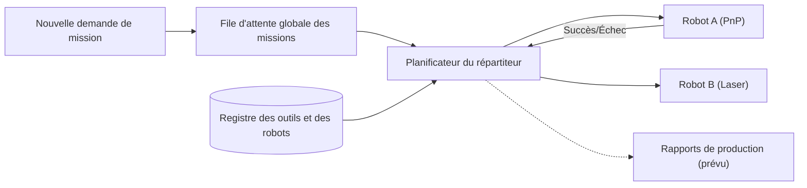

<!-- =============================================================================
HYDRA-UMC-JOB-DISPATCHER - Priority job dispatcher
Copyright (C) JuanenRac (Electro Hobby 3D) <electrohobby3d@gmail.com>
GPL-3.0-or-later - see LICENSE
============================================================================= -->

<p align="center">
  
</p>

# 🗂️ HYDRA-UMC-JOB-DISPATCHER

<p align="center"><a href="README.md">🇺🇸 English</a> | <a href="README_spa.md">🇪🇸 Español</a> | 🇫🇷 <b>Français</b> | <a href="README_ita.md">🇮🇹 Italiano</a> | <a href="README_deu.md">🇩🇪 Deutsch</a> | <a href="README_zho.md">🇨🇳 简体中文</a> | <a href="README_jpn.md">🇯🇵 日本語</a> | <a href="README_por.md">🇵🇹 Português</a></p>

### ⚙️ File d'attente de missions basée sur les priorités pour les flottes de robots hétérogènes

<p align="center">
  
  
  
  
  
  
</p>

---

> **État de la sûreté et de la cybersécurité :** cet écosystème n'est pas un système de sécurité certifié. Il n'existe pas encore de chaîne d'E-STOP matérielle, ni de limites ou de verrouillages imposés par le firmware, ni de commande de mouvement vérifiée ; les images de firmware sont contrôlées par CRC-32 et une signature Ed25519, et une compilation de version refuse les clés de développement publiées (les têtes d'outil et les cartes d'extension derrière le relais utilisent encore les chargeurs d'URTC, qui prennent un HMAC-SHA256 à clé partagée au lieu d'une signature) ; TLS et TLS mutuel sont optionnels et désactivés par défaut ; aucune carte propre n'a encore été assemblée ni testée. Lisez la [base de sécurité](https://github.com/JuanenRac/HYDRA-UMC-DOCS/blob/main/docs/SECURITY_BASELINE.md) et le [modèle de menaces](https://github.com/JuanenRac/HYDRA-UMC-DOCS/blob/main/docs/THREAT_MODEL.md) avant de vous fier à une affirmation d'ici pour la sécurité d'une personne.

---

## 📋 En un coup d'œil

| | |
|---|---|
| Version | `0.2.4` |
| Maturité | Fonctionnel |
| Tests | 153 (`go test ./...`) |
| Technologie | Go / priority queue / HTTP API / SQLite (modernc.org/sqlite, pure Go) |
| Cible | Le Raspberry Pi CM5 d'une cellule HYDRA-UMC |
| Sur matériel réel | Pas encore : aucune exécution sur du matériel réel n'est consignée pour cette version |

**Aller à :** [Présentation](#-présentation) · [Architecture](#-architecture) · [Fonctionnalités](#-fonctionnalités) · [Sécurité et protection](#-sécurité-et-protection) · [Interfaces](#-interfaces) · [Configuration](#-configuration) · [Démarrage rapide](#-démarrage-rapide) · [Tests](#-tests) · [Dépannage](#-dépannage) · [Structure du dépôt](#-structure-du-dépôt) · [Projets liés](#-projets-liés)

## 🚦 État du projet

Chaque ligne est une partie de ce dépôt et le feu dit où elle en est aujourd'hui. Elle est écrite d'après ce que le dépôt peut montrer (tests, compilations, exécutions), pas d'après ce qui est prévu.

🟢 Fait et vérifié · 🟡 Fonctionne, avec des limites connues · 🟠 À moitié fait ou pas encore vérifié · 🔴 Pas fait ou ne fonctionne pas

| Domaine | État | Ce que cela veut dire ici |
|---|---|---|
| Logiciel | 🟡 | Fonctionne pour son usage principal ; la vérification d'honnêteté ci-dessus liste ce qui manque encore |
| Tests | 🟢 | 153 tests automatiques, exécutés à chaque modification |
| Matériel réel | 🔴 | Pas encore : aucune exécution sur du matériel réel n'est consignée pour cette version |
| Documentation | 🟢 | README en huit langues, vérifié par rapport au manifeste à chaque modification |

## 🎯 Présentation

**HYDRA-UMC-JOB-DISPATCHER** est le moteur d'allocation de tâches de l'orchestrateur. Il gère une file d'attente globale de missions, distribuant les travaux aux robots individuels en fonction de leur disponibilité actuelle, de leur emplacement et de l'outil attaché (URTC).

Il garantit que les tâches hautement prioritaires (ex : « Réparation de défaut d'urgence ») contournent le flux de production normal et coordonne les séquences d'assemblage en plusieurs étapes qui nécessitent que différents robots travaillent en tandem.

## 🧩 Rôle dans HYDRA-UMC

**HYDRA-UMC-JOB-DISPATCHER** décide quel robot reçoit quel travail. Les clients soumettent des travaux, les robots déclarent les outils qu'ils portent et demandent du travail, et le répartiteur donne le travail de plus haute priorité qui convient. Il ne déplace aucun robot : ce qu'un robot fait d'un travail le regarde, ainsi que la porte des travaux du SDK.

## 🏛️ Architecture

<p align="center">
  
</p>

<details>
<summary>Version texte du diagramme (Mermaid)</summary>



</details>

**Pourquoi il est construit ainsi**

* **Pourquoi la logique réelle vit sous `src/`, pas à la racine du dépôt.** `src/dispatcher` (le moteur de planification) et `src/api` (les handlers HTTP) contiennent l'implémentation réelle ; `main.go`/`version.go` restent à la racine comme point d'entrée qui les relie.
* **Pourquoi l'attribution des tâches vérifie la disponibilité de l'outil via URTC.** Une tâche nécessitant une tête d'outil spécifique n'est attribuable qu'à un robot dont la tête d'outil contrôlée par URTC est réellement présente et inactive - vérifier cela avant l'attribution (pas après un échec de prise) évite qu'un robot n'arrive à un poste qu'il ne peut en réalité pas utiliser. `src/dispatcher.Engine.DispatchOnce` applique déjà cela aujourd'hui par correspondance exacte `RequiredTool`/`Robot.Tool` ; il ne parle pas encore à un vrai URTC via CAN pour confirmer que la tête d'outil est physiquement attachée (le moteur ne connaît que ce que déclare l'enregistrement du robot via `POST /robots`).
* **L'ordonnanceur, et maintenant la persistance aussi, sont réels.** `src/dispatcher` implémente le véritable algorithme que décrit le diagramme "DISPATCHER FLOW" du README : une file globale triée par priorité, un routage tenant compte de l'outil, et des dépendances multi-étapes (une tâche reste `blocked` tant que chaque tâche de son `DependsOn` n'atteint pas `done`). L'état d'`Engine` est toujours resté derrière des méthodes exportées précisément pour qu'un vrai stockage puisse remplacer ce qu'il y a derrière ces méthodes plus tard sans changer chaque appelant - `NewEngineWithStore` (`src/sqlitestore`) est ce stockage : optionnel, SQLite en Go pur, vérifié de bout en bout contre un vrai processus tué puis relancé. Voir [`docs/API.md`](docs/API.md#persistence).
* **Pourquoi l'API HTTP est du JSON/HTTP simple, pas du gRPC.** C'est une surface de contrôle orientée humain/exploitation (soumettre une tâche, enregistrer un robot, demander ce qui s'est passé) - `hydra.common.v1` (le contrat gRPC partagé de l'écosystème, voir `HYDRA-UMC-ORCHESTRATOR/proto/`) reste réservé au trafic nœud-à-nœud, selon la portée déjà documentée de ce proto.
* **Comment cela s'intègre dans le reste de l'écosystème.** Un service frère sous HYDRA-UMC-ORCHESTRATOR - transforme les décisions au niveau mission en attributions concrètes de tâches par robot. (La vérification des attributions contre la disponibilité d'outils d'URTC et les trajectoires de HYDRA-UMC-PATH-PLANNER-3D est prévue, pas implémentée.)
* **Pourquoi `POST /jobs/submit` est une nouvelle route plutôt qu'un changement de `POST /jobs`.** `AddJob()`/`POST /jobs` insèrent toujours et échouent sur une collision d'ID - ce contrat de bas niveau reste intact. `SubmitJob()`/`POST /jobs/submit` ajoute par-dessus une déduplication réelle et facultative via `Job.DedupKey` : le même motif utilisé dans tout l'écosystème (un point d'entrée protégé ajouté à côté d'une primitive de bas niveau inchangée, pas un changement de comportement greffé dessus).
* **Pourquoi une nouvelle tentative après un échec réutilise le même ID de job plutôt que d'en créer un nouveau.** L'alternative - créer un nouveau job à chaque tentative - disperserait l'historique d'une même unité logique de travail sur plusieurs ID et ne donnerait à l'appelant aucun moyen de distinguer « ceci a échoué une fois et est retenté » de « ceci est un nouveau travail sans rapport ». Réinitialiser le job d'origine à `Pending` garde tout son cycle de vie (y compris la tentative échouée) sous un seul ID.

## ✨ Fonctionnalités

* 📋 **Mise en file d'attente dynamique :** Priorisation et planification intelligentes des missions.
* ⚖️ **Routage sensible aux outils :** Achemine automatiquement les travaux vers le robot disposant de la tête URTC correcte.
* 🧰 **Catalogue d'outils configurable (avertit seulement) :** `-tools-file` (une liste JSON des noms de profils TOOL_* des têtes d'outil) et/ou `-tools` déclarent les outils que connaît l'installation. Un travail dont le `RequiredTool`, ou un robot dont le `Tool`, n'est pas dans le catalogue est accepté quand même et consigné une fois comme avertissement (avec une indication si seule la casse diffère, car les outils correspondent exactement). Sans catalogue rien ne change. *(implémenté)*
* 🔄 **Missions en plusieurs étapes :** Gère les dépendances entre les tâches (ex : « Pick » doit avoir lieu avant « Place »).
* 📡 **Persistance :** état de mission réel et optionnel, adossé à SQLite (`-db PATH`, `src/sqlitestore`, Go pur - sans CGO) - la file survit à un vrai redémarrage du processus, vérifié de bout en bout ; sans cette option, tout reste en mémoire. `GET /health` signale un stockage dégradé au lieu d'échouer silencieusement. Voir [`docs/API.md`](docs/API.md#persistence).
* 🔁 **Soumission idempotente (v0) :** Déduplication réelle et facultative basée sur `DedupKey` via `POST /jobs/submit` - une resoumission d'un job en cours ou déjà terminé est renvoyée inchangée, et une nouvelle tentative après un vrai échec réutilise le même ID de job au lieu d'exécuter le travail deux fois. L'ordre de priorité est déterministe à travers des exécutions répétées, couvert par un test de régression explicite.
* 🧯 **Sûr par défaut, et un robot qui cesse de répondre ne reçoit plus de travail (v0) :** l'API écoute sur `127.0.0.1:8090` sauf indication contraire, et une autre adresse exige un jeton bearer (`-token` / `JOB_DISPATCHER_TOKEN` ; tout sauf `GET /health` l'exige alors) ou un `-allow-anonymous` explicite ; le serveur HTTP a des délais limites et les corps de requête de plus de 64 Ko sont refusés avec `413`. Un robot silencieux plus longtemps que `-robot-timeout` (2 minutes par défaut) ne reçoit pas de nouveau travail, un job peut nommer une `location` préférée (`POST /jobs`, `POST /jobs/submit` ; les robots de cet endroit sont préférés, jamais exigés), et le dernier battement de chaque robot est persisté (une base de la version précédente est migrée sur place), si bien qu'un redémarrage ne cache plus un robot devenu silencieux. *(implémenté)*
* 🗂️ **Écritures atomiques, pagination et tâches traçables :** une fin, une annulation, une remise en file ou un balayage des battements périmés s'écrit dans SQLite en une seule transaction (la base fonctionne en mode WAL) ; `GET /jobs` peut être filtré et paginé (`status`, `limit`, `offset`, `X-Total-Count`) ; chaque tâche porte `SubmittedAtMs`, `AssignedAtMs`, `CompletedAtMs` et un compteur `Attempt` que le rapport de fin peut renvoyer (`attempt`) pour que le rapport tardif d'une affectation abandonnée soit refusé ; `DELETE /robots/{id}` oublie un robot sans tâche ; un battement de robot daté du futur n'est pas cru. Une description lisible par machine est dans `docs/openapi.yaml`. *(implémenté)*

## 🔒 Sécurité et protection

| Menace | Défense | Où |
|---|---|---|
| Une API ouverte au réseau | Il écoute sur `127.0.0.1:8090` ; toute autre adresse exige un jeton Bearer (`-token` ou `JOB_DISPATCHER_TOKEN`) sauf `-allow-anonymous` ; toutes les routes sauf `GET /health` le demandent, comparé en temps constant, et le refus est un `401` avec `WWW-Authenticate: Bearer` | `main.go`, `src/api/api.go` |
| Gros corps et connexions lentes | Un corps fait 64 KiB au plus ; l'en-tête doit arriver en 5 s, la requête en 15 s, la réponse est écrite en 30 s et une connexion inactive se ferme après 60 s | `src/api/api.go`, `main.go` |
| Du travail donné à un robot devenu muet ou à un outil qui n'existe pas | Un robot muet plus longtemps que `-robot-timeout` (2 minutes par défaut, `0` le désactive) ne reçoit plus de travail et ses travaux deviennent inconnus ; un travail ou un robot qui nomme un outil hors de `-tools-file` / `-tools` est refusé | `main.go`, `src/dispatcher/tools.go` |
| Une soumission en double et un redémarrage qui perd la file | La soumission est idempotente grâce à la `DedupKey` ; avec `-db CHEMIN` la file est gardée dans un fichier SQLite en Go pur et survit à un processus tué puis relancé, sinon elle vit en mémoire | `src/dispatcher`, `src/sqlitestore` |

**Ce qu'il ne fait jamais :** il ne déplace aucun robot, et l'acheminement par outil compare les chaînes qu'un robot dit de lui-même : un robot qui ment sur son outil ne se distingue pas, car URTC n'est pas interrogé par CAN.

## 🔌 Interfaces

HTTP sur `127.0.0.1:8090` par défaut ; la référence complète est `docs/API.md` et `docs/openapi.yaml`.

| Topic ou route | Ce qu'il porte |
|---|---|
| `/jobs`, `/jobs/submit`, `/jobs/{id}` | lister, soumettre et lire des travaux |
| `/jobs/complete`, `/jobs/cancel`, `/jobs/requeue`, `/jobs/detect-stale` | terminer, annuler ou remettre en file un travail ; trouver les travaux des robots muets |
| `/robots`, `/robots/{id}`, `/dispatch` | enregistrer un robot et ses outils ; demander le prochain travail qui convient |
| `GET /health` | le service est-il vivant (ouvert sans jeton) |

## ⚙️ Configuration

| Variable | Par défaut | Ce qu'elle définit |
|---|---|---|
| `-addr` | `127.0.0.1:8090` | où le service écoute |
| `-token`, `JOB_DISPATCHER_TOKEN` | vide | le jeton Bearer de l'API |
| `-allow-anonymous` | `false` | autoriser une adresse non loopback sans jeton |
| `-robot-timeout` | `2m` | silence après lequel un robot ne reçoit plus de travail (`0` = désactivé) |
| `-db` | vide (mémoire) | chemin du fichier SQLite qui garde la file |
| `-tools-file`, `JOB_DISPATCHER_TOOLS_FILE`, `-tools`, `JOB_DISPATCHER_TOOLS` | vide | la liste des outils qu'un travail ou un robot peut nommer |

## 🚀 Démarrage rapide

Nécessite Go 1.21 ou plus récent (le pilote SQLite est en Go pur, sans compilateur C) et Python 3 seulement pour les outils du projet.

```bash
bash run.sh        # Linux, macOS (run.bat on Windows)
go run . -addr 127.0.0.1:8090 -db jobs.sqlite3
curl http://127.0.0.1:8090/health
```

## 🧪 Tests

153 tests Go s'exécutent avec `go test ./...` ; ils sont à côté du code (`src/api`, `src/dispatcher`, `src/sqlitestore` et `main_test.go`) et incluent un processus tué puis relancé sur un fichier SQLite. Ni matériel ni réseau extérieur.

La CI exécute `HYDRA_UMC_CI=1 python tools/ci_validate.py`, qui vérifie le manifeste, les documents, les huit README et les images.

## 🏗️ Compilation et publication

Une véritable file de missions priorisées avec une API HTTP, pas
seulement un squelette qui compile.

```bash
# Windows
build.bat
run.bat -addr 127.0.0.1:8090

# Linux / macOS
./build.sh
./run.sh -addr 127.0.0.1:8090
```

`build.sh`/`build.bat` ne changent jamais la version (seule `python tools/hydra_project_tool.py bump` la fait monter) puis
exécutent `go build`. `run.sh`/`run.bat` exécutent directement le binaire
résultant.

```bash
# Enregistrer un robot, soumettre une tâche, la répartir, puis la marquer terminée
curl -X POST localhost:8090/robots -d '{"id":"robot-a","tool":"PnP","available":true}'
curl -X POST localhost:8090/jobs   -d '{"id":"job-1","priority":5,"requiredTool":"PnP"}'
curl -X POST localhost:8090/dispatch -d '{}'
curl -X POST localhost:8090/jobs/complete -d '{"id":"job-1","success":true,"robotId":"robot-a"}'
curl localhost:8090/jobs
curl localhost:8090/robots
```

```bash
# Soumission idempotente : une requête retentée avec le même dedupKey
# n'exécute jamais deux fois le même job, même si le client utilise un id différent.
curl -X POST localhost:8090/jobs/submit -d '{"id":"job-2","priority":5,"requiredTool":"PnP","dedupKey":"req-abc"}'
# -> {"ID":"job-2", ..., "result":"created"}
curl -X POST localhost:8090/jobs/submit -d '{"id":"job-2-retry","priority":5,"requiredTool":"PnP","dedupKey":"req-abc"}'
# -> {"ID":"job-2", ..., "result":"duplicate"} - même job, inchangé

# Après un vrai échec, une nouvelle tentative avec le même dedupKey réutilise l'ID de job-2 :
curl -X POST localhost:8090/jobs/complete -d '{"id":"job-2","success":false,"robotId":"robot-a"}'
curl -X POST localhost:8090/jobs/submit -d '{"id":"job-2-retry-2","priority":5,"requiredTool":"PnP","dedupKey":"req-abc"}'
# -> {"ID":"job-2", "Status":"pending", ..., "result":"retried"}
```

```bash
go test ./...   # src/dispatcher (algorithme d'ordonnancement) +
                 # src/api (allers-retours HTTP réels via httptest)
```

## 🩺 Dépannage

| Vous voyez | Parce que | Faites |
|---|---|---|
| the service refuses to start | L'adresse n'est pas loopback et aucun jeton n'a été donné | Donnez `-token` (ou `JOB_DISPATCHER_TOKEN`) ou `-allow-anonymous` si vous l'acceptez |
| `401` | La requête n'a pas de jeton Bearer ou en a un mauvais | Envoyez `Authorization: Bearer <token>` |
| a job stays queued | Aucun robot enregistré ne porte l'outil nommé, ou le robot est muet | Enregistrez un robot avec cet outil et faites-le interroger `/dispatch` ; vérifiez `-robot-timeout` |
| the queue is empty after a restart | Le service tournait sans `-db` | Démarrez-le avec `-db` pointant vers un fichier SQLite |

## 📂 Structure du dépôt

<p align="center">
  
</p>

<details>
<summary>Version texte de l'arborescence</summary>

```text
HYDRA-UMC-JOB-DISPATCHER/
├── src/
│   ├── dispatcher/                              la file, l'acheminement par outil, les étapes, la reprise
│   ├── api/                                     l'interface HTTP, jeton, limites
│   └── sqlitestore/                             file durable optionnelle (SQLite en Go pur)
├── docs/                                        la référence de l'API et le fichier OpenAPI
├── systemd/                                     unité de service pour la CM5
├── tools/                                       exécuteur de build et de tests, montée de version, validateur CI, générateurs et vérifications des README et des images
├── images/                                      bannière et images du README
├── .github/                                     workflow CI et modèles de tickets
├── hydra-umc.project.json                       manifeste : version, maturité, famille
├── CHANGELOG.md                                 ce qui a changé à chaque version
├── build.sh build.bat                           scripts de build (ils ne changent jamais la version)
├── build-test.sh build-test.bat                 scripts de build (ils ne changent jamais la version)
├── test.sh test.bat                             lancent les tests
├── main.go / version.go                         point d'entrée, options et version
├── main_test.go                                 tests du point d'entrée
├── go.mod / go.sum                              module Go et sommes de contrôle
├── bump_version.py / bump_manifest_version.py   montée de version explicite
├── run.sh run.bat                               démarrer le service
└── SECURITY.md SUPPORT.md CONTRIBUTING.md CODE_OF_CONDUCT.md LICENSE LICENSE.md
```

</details>

## 🗺️ Feuille de route et limites connues

**Limites connues aujourd'hui**

* **Phase 1 :** Synchronisation déterministe d'essaim sur TSN et réduction de la gigue sub-ms.
* **Phase 2 :** Planification de trajectoires 3D avec évitement dynamique d'obstacles dans les cellules multi-robots.
* **Phase 3 :** Optimisation de la répartition des tâches multi-robots à l'aide de la disponibilité des ressources en temps réel.
* **Phase 4 :** Estimation de la durée des travaux pilotée par l'IA pour une meilleure planification et coordination des flottes hétérogènes.

## 🌍 Langues

Ce README et les documents du dépôt existent en huit langues : anglais, espagnol, allemand, français, italien, japonais, chinois et portugais (Portugal). Ils sont écrits ensemble et la CI vérifie que les huit fichiers ont les mêmes sections et les mêmes liens. Ce dépôt n'a ni écran ni catalogue de messages propre, il n'y a donc aucune chaîne d'interface à traduire.

## 🔗 Projets liés

Ce projet fait partie de l'écosystème robotique HYDRA-UMC du même auteur (JuanenRac / Electro Hobby 3D). Bon à savoir, car une demande pourrait en réalité concerner l'un de ceux-ci plutôt que ce dépôt.

**Projet Parent**
- **[HYDRA-UMC-ORCHESTRATOR](https://github.com/JuanenRac/HYDRA-UMC-ORCHESTRATOR)** — hub d'intégration avec un vrai contrat de rapport de santé gRPC/Protobuf et une machine à états de mission ; le parent dont ce dépôt est un service d'orchestration spécifique, au sein de sa propre couche de coordination d'essaim.

**Projets Frères** — les autres services d'orchestration de la propre couche de coordination d'essaim de HYDRA-UMC-ORCHESTRATOR
- **[HYDRA-UMC-SWARM-SYNC](https://github.com/JuanenRac/HYDRA-UMC-SWARM-SYNC)** — vraie synchronisation d'état CRDT LWW-Element-Map, testée par propriétés pour la convergence multi-cellule.
- **[HYDRA-UMC-PATH-PLANNER-3D](https://github.com/JuanenRac/HYDRA-UMC-PATH-PLANNER-3D)** — vrai planificateur de trajectoire 3D basé sur RRT, avec vraie validation des collisions obstacle/espace de travail.
- **[HYDRA-UMC-NODE-HEALING](https://github.com/JuanenRac/HYDRA-UMC-NODE-HEALING)** — vrai chien de garde de santé de flotte basé sur gRPC, avec retry/backoff et détection d'incohérence d'identité.

**Directement Liés**
- **[URTC](https://github.com/JuanenRac/URTC)** — firmware pour la carte physique Universal Robot Tool Controller, plus de 25 profils d'outil sur bus CAN — attribue les tâches selon laquelle des propres têtes d'outil d'URTC est réellement disponible.
- **[HYDRA-UMC-PRODUCTION-REPORTS](https://github.com/JuanenRac/HYDRA-UMC-PRODUCTION-REPORTS)** — vrai calcul OEE/disponibilité sur l'historique de DATALAKE, avec export CSV reproductible — la destination prévue pour les journaux d'achèvement de mission ; ce répartiteur est la source réelle prévue de ses propres données OEE `production_event` une fois les achèvements câblés pour les écrire (pas encore implémenté, suivi du côté de ce projet).

**Fait Également Partie de l'Écosystème**

*Matériel & Plateforme de Base*
- **[HYDRA-UMC](https://github.com/JuanenRac/HYDRA-UMC)** — la conception de la carte mère du bras robotique : hôte CM5 + coprocesseur STM32H745 double cœur, destinée à coordonner jusqu'à 8 bras-outils via CAN-OTA/SPI-OTA (firmware à un stade précoce ; aucune carte assemblée pour l'instant).
- **[HYDRA-UMC-OS](https://github.com/JuanenRac/HYDRA-UMC-OS)** — couche produit reproductible sur Raspberry Pi OS pour le CM5 : agent en lecture seule, config/profils validés, provisionnement WiFi de premier contact.
- **[HYDRA-UMC-SDK](https://github.com/JuanenRac/HYDRA-UMC-SDK)** — le contrat JSON-Schema partagé et la barrière logicielle de contrôle des jobs contre laquelle chaque bridge valide ses commandes (pas une fonction de sécurité certifiée).
- **[HYDRA-UMC-CONNECTOR-HUB](https://github.com/JuanenRac/HYDRA-UMC-CONNECTOR-HUB)** — registre déclaratif et validateur de manifestes d'adaptateur pour les connecteurs de machines externes ; étend la propre idée de contrat du SDK aux machines externes sans remplacer les projets de passerelle industrielle.

*Backend Central & Clients*
- **[HYDRA-UMC-SERVER](https://github.com/JuanenRac/HYDRA-UMC-SERVER)** — le vrai backend headless (REST/WebSocket) auquel parle réellement chaque client de contrôle.
- **[HYDRA-UMC-STUDIO](https://github.com/JuanenRac/HYDRA-UMC-STUDIO)** — tableau de bord de contrôle web avec visualisation 3D multi-robot en temps réel.
- **[HYDRA-UMC-SUITE](https://github.com/JuanenRac/HYDRA-UMC-SUITE)** — centre de commande d'essaim de bureau (PySide6) pour plusieurs serveurs à la fois, empaqueté en exécutable autonome.
- **[HYDRA-UMC-ANDROID-CONTROL](https://github.com/JuanenRac/HYDRA-UMC-ANDROID-CONTROL)** — application de contrôle Android native avec connexion biométrique et un compagnon Wear OS jumelé.
- **[HYDRA-UMC-IOS-CONTROL](https://github.com/JuanenRac/HYDRA-UMC-IOS-CONTROL)** — application de contrôle iOS/iPadOS (Flutter) avec synchronisation WebSocket en temps réel.
- **[HYDRA-UMC-DSI](https://github.com/JuanenRac/HYDRA-UMC-DSI)** — interface tactile native pour l'écran tactile DSI 7" embarqué, intégrée directement sur le CM5.
- **[HYDRA-UMC-EDITOR-URDF](https://github.com/JuanenRac/HYDRA-UMC-EDITOR-URDF)** — créateur/éditeur graphique de bureau pour URDF qui envoie les modèles terminés vers le propre catalogue de STUDIO.
- **[HYDRA-UMC-EDITOR-STL](https://github.com/JuanenRac/HYDRA-UMC-EDITOR-STL)** — éditeur de bureau de modèles STL, transformant/remplaçant/retirant/ajoutant de vraies pièces dans le même catalogue de modèles qu'édite aussi HYDRA-UMC-EDITOR-URDF.
- **[HYDRA-UMC-BRIDGE-AMR](https://github.com/JuanenRac/HYDRA-UMC-BRIDGE-AMR)** — frontière de coordination pour les flottes AGV/AMR via un éditeur MQTT VDA 5050 (testé uniquement contre une flotte émulée).
- **[HYDRA-UMC-BRIDGE-CNC](https://github.com/JuanenRac/HYDRA-UMC-BRIDGE-CNC)** — coordinateur haut niveau pour cellules CNC avec accès au statut/octets de contrôle GRBL (testé uniquement contre un émulateur).
- **[HYDRA-UMC-BRIDGE-DROIDS](https://github.com/JuanenRac/HYDRA-UMC-BRIDGE-DROIDS)** — frontière de coordination pour droïdes à pattes/humanoïdes, avec un émetteur de commandes Boston Dynamics Spot (testé uniquement contre un émulateur).
- **[HYDRA-UMC-BRIDGE-LASER](https://github.com/JuanenRac/HYDRA-UMC-BRIDGE-LASER)** — coordinateur de cellules laser lisant 3 signaux GPIO de clé/enceinte/verrouillage (testé uniquement contre une puce simulée ; il ne peut ni armer ni tirer un laser).
- **[HYDRA-UMC-BRIDGE-OPENPNP](https://github.com/JuanenRac/HYDRA-UMC-BRIDGE-OPENPNP)** — coordinateur haut niveau sûr pour le flux de cartes du pick-and-place OpenPnP.
- **[HYDRA-UMC-BRIDGE-PRINTER3D](https://github.com/JuanenRac/HYDRA-UMC-BRIDGE-PRINTER3D)** — frontière de coordination sûre pour imprimantes 3D Moonraker/Klipper, avec de vraies commandes de tâche contrôlées.
- **[HYDRA-UMC-BRIDGE-ROS2](https://github.com/JuanenRac/HYDRA-UMC-BRIDGE-ROS2)** — coordinateur avec un transport ROS 2 rclpy à importation paresseuse (pas encore exécuté contre une installation ROS 2).
- **[HYDRA-UMC-BRIDGE-UAV](https://github.com/JuanenRac/HYDRA-UMC-BRIDGE-UAV)** — frontière de coordination pour UAV équipés de caméra, avec un émetteur de commandes MAVLink (testé uniquement contre un émulateur).

*Plateforme d'Outils URTC*
- **[URTC-FLASHER](https://github.com/JuanenRac/URTC-FLASHER)** — outil de bureau à interface graphique pour flasher les cartes URTC, CAN-OTA plus SWD/JTAG puce complète.
- **[URTC-TESTER](https://github.com/JuanenRac/URTC-TESTER)** — outil de bureau de diagnostic CAN-bus en direct pour cartes URTC, un panneau par profil d'outil.
- **[URTC-WEB-STUDIO](https://github.com/JuanenRac/URTC-WEB-STUDIO)** — alternative basée navigateur à URTC-TESTER via la Web Serial API, sans installation locale.
- **[URTC-GATEWAY](https://github.com/JuanenRac/URTC-GATEWAY)** — passerelle devant le bus CAN d'URTC : liste d'identifiants autorisés, limite de débit et clé de session ; logiciel testé sur ordinateur, pas encore sur un bus réel.

*Nœud IA de Vision (Hailo-8)*
- **[HYDRA-UMC-VISION-NODE](https://github.com/JuanenRac/HYDRA-UMC-VISION-NODE)** — hub d'intégration pour le pipeline de vision Hailo-8, avec une vraie vérification de disponibilité matérielle par étape.
- **[HYDRA-UMC-DETECTION-HEF](https://github.com/JuanenRac/HYDRA-UMC-DETECTION-HEF)** — registre réel de modèles compilés avec vérification de chargement sécurisé par architecture Hailo/checksum.
- **[HYDRA-UMC-VISION-STREAMER](https://github.com/JuanenRac/HYDRA-UMC-VISION-STREAMER)** — générateur réel de pipeline GStreamer + config MediaMTX, avec une vraie frontière d'intégration HailoRT.
- **[HYDRA-UMC-VISUAL-SERVOING-API](https://github.com/JuanenRac/HYDRA-UMC-VISUAL-SERVOING-API)** — loi de correction Position-Based Visual Servoing avec autorisation conditionnée à l'état de zone ; pas encore d'estimation de pose par caméra.
- **[HYDRA-UMC-SAFETY-ZONES](https://github.com/JuanenRac/HYDRA-UMC-SAFETY-ZONES)** — logique v0 de violation de zone, de fraîcheur de calibration et de demande d'E-STOP qui lit les positions d'objets dans un fichier ; aucun détecteur ne l'alimente et aucun E-STOP physique n'y est encore relié.

*Nœud IA Cognitif (Hailo-10)*
- **[HYDRA-UMC-COGNITIVE-NODE](https://github.com/JuanenRac/HYDRA-UMC-COGNITIVE-NODE)** — hub d'intégration pour le pipeline cognitif Hailo-10 (orchestration LLM/VLA/voix).
- **[HYDRA-UMC-VLA-ENGINE](https://github.com/JuanenRac/HYDRA-UMC-VLA-ENGINE)** — vrai encodage/décodage de jetons d'action et génération de trajectoire pour un modèle Vision-Language-Action.
- **[HYDRA-UMC-VOICE-UI](https://github.com/JuanenRac/HYDRA-UMC-VOICE-UI)** — vrai front-end vocal (VAD + analyseur d'intention) avec un relais Watch borné et soumis à confirmation.
- **[HYDRA-UMC-SEMANTIC-PLANNER](https://github.com/JuanenRac/HYDRA-UMC-SEMANTIC-PLANNER)** — vraie décomposition de tâches basée sur des règles et récupération sémantique d'erreurs sur les codes d'erreur MCU.
- **[HYDRA-UMC-DOCS-QA](https://github.com/JuanenRac/HYDRA-UMC-DOCS-QA)** — vraie recherche documentaire TF-IDF (bibliothèque standard uniquement) sur les propres documents Markdown de cet écosystème.
- **[HYDRA-UMC-LOCAL-TECHNICIAN](https://github.com/JuanenRac/HYDRA-UMC-LOCAL-TECHNICIAN)** — technicien de maintenance IA local et à portes de politique pour l'écosystème lui-même - observe, diagnostique et propose des corrections ; les deux niveaux de risque les plus élevés ne sont délibérément pas encore implémentés.

*Jumeau Numérique & Simulation*
- **[HYDRA-UMC-TWIN](https://github.com/JuanenRac/HYDRA-UMC-TWIN)** — hub d'intégration pour le moteur de jumeau numérique, avec un vrai contrat de synchronisation par compatibilité de version.
- **[HYDRA-UMC-HIL-BRIDGE](https://github.com/JuanenRac/HYDRA-UMC-HIL-BRIDGE)** — routeur hardware-in-the-loop avec un verrouillage logiciel de collision entre simulation et matériel réel (testé sans matériel réel).
- **[HYDRA-UMC-PHYSICS-REPLICA](https://github.com/JuanenRac/HYDRA-UMC-PHYSICS-REPLICA)** — vraie cinématique directe et validation des limites articulaires sur un vrai sous-ensemble URDF.
- **[HYDRA-UMC-SYNTHETIC-DATA-GEN](https://github.com/JuanenRac/HYDRA-UMC-SYNTHETIC-DATA-GEN)** — vrai générateur procédural de scènes 2D avec export d'annotations YOLO/COCO.

*Données & Analytique*
- **[HYDRA-UMC-DATALAKE](https://github.com/JuanenRac/HYDRA-UMC-DATALAKE)** — vrai magasin de séries temporelles basé sur sqlite3, avec une vraie API HTTP d'ingestion/requête.
- **[HYDRA-UMC-ANOMALY-DETECTOR](https://github.com/JuanenRac/HYDRA-UMC-ANOMALY-DETECTOR)** — vrai détecteur d'anomalies FFT + ligne de base statistique, avec surveillance de dérive.
- **[HYDRA-UMC-TELEMETRY-COLLECTOR](https://github.com/JuanenRac/HYDRA-UMC-TELEMETRY-COLLECTOR)** — vrai pipeline d'ingestion CAN/WebSocket vers DATALAKE, avec déduplication par séquence.

*Passerelle Industrielle*
- **[HYDRA-UMC-GATEWAY-INDUSTRIAL](https://github.com/JuanenRac/HYDRA-UMC-GATEWAY-INDUSTRIAL)** — hub d'intégration relayant vers les protocoles industriels, avec une vraie couche de liste blanche de commandes/contre-pression.
- **[HYDRA-UMC-OPCUA-SERVER](https://github.com/JuanenRac/HYDRA-UMC-OPCUA-SERVER)** — vrai espace d'adressage OPC-UA, vérifié avec une vraie session client du protocole binaire.
- **[HYDRA-UMC-MQTT-BROKER](https://github.com/JuanenRac/HYDRA-UMC-MQTT-BROKER)** — vrai broker MQTT avec authentification par client optionnelle et ACL de sujets.
- **[HYDRA-UMC-MTCONNECT-ADAPTER](https://github.com/JuanenRac/HYDRA-UMC-MTCONNECT-ADAPTER)** — vrais points de terminaison XML MTConnect `/probe` et `/current`, avec sortie en mode dégradé.

*Outils Complémentaires & Opérations de l'Écosystème*
- **[HYDRA-UMC-DASHBOARD-AI](https://github.com/JuanenRac/HYDRA-UMC-DASHBOARD-AI)** — panneaux Smart Summaries et Anomaly Highlighting sur DATALAKE/ANOMALY-DETECTOR, avec un repli statistique honnête.
- **[HYDRA-UMC-TOOL-CLI](https://github.com/JuanenRac/HYDRA-UMC-TOOL-CLI)** — CLI de flotte avec un vrai contrat de codes de sortie stable, un vrai client en direct de la propre API de HYDRA-UMC-SERVER.
- **[HYDRA-UMC-WATCH](https://github.com/JuanenRac/HYDRA-UMC-WATCH)** — application compagnon WearOS avec des motifs d'alerte haptique et un relais vocal vers le téléphone jumelé (pas encore exécutée sur une montre physique).
- **[URTC-SMART-RACK](https://github.com/JuanenRac/URTC-SMART-RACK)** — firmware pour un rack de montage de cartes avec décodage réel d'ID d'outil et logique de préchauffage Smart Idle.
- **[URTC-VISION-TOOL](https://github.com/JuanenRac/URTC-VISION-TOOL)** — firmware plus un vrai compagnon de vision Python pour une tête d'outil d'inspection thermique/RGB.
- **[HYDRA-UMC-UPDATER](https://github.com/JuanenRac/HYDRA-UMC-UPDATER)** — outil administratif de bureau qui découvre, clone et met à jour chaque dépôt de cet écosystème.
- **[HYDRA-UMC-OS-REBUILDER](https://github.com/JuanenRac/HYDRA-UMC-OS-REBUILDER)** — outil de bureau Windows/Linux qui construit une image de la CM5 prête à graver, préchargée avec les versions les plus actuelles de l'écosystème, avec une configuration de premier démarrage Wi-Fi/utilisateur/SSH façon Raspberry Pi Imager.
- **[HYDRA-UMC-OPS-AGENT](https://github.com/JuanenRac/HYDRA-UMC-OPS-AGENT)** — coordinateur d'incidents de maintenance : un rôle edge à faible privilège collecte un instantané d'inventaire/santé assaini, un rôle control-plane le rend en lecture seule et demande à un fournisseur d'IA de suggérer un diagnostic - n'applique jamais de correctif ni ne déploie rien.
- **[HYDRA-UMC-DEV-SERVER](https://github.com/JuanenRac/HYDRA-UMC-DEV-SERVER)** — hôte de développement reproductible (Raspberry Pi 5 / CM5) qui héberge le code source de l'écosystème et exécute des tâches de compilation/test délimitées via une file d'attente durable ; un rôle de développement dédié, explicitement distinct d'un CM5 opérationnel.

## 📚 Documentation

Où lire la suite :

* [docs/API.md](docs/API.md) - chaque route, ses champs et ses erreurs
* [docs/openapi.yaml](docs/openapi.yaml) - la même API en fichier OpenAPI
* [Base de sécurité de l'écosystème](https://github.com/JuanenRac/HYDRA-UMC-DOCS/blob/main/docs/SECURITY_BASELINE.md)
* [Modèle de menaces de l'écosystème](https://github.com/JuanenRac/HYDRA-UMC-DOCS/blob/main/docs/THREAT_MODEL.md)
* [Journal des modifications de ce dépôt](CHANGELOG.md)
* [Licence de ce dépôt](LICENSE.md)

## 🤝 Contribuer et communauté

* Avant une pull request, exécutez `HYDRA_UMC_CI=1 py -3 tools/ci_validate.py` (ou `HYDRA_UMC_CI=1 python3 tools/ci_validate.py`) : il doit afficher `CI_VALIDATION=PASS`. N'exécutez pas `build.sh` ni `build.bat` pour cette vérification ; compiler n'est pas vérifier.
* Les huit README sont écrits à partir d'une source unique dans HYDRA-UMC-DOCS ; ne les modifiez pas à la main. Changez la source et réécrivez-les avec `tools/make_readmes.py`.
* N'affirmez pas dans un README ce qui n'a pas tourné : écrivez « simulé » ou « non essayé sur matériel » quand c'est la vérité.
* Voir [CONTRIBUTING.md](CONTRIBUTING.md), le [code de conduite](CODE_OF_CONDUCT.md), [SECURITY.md](SECURITY.md) et [SUPPORT.md](SUPPORT.md).

## 👤 AUTEUR

**JuanenRac (Electro Hobby 3D)** · electrohobby3d@gmail.com

## 📜 LICENCE

GPL-3.0-or-later - [LICENSE](LICENSE).
