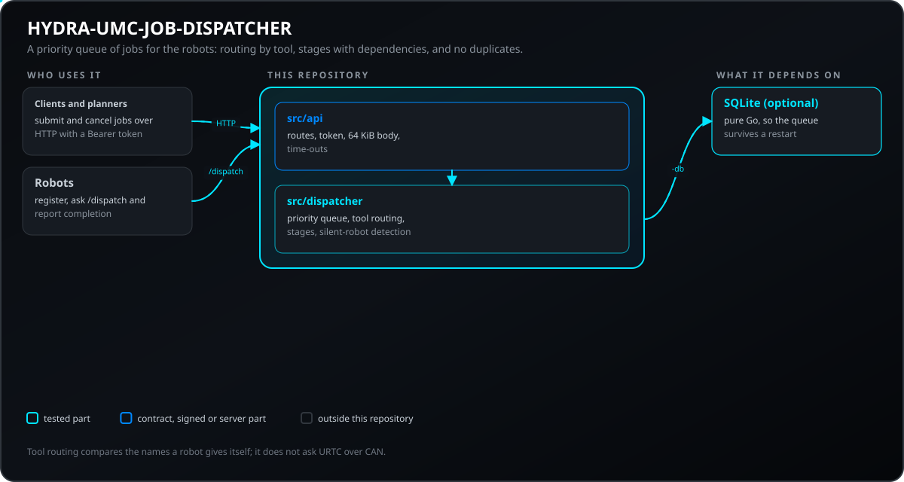
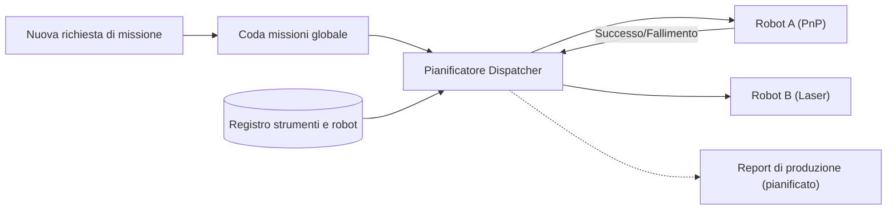
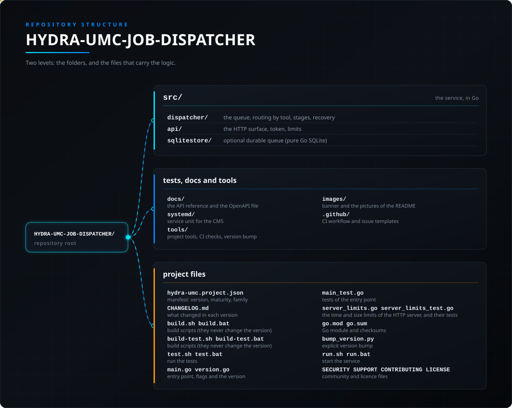

<!-- =============================================================================
HYDRA-UMC-JOB-DISPATCHER - Priority job dispatcher
Copyright (C) JuanenRac (Electro Hobby 3D) <electrohobby3d@gmail.com>
GPL-3.0-or-later - see LICENSE
============================================================================= -->

<p align="center">
  
</p>

# 🗂️ HYDRA-UMC-JOB-DISPATCHER

<p align="center"><a href="README.md">🇺🇸 English</a> | <a href="README_spa.md">🇪🇸 Español</a> | <a href="README_fra.md">🇫🇷 Français</a> | 🇮🇹 <b>Italiano</b> | <a href="README_deu.md">🇩🇪 Deutsch</a> | <a href="README_zho.md">🇨🇳 简体中文</a> | <a href="README_jpn.md">🇯🇵 日本語</a> | <a href="README_por.md">🇵🇹 Português</a></p>

### ⚙️ Coda di missioni basata sulle priorità per flotte di robot eterogenee

<p align="center">
  
  
  
  
  
  
</p>

---

> **Stato di sicurezza (safety e security):** questo ecosistema non è un sistema di sicurezza certificato. Non esiste ancora un percorso E-STOP hardware, né limiti o interblocchi imposti dal firmware, né un comando di movimento verificato; le immagini firmware sono controllate con CRC-32 e una firma Ed25519, e una compilazione di rilascio rifiuta le chiavi di sviluppo pubblicate (le teste utensile e le schede di espansione dietro il relè usano ancora i bootloader di URTC, che accettano un HMAC-SHA256 a chiave condivisa invece di una firma); TLS e TLS reciproco sono opzionali e disattivati per impostazione predefinita; nessuna scheda propria è stata ancora assemblata o provata. Leggi la [base di sicurezza](https://github.com/JuanenRac/HYDRA-UMC-DOCS/blob/main/docs/SECURITY_BASELINE.md) e il [modello delle minacce](https://github.com/JuanenRac/HYDRA-UMC-DOCS/blob/main/docs/THREAT_MODEL.md) prima di fidarti di qualsiasi affermazione qui per la sicurezza di una persona.

---

## 📋 In breve

| | |
|---|---|
| Versione | `0.2.4` |
| Maturità | Funzionale |
| Test | 188 (`go test ./...`) |
| Tecnologia | Go / priority queue / HTTP API / SQLite (modernc.org/sqlite, pure Go) |
| Destinazione | Il Raspberry Pi CM5 di una cella HYDRA-UMC |
| Su hardware reale | Non ancora: per questa versione non risulta alcuna esecuzione su hardware reale |

**Vai a:** [Panoramica](#-panoramica) · [Architettura](#-architettura) · [Funzionalità](#-funzionalità) · [Sicurezza e protezione](#-sicurezza-e-protezione) · [Interfacce](#-interfacce) · [Configurazione](#-configurazione) · [Avvio rapido](#-avvio-rapido) · [Test](#-test) · [Risoluzione dei problemi](#-risoluzione-dei-problemi) · [Struttura del repository](#-struttura-del-repository) · [Progetti correlati](#-progetti-correlati)

## 🚦 Stato del progetto

Ogni riga è una parte di questo repository e il semaforo dice a che punto è oggi. È scritta in base a ciò che il repository può mostrare (test, compilazioni, esecuzioni), non a ciò che è previsto.

🟢 Fatto e verificato · 🟡 Funziona, con limiti noti · 🟠 Fatto a metà o non ancora verificato · 🔴 Non fatto o non funzionante

| Area | Stato | Cosa significa qui |
|---|---|---|
| Software | 🟡 | Funziona per il suo scopo principale; la verifica di onestà qui sopra elenca ciò che manca ancora |
| Test | 🟢 | 188 test automatici, eseguiti a ogni modifica |
| Hardware reale | 🔴 | Non ancora: per questa versione non risulta alcuna esecuzione su hardware reale |
| Documentazione | 🟢 | README in otto lingue, verificato rispetto al manifesto a ogni modifica |

## 🎯 Panoramica

**HYDRA-UMC-JOB-DISPATCHER** è il motore di allocazione dei compiti dell'Orchestratore. Gestisce una coda di missioni globale, distribuendo i lavori ai singoli robot in base alla loro disponibilità attuale, posizione e strumento collegato (URTC).

Garantisce che i compiti ad alta priorità (ad esempio, «Riparazione difetti di emergenza») bypassino il normale flusso di produzione e coordina le sequenze di assemblaggio in più fasi che richiedono il lavoro in tandem di diversi robot.

## 🧩 Ruolo in HYDRA-UMC

**HYDRA-UMC-JOB-DISPATCHER** decide quale robot riceve quale lavoro. I client inviano lavori, i robot registrano gli strumenti che montano e chiedono lavoro, e il dispatcher consegna il lavoro di priorità più alta che si adatta. Non muove nessun robot: ciò che un robot fa con un lavoro è affar suo e della porta dei lavori dell'SDK.

## 🏛️ Architettura

<p align="center">
  
</p>

<details>
<summary>Versione testuale del diagramma (Mermaid)</summary>



</details>

**Perché è fatto così**

* **Perché la logica reale vive sotto `src/` e non nella radice del repo.** `src/dispatcher` (il motore di pianificazione) e `src/api` (gli handler HTTP) contengono l'implementazione reale; `main.go`/`version.go` restano nella radice come punto di ingresso che li collega.
* **Perché l'assegnazione dei lavori controlla la disponibilità dell'utensile via URTC.** Un lavoro che richiede una specifica testa utensile è assegnabile solo a un robot la cui testa utensile controllata da URTC è realmente presente e inattiva - controllarlo prima dell'assegnazione (non dopo un prelievo fallito) evita che un robot arrivi a una stazione che in realtà non può usare. `src/dispatcher.Engine.DispatchOnce` applica già questo oggi confrontando esattamente `RequiredTool` e `Robot.Tool`; non parla ancora con un vero URTC via CAN per confermare che la testa utensile sia fisicamente collegata (il motore conosce solo ciò che dichiara la registrazione del robot via `POST /robots`).
* **Lo scheduler, e ora anche la persistenza, sono entrambi reali.** `src/dispatcher` implementa il vero algoritmo descritto dal diagramma "DISPATCHER FLOW" del README: una coda globale ordinata per priorità, instradamento consapevole dell'utensile, e dipendenze multi-fase (un lavoro resta `blocked` finché ogni suo `DependsOn` non raggiunge `done`). Lo stato di `Engine` è sempre rimasto dietro metodi esportati proprio perché uno storage reale potesse sostituire ciò che sta dietro quei metodi in seguito senza cambiare ogni chiamante - `NewEngineWithStore` (`src/sqlitestore`) è quello storage: opzionale, SQLite in Go puro, verificato end-to-end contro un vero processo terminato e rilanciato. Vedi [`docs/API.md`](docs/API.md#persistence).
* **Perché l'API HTTP è JSON/HTTP semplice, non gRPC.** È una superficie di controllo rivolta a umani/operatori (inviare un lavoro, registrare un robot, chiedere cosa è successo) - `hydra.common.v1` (il contratto gRPC condiviso dell'ecosistema, vedi `HYDRA-UMC-ORCHESTRATOR/proto/`) resta riservato al traffico nodo-a-nodo, secondo l'ambito già documentato di quel proto.
* **Come si inserisce nel resto dell'ecosistema.** Un servizio fratello sotto HYDRA-UMC-ORCHESTRATOR - trasforma decisioni a livello di missione in assegnazioni concrete di lavoro per robot. (La verifica delle assegnazioni rispetto alla disponibilità utensili di URTC e ai percorsi di HYDRA-UMC-PATH-PLANNER-3D è pianificata, non implementata.)
* **Perché `POST /jobs/submit` è una nuova rotta invece di modificare `POST /jobs`.** `AddJob()`/`POST /jobs` inseriscono sempre e falliscono su una collisione di ID - quel contratto di basso livello resta intatto. `SubmitJob()`/`POST /jobs/submit` aggiunge sopra una deduplicazione reale e opzionale tramite `Job.DedupKey`: lo stesso schema usato in tutto l'ecosistema (un punto di ingresso con verifica aggiunto accanto a una primitiva di basso livello invariata, non un cambio di comportamento innestato su di essa).
* **Perché un nuovo tentativo dopo un fallimento riutilizza lo stesso ID del job invece di crearne uno nuovo.** L'alternativa - generare un nuovo job a ogni tentativo - disperderebbe la cronologia di un'unica unità logica di lavoro su più ID e non darebbe a chi chiama modo di distinguere "questo è fallito una volta e viene ritentato" da "questo è nuovo lavoro senza relazione". Ripristinare il job originale a `Pending` mantiene tutto il suo ciclo di vita (incluso il tentativo fallito) sotto un unico ID.

**Lavori da una Operation.** `POST /jobs/submit` accetta anche l'Operation comune dell'SDK (un corpo con `operation_id`), che è ciò che consegna il pianificatore semantico: l'id dell'operazione è l'id del lavoro e anche la sua chiave di deduplicazione, quindi inviare di nuovo la stessa operazione dà lo stesso lavoro, e `priority`, `required_tool`, `location` e `depends_on` dei suoi `params` sono quelli del lavoro. Viene accettata solo un'operazione nello stato `received`; tutto il resto è un `400`.

## ✨ Funzionalità

* 📋 **Code dinamiche:** Priorità e pianificazione intelligente delle missioni.
* ⚖️ **Routing consapevole degli strumenti:** Instrada automaticamente i lavori al robot con la testina URTC corretta.
* 🧰 **Catalogo utensili configurabile (solo avvisa):** `-tools-file` (un elenco JSON dei nomi dei profili TOOL_* delle teste utensile) e/o `-tools` dichiarano gli utensili noti all'impianto. Un lavoro il cui `RequiredTool`, o un robot il cui `Tool`, non è nel catalogo viene accettato comunque e registrato una volta come avviso (con un suggerimento se cambia solo la maiuscola, perché gli utensili corrispondono esattamente). Senza catalogo non cambia nulla. *(implementato)*
* 🔄 **Missioni multi-fase:** Gestisce le dipendenze tra i compiti (es. «Pick» deve avvenire prima di «Place»).
* 📡 **Persistenza:** stato della missione reale e opzionale basato su SQLite (`-db PATH`, `src/sqlitestore`, Go puro - senza CGO) - la coda sopravvive a un vero riavvio del processo, verificato end-to-end; se non impostato, resta puramente in memoria. `GET /health` segnala uno storage degradato invece di fallire silenziosamente. Vedi [`docs/API.md`](docs/API.md#persistence).
* 🔁 **Invio Idempotente (v0):** Deduplicazione reale e opzionale basata su `DedupKey` tramite `POST /jobs/submit` - un reinvio di un job in corso o già completato viene restituito invariato, e un nuovo tentativo dopo un fallimento reale riutilizza lo stesso ID del job invece di eseguire il lavoro due volte. L'ordine di priorità è deterministico attraverso esecuzioni ripetute, coperto da un test di regressione esplicito.
* 🧯 **Sicuro per impostazione predefinita, e un robot che smette di rispondere non riceve lavoro (v0):** l'API ascolta su `127.0.0.1:8090` salvo diversa indicazione, e un altro indirizzo richiede un token bearer (`-token` / `JOB_DISPATCHER_TOKEN`; allora tutto tranne `GET /health` lo richiede) o un `-allow-anonymous` esplicito; il server HTTP ha timeout e i corpi di richiesta oltre 64 KB sono rifiutati con `413`. Un robot silenzioso per più di `-robot-timeout` (2 minuti per impostazione predefinita) non riceve nuovo lavoro, un lavoro può indicare una `location` preferita (`POST /jobs`, `POST /jobs/submit`; i robot in quella posizione sono preferiti, mai richiesti), e l'ultimo heartbeat di ogni robot è persistito (un database della versione precedente viene migrato sul posto), quindi un riavvio non nasconde più un robot rimasto in silenzio. *(implementato)*
* 🗂️ **Scritture atomiche, paginazione e lavori tracciabili:** un completamento, un annullamento, un reinserimento o uno scorrimento dei battiti scaduti viene scritto in SQLite in un'unica transazione (il database funziona in modalità WAL); `GET /jobs` si può filtrare e paginare (`status`, `limit`, `offset`, `X-Total-Count`); ogni lavoro porta `SubmittedAtMs`, `AssignedAtMs`, `CompletedAtMs` e un contatore `Attempt` che il rapporto di completamento può rimandare (`attempt`) così il rapporto tardivo di un'assegnazione abbandonata viene rifiutato; `DELETE /robots/{id}` dimentica un robot senza lavoro; un battito di robot con data futura non è considerato attendibile. Una descrizione leggibile dalle macchine è in `docs/openapi.yaml`. *(implementato)*
* 🕒 **Perché un lavoro attende:** `GET /dispatch/waiting` elenca i lavori in attesa nell'ordine di assegnazione con il motivo per cui ciascuno non ha un robot (nessun robot registrato, nessun robot con lo strumento, robot adatti occupati, robot adatti silenziosi, oppure un robot libero per il prossimo passaggio). È di sola lettura; `POST /dispatch` risponde ancora con l'elenco semplice delle assegnazioni.
* ⏱️ **Tempo stimato di ogni lavoro (spento per impostazione predefinita):** con `-eta`, `GET /dispatch/eta` stima quando inizia e finisce ogni lavoro non concluso, su quale robot e quando la coda sarà vuota, in base alla durata degli ultimi lavori conclusi con lo stesso strumento (un valore predefinito configurabile finché non ce ne sono). Un lavoro che non si può stimare ne indica il motivo. Senza `-eta` la route non esiste e nient'altro cambia; è di sola lettura e viene provata con un orologio iniettato.
* 🧾 **Un evento di produzione per ogni lavoro che termina (spento di default):** con `-production-events` e una destinazione (`-production-events-file` per una riga JSON per evento, `-production-events-url` per un `POST` JSON), ogni segnalazione che un lavoro è terminato consegna un `ProductionEvent` del contratto condiviso di HYDRA-UMC-SDK (robot, ora di fine, buono o no, tempo di ciclo, lavoro), che i rapporti di produzione trasformano in OEE. L'evento viene prima verificato rispetto al contratto; un ciclo che non può descrivere viene saltato e registrato, mai inventato, e una destinazione che fallisce non fa mai fallire la chiusura. Senza l'interruttore non cambia nulla; provato con un orologio iniettato.
* 🧭 **Robot più vicino, ripianificazione e intervalli (tutto spento per impostazione predefinita):** un file di configurazione (`-config`) contiene i valori calibrati e ogni sezione è spenta salvo diversa indicazione: `location_costs` manda un lavoro che indica una posizione al robot con il costo dichiarato più basso verso di essa, `replan` (`POST /jobs/replan`, o da sola per un robot diventato muto o in guasto) rimette in coda, in ordine, i lavori di un robot guasto senza duplicarne né perderne alcuno, e `eta_interval` aggiunge a ogni stima un intervallo dal basso all'alto (quartili delle durate recenti dello stesso strumento) o dice perché non può. Senza il file non cambia nulla; testato con orologio iniettato e scenari casuali a seme fisso.

## 🔒 Sicurezza e protezione

| Minaccia | Difesa | Dove |
|---|---|---|
| Un'API aperta alla rete | Ascolta su `127.0.0.1:8090`; ogni altro indirizzo richiede un token Bearer (`-token` o `JOB_DISPATCHER_TOKEN`) salvo `-allow-anonymous`; tutte le rotte tranne `GET /health` lo chiedono, confrontato in tempo costante, e il rifiuto è `401` con `WWW-Authenticate: Bearer` | `main.go`, `src/api/api.go` |
| Corpi grandi e connessioni lente | Un corpo è al massimo 64 KiB; l'intestazione deve arrivare in 5 s, la richiesta in 15 s, la risposta è scritta in 30 s e una connessione inattiva si chiude dopo 60 s | `src/api/api.go`, `main.go` |
| Lavoro dato a un robot che non risponde più o a uno strumento che non esiste | Un robot silenzioso oltre `-robot-timeout` (2 minuti per impostazione predefinita, `0` lo disattiva) non riceve lavoro e i suoi lavori diventano sconosciuti; un lavoro o robot che nomina uno strumento fuori da `-tools-file` / `-tools` viene rifiutato | `main.go`, `src/dispatcher/tools.go` |
| Un invio duplicato e un riavvio che perde la coda | L'invio è idempotente grazie alla `DedupKey`; con `-db PERCORSO` la coda è conservata in un file SQLite in Go puro e sopravvive a un processo ucciso e riavviato, senza di esso la coda vive in memoria | `src/dispatcher`, `src/sqlitestore` |

**Cosa non fa mai:** non muove nessun robot, e l'instradamento per strumento confronta le stringhe che un robot dice di sé: un robot che mente sul suo strumento non si distingue, perché URTC non viene interrogato via CAN.

## 🔌 Interfacce

HTTP su `127.0.0.1:8090` per impostazione predefinita; il riferimento completo è `docs/API.md` e `docs/openapi.yaml`.

| Topic o rotta | Cosa porta |
|---|---|
| `/jobs`, `/jobs/submit`, `/jobs/{id}` | elencare, inviare e leggere lavori |
| `/jobs/replan` | rimettere in coda i lavori di un robot guasto (solo se il file di configurazione attiva la ripianificazione; altrimenti 404) |
| `/jobs/complete`, `/jobs/cancel`, `/jobs/requeue`, `/jobs/detect-stale` | terminare, annullare o riaccodare un lavoro; trovare i lavori dei robot silenziosi |
| `/robots`, `/robots/{id}`, `/dispatch` | registrare un robot e i suoi strumenti; chiedere il prossimo lavoro adatto |
| `GET /health` | il servizio è vivo (aperta senza token) |

## ⚙️ Configurazione

| Variabile | Predefinito | Cosa imposta |
|---|---|---|
| `-addr` | `127.0.0.1:8090` | dove il servizio ascolta |
| `-token`, `JOB_DISPATCHER_TOKEN` | vuoto | il token Bearer dell'API |
| `-allow-anonymous` | `false` | consentire un indirizzo non loopback senza token |
| `-robot-timeout` | `2m` | silenzio dopo il quale un robot non riceve lavoro (`0` = spento) |
| `-eta`, `JOB_DISPATCHER_ETA=1`, `-eta-default-duration`, `-eta-window` | spento, `1m`, `20` | attivare `GET /dispatch/eta` (inizio e fine stimati di ogni lavoro non concluso e della coda); la durata ipotizzata finché un lavoro dello strumento non è concluso (`0` = nessuna ipotesi) e su quanti lavori conclusi recenti per strumento si fa la media |
| `-config`, `JOB_DISPATCHER_CONFIG` | vuoto | un file JSON con i valori calibrati di tre comportamenti facoltativi, ciascuno spento salvo che il file lo attivi: `location_costs` (una tabella di costi tra posizioni; il lavoro va al robot di costo più basso), `replan` (i lavori di un robot guasto o muto tornano in coda) e `eta_interval` (un intervallo accanto a ogni stima, richiede `-eta`) |
| `-production-events`, `JOB_DISPATCHER_PRODUCTION_EVENTS=1`, `-production-events-file`, `-production-events-url`, `-production-events-token` | spento, vuoto, vuoto, vuoto | consegnare un `ProductionEvent` del contratto condiviso per ogni lavoro che termina: una riga JSON per evento nel file e/o un `POST` JSON all'URL (con il token bearer); l'interruttore richiede almeno una destinazione |
| `-db` | vuoto (memoria) | percorso del file SQLite che conserva la coda |
| `-tools-file`, `JOB_DISPATCHER_TOOLS_FILE`, `-tools`, `JOB_DISPATCHER_TOOLS` | vuoto | l'elenco degli strumenti che un lavoro o un robot può nominare |
| `-max-body-bytes`, `-read-header-timeout`, `-read-timeout`, `-write-timeout`, `-idle-timeout` | `65536`, `5s`, `15s`, `30s`, `60s` | corpo di richiesta più grande in byte (uno più grande riceve `413`) e limiti di tempo del server HTTP; nessuno accetta zero |

## 🚀 Avvio rapido

Richiede Go 1.21 o successivo (il driver SQLite è Go puro, senza compilatore C) e Python 3 solo per gli strumenti del progetto.

```bash
bash run.sh        # Linux, macOS (run.bat on Windows)
go run . -addr 127.0.0.1:8090 -db jobs.sqlite3
curl http://127.0.0.1:8090/health
```

## 🧪 Test

188 test Go si eseguono con `go test ./...`; stanno accanto al codice (`src/api`, `src/dispatcher`, `src/sqlitestore` e `main_test.go`) e includono un processo ucciso e riavviato su un file SQLite. Né hardware né rete esterna.

La CI esegue `HYDRA_UMC_CI=1 python tools/ci_validate.py`, che controlla il manifesto, i documenti, gli otto README e le immagini.

## 🏗️ Compilazione e rilascio

Una vera coda di missioni con priorità e API HTTP, non solo uno scheletro
che compila.

```bash
# Windows
build.bat
run.bat -addr 127.0.0.1:8090

# Linux / macOS
./build.sh
./run.sh -addr 127.0.0.1:8090
```

`build.sh`/`build.bat` non cambiano mai la versione (solo `python tools/hydra_project_tool.py bump` la alza) e poi eseguono
`go build`. `run.sh`/`run.bat` eseguono direttamente il binario risultante.

```bash
# Registra un robot, invia un lavoro, distribuiscilo, poi segnalo completato
curl -X POST localhost:8090/robots -d '{"id":"robot-a","tool":"PnP","available":true}'
curl -X POST localhost:8090/jobs   -d '{"id":"job-1","priority":5,"requiredTool":"PnP"}'
curl -X POST localhost:8090/dispatch -d '{}'
curl -X POST localhost:8090/jobs/complete -d '{"id":"job-1","success":true,"robotId":"robot-a"}'
curl localhost:8090/jobs
curl localhost:8090/robots
```

```bash
# Invio idempotente: una richiesta ritentata con lo stesso dedupKey non
# esegue mai due volte lo stesso job, anche se il client usa un id diverso.
curl -X POST localhost:8090/jobs/submit -d '{"id":"job-2","priority":5,"requiredTool":"PnP","dedupKey":"req-abc"}'
# -> {"ID":"job-2", ..., "result":"created"}
curl -X POST localhost:8090/jobs/submit -d '{"id":"job-2-retry","priority":5,"requiredTool":"PnP","dedupKey":"req-abc"}'
# -> {"ID":"job-2", ..., "result":"duplicate"} - stesso job, invariato

# Dopo un fallimento reale, un nuovo tentativo con lo stesso dedupKey riutilizza l'ID di job-2:
curl -X POST localhost:8090/jobs/complete -d '{"id":"job-2","success":false,"robotId":"robot-a"}'
curl -X POST localhost:8090/jobs/submit -d '{"id":"job-2-retry-2","priority":5,"requiredTool":"PnP","dedupKey":"req-abc"}'
# -> {"ID":"job-2", "Status":"pending", ..., "result":"retried"}
```

```bash
go test ./...   # src/dispatcher (algoritmo di scheduling) +
                 # src/api (round-trip HTTP reali via httptest)
```

## 🩺 Risoluzione dei problemi

| Vedi | Perché | Fai |
|---|---|---|
| the service refuses to start | L'indirizzo non è loopback e non è stato dato alcun token | Dai `-token` (o `JOB_DISPATCHER_TOKEN`) o `-allow-anonymous` se lo accetti |
| `401` | La richiesta non ha un token Bearer o ne ha uno sbagliato | Invia `Authorization: Bearer <token>` |
| a job stays queued | Nessun robot registrato monta lo strumento indicato, o il robot è silenzioso | Registra un robot con quello strumento e fagli chiedere `/dispatch`; controlla `-robot-timeout` |
| the queue is empty after a restart | Il servizio girava senza `-db` | Avvialo con `-db` che punta a un file SQLite |

## 📂 Struttura del repository

<p align="center">
  
</p>

<details>
<summary>Versione testuale dell'albero</summary>

```text
HYDRA-UMC-JOB-DISPATCHER/
├── src/
│   ├── dispatcher/                              la coda, l'instradamento per strumento, le fasi, il ripristino
│   ├── api/                                     l'interfaccia HTTP, token, limiti
│   └── sqlitestore/                             coda durevole opzionale (SQLite in Go puro)
├── docs/                                        il riferimento dell'API e il file OpenAPI
├── systemd/                                     unità di servizio per la CM5
├── tools/                                       esecutore di build e test, aumento di versione, validatore CI, generatori e controlli di README e immagini
├── images/                                      banner e immagini del README
├── .github/                                     workflow CI e modelli di segnalazione
├── hydra-umc.project.json                       manifesto: versione, maturità, famiglia
├── CHANGELOG.md                                 cosa è cambiato in ogni versione
├── build.sh build.bat                           script di build (non cambiano mai la versione)
├── build-test.sh build-test.bat                 script di build (non cambiano mai la versione)
├── test.sh test.bat                             eseguono i test
├── main.go / version.go                         ingresso, opzioni e versione
├── main_test.go                                 test del punto di ingresso
├── server_limits.go / server_limits_test.go     i limiti di tempo e dimensione del server HTTP e i loro test
├── go.mod / go.sum                              modulo Go e checksum
├── bump_version.py / bump_manifest_version.py   aumento di versione esplicito
├── run.sh run.bat                               avviare il servizio
└── SECURITY.md SUPPORT.md CONTRIBUTING.md CODE_OF_CONDUCT.md LICENSE LICENSE.md
```

</details>

## 🗺️ Roadmap e limiti noti

**Limiti noti oggi**

* **Fase 1:** Sincronizzazione deterministica dello sciame su TSN e riduzione del jitter sub-ms.
* **Fase 2:** Pianificazione dei percorsi 3D con evitamento dinamico degli ostacoli in celle multi-robot.
* **Fase 3:** Ottimizzazione del dispacciamento dei lavori multi-robot utilizzando la disponibilità delle risorse in tempo reale.
* **Fase 4:** Stima della durata del lavoro guidata dall'IA per una migliore pianificazione e coordinamento della flotta eterogenea.

## 🌍 Lingue

Questo README e i documenti del repository esistono in otto lingue: inglese, spagnolo, tedesco, francese, italiano, giapponese, cinese e portoghese (Portogallo). Sono scritti insieme e la CI verifica che gli otto file abbiano le stesse sezioni e gli stessi link. Questo repository non ha uno schermo né un catalogo di messaggi propri, quindi non ci sono stringhe di interfaccia da tradurre.

## 🔗 Progetti correlati

Questo progetto fa parte dell'ecosistema robotico HYDRA-UMC dello stesso autore (JuanenRac / Electro Hobby 3D). Vale la pena conoscerlo, poiché una richiesta potrebbe in realtà riguardare uno di questi invece di questo repository.

**Progetto Padre**
- **[HYDRA-UMC-ORCHESTRATOR](https://github.com/JuanenRac/HYDRA-UMC-ORCHESTRATOR)** — hub di integrazione con un vero contratto di health-report gRPC/Protobuf e una macchina a stati di missione; il genitore di cui questo repository è un servizio di orchestrazione specifico, all'interno del proprio livello di coordinamento dello sciame.

**Progetti Fratelli** — gli altri servizi di orchestrazione del livello di coordinamento dello sciame proprio di HYDRA-UMC-ORCHESTRATOR
- **[HYDRA-UMC-SWARM-SYNC](https://github.com/JuanenRac/HYDRA-UMC-SWARM-SYNC)** — vera sincronizzazione di stato CRDT LWW-Element-Map, con property test per la convergenza multi-cella.
- **[HYDRA-UMC-PATH-PLANNER-3D](https://github.com/JuanenRac/HYDRA-UMC-PATH-PLANNER-3D)** — vero pianificatore di percorsi 3D basato su RRT, con vera validazione delle collisioni ostacolo/spazio di lavoro.
- **[HYDRA-UMC-NODE-HEALING](https://github.com/JuanenRac/HYDRA-UMC-NODE-HEALING)** — vero watchdog di salute della flotta basato su gRPC, con retry/backoff e rilevamento di discrepanza d'identità.

**Direttamente Correlati**
- **[URTC](https://github.com/JuanenRac/URTC)** — firmware per la scheda fisica dell'Universal Robot Tool Controller, oltre 25 profili utensile su bus CAN — assegna i lavori in base a quale delle proprie teste utensile di URTC è effettivamente disponibile.
- **[HYDRA-UMC-PRODUCTION-REPORTS](https://github.com/JuanenRac/HYDRA-UMC-PRODUCTION-REPORTS)** — vero calcolo OEE/disponibilità sullo storico di DATALAKE, con esportazione CSV riproducibile — la destinazione prevista per i log di completamento missione; questo dispatcher è la fonte reale prevista dei propri dati OEE `production_event` una volta che i completamenti saranno collegati per scriverli (non ancora implementato, tracciato sul lato di quel progetto).

**Fa Anche Parte dell'Ecosistema**

*Hardware e Piattaforma di Base*
- **[HYDRA-UMC](https://github.com/JuanenRac/HYDRA-UMC)** — il progetto della scheda madre del braccio robotico: host CM5 + coprocessore STM32H745 dual-core, pensato per coordinare fino a 8 bracci utensile via CAN-OTA/SPI-OTA (firmware in fase iniziale; nessuna scheda assemblata per ora).
- **[HYDRA-UMC-OS](https://github.com/JuanenRac/HYDRA-UMC-OS)** — livello prodotto riproducibile su Raspberry Pi OS per il CM5: agente in sola lettura, config/profili validati, provisioning WiFi al primo contatto.
- **[HYDRA-UMC-SDK](https://github.com/JuanenRac/HYDRA-UMC-SDK)** — il contratto JSON-Schema condiviso e la barriera software di controllo dei job contro cui ogni bridge valida i propri comandi (non è una funzione di sicurezza certificata).
- **[HYDRA-UMC-CONNECTOR-HUB](https://github.com/JuanenRac/HYDRA-UMC-CONNECTOR-HUB)** — registro dichiarativo e validatore di manifesti adattatore per connettori di macchine esterne; estende la propria idea di contratto dell'SDK alle macchine esterne senza sostituire i progetti di gateway industriale.

*Backend Centrale e Client*
- **[HYDRA-UMC-SERVER](https://github.com/JuanenRac/HYDRA-UMC-SERVER)** — il vero backend headless (REST/WebSocket) con cui parla davvero ogni client di controllo.
- **[HYDRA-UMC-STUDIO](https://github.com/JuanenRac/HYDRA-UMC-STUDIO)** — dashboard di controllo web con visualizzazione 3D multi-robot in tempo reale.
- **[HYDRA-UMC-SUITE](https://github.com/JuanenRac/HYDRA-UMC-SUITE)** — centro di comando sciame desktop (PySide6) per più server contemporaneamente, pacchettizzato come eseguibile standalone.
- **[HYDRA-UMC-ANDROID-CONTROL](https://github.com/JuanenRac/HYDRA-UMC-ANDROID-CONTROL)** — app di controllo nativa per Android con login biometrico e un companion Wear OS abbinato.
- **[HYDRA-UMC-IOS-CONTROL](https://github.com/JuanenRac/HYDRA-UMC-IOS-CONTROL)** — app di controllo per iOS/iPadOS (Flutter) con sincronizzazione WebSocket in tempo reale.
- **[HYDRA-UMC-DSI](https://github.com/JuanenRac/HYDRA-UMC-DSI)** — interfaccia touch nativa per il touchscreen DSI da 7" a bordo, incorporata direttamente nel CM5.
- **[HYDRA-UMC-EDITOR-URDF](https://github.com/JuanenRac/HYDRA-UMC-EDITOR-URDF)** — creatore/editor grafico desktop di URDF che invia i modelli finiti al catalogo di STUDIO.
- **[HYDRA-UMC-EDITOR-STL](https://github.com/JuanenRac/HYDRA-UMC-EDITOR-STL)** — editor desktop di modelli STL, che trasforma/sostituisce/rimuove/aggiunge veri pezzi nello stesso catalogo di modelli modificato anche da HYDRA-UMC-EDITOR-URDF.
- **[HYDRA-UMC-BRIDGE-AMR](https://github.com/JuanenRac/HYDRA-UMC-BRIDGE-AMR)** — barriera di coordinamento per flotte AGV/AMR tramite un publisher MQTT VDA 5050 (testato solo contro una flotta emulata).
- **[HYDRA-UMC-BRIDGE-CNC](https://github.com/JuanenRac/HYDRA-UMC-BRIDGE-CNC)** — coordinatore ad alto livello per celle CNC con accesso a stato/byte di controllo GRBL (testato solo contro un emulatore).
- **[HYDRA-UMC-BRIDGE-DROIDS](https://github.com/JuanenRac/HYDRA-UMC-BRIDGE-DROIDS)** — barriera di coordinamento per droidi con zampe/umanoidi, con un mittente di comandi per Boston Dynamics Spot (testato solo contro un emulatore).
- **[HYDRA-UMC-BRIDGE-LASER](https://github.com/JuanenRac/HYDRA-UMC-BRIDGE-LASER)** — coordinatore per celle laser che legge 3 segnali GPIO di chiave/involucro/interblocco (testato solo contro un chip simulato; non può armare né far partire un laser).
- **[HYDRA-UMC-BRIDGE-OPENPNP](https://github.com/JuanenRac/HYDRA-UMC-BRIDGE-OPENPNP)** — coordinatore ad alto livello sicuro per il flusso schede del pick-and-place OpenPnP.
- **[HYDRA-UMC-BRIDGE-PRINTER3D](https://github.com/JuanenRac/HYDRA-UMC-BRIDGE-PRINTER3D)** — barriera di coordinamento sicura per stampanti 3D Moonraker/Klipper, con comandi di lavoro reali e controllati.
- **[HYDRA-UMC-BRIDGE-ROS2](https://github.com/JuanenRac/HYDRA-UMC-BRIDGE-ROS2)** — coordinatore con un trasporto ROS 2 rclpy importato in modo lazy (non ancora eseguito contro un'installazione ROS 2).
- **[HYDRA-UMC-BRIDGE-UAV](https://github.com/JuanenRac/HYDRA-UMC-BRIDGE-UAV)** — barriera di coordinamento per UAV dotati di fotocamera, con un mittente di comandi MAVLink (testato solo contro un emulatore).

*Piattaforma Strumenti URTC*
- **[URTC-FLASHER](https://github.com/JuanenRac/URTC-FLASHER)** — strumento desktop con GUI per il flashing delle schede URTC, CAN-OTA più SWD/JTAG a chip intero.
- **[URTC-TESTER](https://github.com/JuanenRac/URTC-TESTER)** — strumento desktop di diagnostica CAN-bus dal vivo per schede URTC, un pannello per profilo utensile.
- **[URTC-WEB-STUDIO](https://github.com/JuanenRac/URTC-WEB-STUDIO)** — alternativa basata su browser a URTC-TESTER tramite la Web Serial API, senza installazione locale.
- **[URTC-GATEWAY](https://github.com/JuanenRac/URTC-GATEWAY)** — gateway davanti al bus CAN di URTC: elenco di identificatori consentiti, limite di frequenza e chiave di sessione; software provato su computer, non ancora su un bus reale.

*Nodo IA Visione (Hailo-8)*
- **[HYDRA-UMC-VISION-NODE](https://github.com/JuanenRac/HYDRA-UMC-VISION-NODE)** — hub di integrazione per la pipeline di visione Hailo-8, con un vero controllo di prontezza hardware per fase.
- **[HYDRA-UMC-DETECTION-HEF](https://github.com/JuanenRac/HYDRA-UMC-DETECTION-HEF)** — registro reale di modelli compilati con verifica di caricamento sicuro per architettura Hailo/checksum.
- **[HYDRA-UMC-VISION-STREAMER](https://github.com/JuanenRac/HYDRA-UMC-VISION-STREAMER)** — generatore reale di pipeline GStreamer + config MediaMTX, con una vera barriera di integrazione HailoRT.
- **[HYDRA-UMC-VISUAL-SERVOING-API](https://github.com/JuanenRac/HYDRA-UMC-VISUAL-SERVOING-API)** — legge di correzione Position-Based Visual Servoing con autorizzazione condizionata allo stato di zona; ancora nessuna stima di posa da telecamera.
- **[HYDRA-UMC-SAFETY-ZONES](https://github.com/JuanenRac/HYDRA-UMC-SAFETY-ZONES)** — logica v0 di violazione zona, freschezza di calibrazione e richiesta E-STOP che legge le posizioni degli oggetti da un file; nessun rilevatore la alimenta e nessun E-STOP fisico è ancora collegato.

*Nodo IA Cognitivo (Hailo-10)*
- **[HYDRA-UMC-COGNITIVE-NODE](https://github.com/JuanenRac/HYDRA-UMC-COGNITIVE-NODE)** — hub di integrazione per la pipeline cognitiva Hailo-10 (orchestrazione LLM/VLA/voce).
- **[HYDRA-UMC-VLA-ENGINE](https://github.com/JuanenRac/HYDRA-UMC-VLA-ENGINE)** — vera codifica/decodifica di token d'azione e generazione di traiettoria per un modello Vision-Language-Action.
- **[HYDRA-UMC-VOICE-UI](https://github.com/JuanenRac/HYDRA-UMC-VOICE-UI)** — vero front-end vocale (VAD + parser di intenti) con un relay verso Watch limitato e soggetto a conferma.
- **[HYDRA-UMC-SEMANTIC-PLANNER](https://github.com/JuanenRac/HYDRA-UMC-SEMANTIC-PLANNER)** — vera scomposizione dei task basata su regole e recupero semantico degli errori sui codici errore MCU.
- **[HYDRA-UMC-DOCS-QA](https://github.com/JuanenRac/HYDRA-UMC-DOCS-QA)** — vera ricerca documentale TF-IDF (solo libreria standard) sui documenti Markdown di questo ecosistema.
- **[HYDRA-UMC-LOCAL-TECHNICIAN](https://github.com/JuanenRac/HYDRA-UMC-LOCAL-TECHNICIAN)** — tecnico di manutenzione IA locale e con cancelli di policy per l'ecosistema stesso - osserva, diagnostica e propone correzioni; i due livelli di rischio più alti non sono deliberatamente ancora implementati.

*Gemello Digitale e Simulazione*
- **[HYDRA-UMC-TWIN](https://github.com/JuanenRac/HYDRA-UMC-TWIN)** — hub di integrazione per il motore di gemello digitale, con un vero contratto di sincronizzazione per compatibilità di versione.
- **[HYDRA-UMC-HIL-BRIDGE](https://github.com/JuanenRac/HYDRA-UMC-HIL-BRIDGE)** — router hardware-in-the-loop con un interblocco software di collisione tra simulazione e hardware reale (testato senza hardware reale).
- **[HYDRA-UMC-PHYSICS-REPLICA](https://github.com/JuanenRac/HYDRA-UMC-PHYSICS-REPLICA)** — vera cinematica diretta e validazione dei limiti articolari su un vero sottoinsieme URDF.
- **[HYDRA-UMC-SYNTHETIC-DATA-GEN](https://github.com/JuanenRac/HYDRA-UMC-SYNTHETIC-DATA-GEN)** — vero generatore procedurale di scene 2D con esportazione di annotazioni YOLO/COCO.

*Dati e Analisi*
- **[HYDRA-UMC-DATALAKE](https://github.com/JuanenRac/HYDRA-UMC-DATALAKE)** — vero archivio di serie temporali basato su sqlite3, con una vera API HTTP di ingestione/query.
- **[HYDRA-UMC-ANOMALY-DETECTOR](https://github.com/JuanenRac/HYDRA-UMC-ANOMALY-DETECTOR)** — vero rilevatore di anomalie FFT + baseline statistica, con monitoraggio della deriva.
- **[HYDRA-UMC-TELEMETRY-COLLECTOR](https://github.com/JuanenRac/HYDRA-UMC-TELEMETRY-COLLECTOR)** — vera pipeline di ingestione CAN/WebSocket verso DATALAKE, con deduplicazione per sequenza.

*Gateway Industriale*
- **[HYDRA-UMC-GATEWAY-INDUSTRIAL](https://github.com/JuanenRac/HYDRA-UMC-GATEWAY-INDUSTRIAL)** — hub di integrazione che inoltra ai protocolli industriali, con un vero livello di allowlist dei comandi/backpressure.
- **[HYDRA-UMC-OPCUA-SERVER](https://github.com/JuanenRac/HYDRA-UMC-OPCUA-SERVER)** — vero spazio di indirizzi OPC-UA, verificato con una vera sessione client del protocollo binario.
- **[HYDRA-UMC-MQTT-BROKER](https://github.com/JuanenRac/HYDRA-UMC-MQTT-BROKER)** — vero broker MQTT con autenticazione opzionale per client e ACL sui topic.
- **[HYDRA-UMC-MTCONNECT-ADAPTER](https://github.com/JuanenRac/HYDRA-UMC-MTCONNECT-ADAPTER)** — veri endpoint XML `/probe` e `/current` di MTConnect, con output in modalità degradata.

*Strumenti Complementari e Operazioni dell'Ecosistema*
- **[HYDRA-UMC-DASHBOARD-AI](https://github.com/JuanenRac/HYDRA-UMC-DASHBOARD-AI)** — pannelli Smart Summaries e Anomaly Highlighting su DATALAKE/ANOMALY-DETECTOR, con un fallback statistico onesto.
- **[HYDRA-UMC-TOOL-CLI](https://github.com/JuanenRac/HYDRA-UMC-TOOL-CLI)** — CLI di flotta con un vero e stabile contratto di exit-code, un client live reale della stessa API di HYDRA-UMC-SERVER.
- **[HYDRA-UMC-WATCH](https://github.com/JuanenRac/HYDRA-UMC-WATCH)** — app companion WearOS con schemi di avviso aptico e un relay vocale verso il telefono abbinato (non ancora eseguita su un orologio fisico).
- **[URTC-SMART-RACK](https://github.com/JuanenRac/URTC-SMART-RACK)** — firmware per un rack di montaggio schede con decodifica reale dell'ID utensile e logica di preriscaldamento Smart Idle.
- **[URTC-VISION-TOOL](https://github.com/JuanenRac/URTC-VISION-TOOL)** — firmware più un vero companion di visione Python per una testa utensile di ispezione termica/RGB.
- **[HYDRA-UMC-UPDATER](https://github.com/JuanenRac/HYDRA-UMC-UPDATER)** — strumento amministrativo desktop che scopre, clona e aggiorna ogni repository di questo ecosistema.
- **[HYDRA-UMC-OS-REBUILDER](https://github.com/JuanenRac/HYDRA-UMC-OS-REBUILDER)** — strumento desktop Windows/Linux che costruisce un'immagine della CM5 pronta da scrivere, precaricata con le versioni più aggiornate dell'ecosistema, con configurazione di primo avvio Wi-Fi/utente/SSH in stile Raspberry Pi Imager.
- **[HYDRA-UMC-OPS-AGENT](https://github.com/JuanenRac/HYDRA-UMC-OPS-AGENT)** — coordinatore di incidenti di manutenzione: un ruolo edge a basso privilegio raccoglie uno snapshot di inventario/salute sanificato, un ruolo control-plane lo rende in sola lettura e chiede a un provider di IA di suggerire una diagnosi - non applica mai una patch né distribuisce nulla.
- **[HYDRA-UMC-DEV-SERVER](https://github.com/JuanenRac/HYDRA-UMC-DEV-SERVER)** — host di sviluppo riproducibile (Raspberry Pi 5 / CM5) che conserva il codice sorgente dell'ecosistema ed esegue attività delimitate di build/test tramite una coda durevole; un ruolo di sviluppo dedicato, esplicitamente distinto da un CM5 operativo.

## 📚 Documentazione

Dove leggere di più:

* [docs/API.md](docs/API.md) - ogni rotta, i suoi campi e i suoi errori
* [docs/openapi.yaml](docs/openapi.yaml) - la stessa API come file OpenAPI
* [Base di sicurezza dell'ecosistema](https://github.com/JuanenRac/HYDRA-UMC-DOCS/blob/main/docs/SECURITY_BASELINE.md)
* [Modello delle minacce dell'ecosistema](https://github.com/JuanenRac/HYDRA-UMC-DOCS/blob/main/docs/THREAT_MODEL.md)
* [Registro delle modifiche di questo repository](CHANGELOG.md)
* [Licenza di questo repository](LICENSE.md)

## 🤝 Contribuire e comunità

* Prima di una pull request esegui `HYDRA_UMC_CI=1 py -3 tools/ci_validate.py` (oppure `HYDRA_UMC_CI=1 python3 tools/ci_validate.py`): deve stampare `CI_VALIDATION=PASS`. Non eseguire `build.sh` né `build.bat` per questa verifica; compilare non è verificare.
* I otto README sono scritti da un'unica fonte in HYDRA-UMC-DOCS; non modificarli a mano. Cambia la fonte e riscrivili con `tools/make_readmes.py`.
* Non affermare in un README ciò che non è stato eseguito: scrivi «simulato» o «non provato su hardware» quando è la verità.
* Vedi [CONTRIBUTING.md](CONTRIBUTING.md), il [codice di condotta](CODE_OF_CONDUCT.md), [SECURITY.md](SECURITY.md) e [SUPPORT.md](SUPPORT.md).

## 👤 AUTORE

**JuanenRac (Electro Hobby 3D)** · electrohobby3d@gmail.com

## 📜 LICENZA

GPL-3.0-or-later - [LICENSE](LICENSE).
