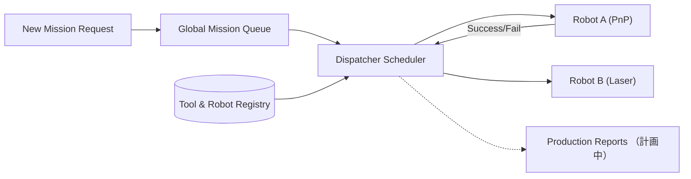

<!-- =============================================================================
HYDRA-UMC-JOB-DISPATCHER - Priority job dispatcher
Copyright (C) JuanenRac (Electro Hobby 3D) <electrohobby3d@gmail.com>
GPL-3.0-or-later - see LICENSE
============================================================================= -->

<p align="center">
  
</p>

# 🗂️ HYDRA-UMC-JOB-DISPATCHER

<p align="center"><a href="README.md">🇺🇸 English</a> | <a href="README_spa.md">🇪🇸 Español</a> | <a href="README_fra.md">🇫🇷 Français</a> | <a href="README_ita.md">🇮🇹 Italiano</a> | <a href="README_deu.md">🇩🇪 Deutsch</a> | <a href="README_zho.md">🇨🇳 简体中文</a> | 🇯🇵 <b>日本語</b> | <a href="README_por.md">🇵🇹 Português</a></p>

### ⚙️ 異種ロボットフリート向けの優先度ベースのミッションキュー

<p align="center">
  
  
  
  
  
  
</p>

---

> **安全性とセキュリティの現状:** このエコシステムは認証された安全システムではありません。ハードウェアの E-STOP 経路、ファームウェアが強制する制限やインターロック、検証済みの動作コマンドはまだありません。ファームウェアイメージは CRC-32 と Ed25519 署名で検査し、リリースビルドは公開済みの開発用鍵を拒否します(リレーの先のツールヘッドと拡張ボードは引き続き URTC のブートローダーを使い、署名ではなく共有鍵の HMAC-SHA256 を使います)。TLS と相互 TLS は任意で、既定では無効です。独自基板はまだ実装も試験もされていません。ここに書かれた内容を人の安全のために頼る前に、[セキュリティベースライン](https://github.com/JuanenRac/HYDRA-UMC-DOCS/blob/main/docs/SECURITY_BASELINE.md)と[脅威モデル](https://github.com/JuanenRac/HYDRA-UMC-DOCS/blob/main/docs/THREAT_MODEL.md)をお読みください。

---

## 📋 ひと目で

| | |
|---|---|
| バージョン | `0.2.4` |
| 成熟度 | 機能する |
| テスト | 153 (`go test ./...`) |
| 技術 | Go / priority queue / HTTP API / SQLite (modernc.org/sqlite, pure Go) |
| 対象 | HYDRA-UMC セルの Raspberry Pi CM5 |
| 実機での確認 | まだです：このバージョンについて実機での動作記録はありません |

**移動：** [概要](#-概要) · [アーキテクチャ](#-アーキテクチャ) · [機能](#-機能) · [セキュリティと安全](#-セキュリティと安全) · [インターフェース](#-インターフェース) · [設定](#-設定) · [クイックスタート](#-クイックスタート) · [テスト](#-テスト) · [トラブルシューティング](#-トラブルシューティング) · [リポジトリの構成](#-リポジトリの構成) · [関連プロジェクト](#-関連プロジェクト)

## 🚦 プロジェクトの状況

各行はこのリポジトリの一部分で、信号は今日どこまで進んでいるかを示します。計画ではなく、リポジトリが示せるもの（テスト、ビルド、実行）に基づいて書かれています。

🟢 完了・検証済み · 🟡 動作する（既知の制限あり） · 🟠 一部のみ、または未検証 · 🔴 未実装または動作しない

| 領域 | 状態 | ここでの意味 |
|---|---|---|
| ソフトウェア | 🟡 | 主な目的では動作します。足りない点は上の正直さの確認に書かれています |
| テスト | 🟢 | 自動テスト 153 件。変更のたびに実行されます |
| 実機 | 🔴 | まだです：このバージョンについて実機での動作記録はありません |
| ドキュメント | 🟢 | 8 言語の README。変更のたびにマニフェストと照合されます |

## 🎯 概要

**HYDRA-UMC-JOB-DISPATCHER** は、オーケストレーターのタスク割り当て
エンジンです。グローバルなミッションキューを管理し、各ロボットの現在の
可用性、位置、装着されている工具（URTC）に基づいてジョブを分配します。

高優先度タスク（例：「緊急欠陥修正」）が通常の生産フローをバイパスする
ことを保証し、異なるロボットが連携して動作する必要のあるマルチステップ
組立シーケンスを調整します。

## 🧩 HYDRA-UMC での役割

**HYDRA-UMC-JOB-DISPATCHER** はどのロボットにどのジョブを渡すかを決めます。クライアントがジョブを投入し、ロボットは搭載ツールを登録して仕事を求め、ディスパッチャーは条件に合う最優先のジョブを渡します。ロボットは動かしません。ジョブをどう扱うかはロボット自身と SDK のジョブゲートの役目です。

## 🏛️ アーキテクチャ

<p align="center">
  
</p>

<details>
<summary>図のテキスト版（Mermaid）</summary>



</details>

**この作りにした理由**

* **実際のロジックがリポジトリのルートではなく `src/` の下にある理由。** `src/dispatcher`（スケジューリングエンジン）と `src/api`（HTTP ハンドラ）が実際の実装を保持しています。`main.go`/`version.go` はそれらを結びつけるエントリポイントとしてリポジトリのルートに残ります。
* **ジョブの割当てが URTC 経由で工具の可用性をチェックする理由。** 特定の工具ヘッドを必要とするジョブは、その URTC 制御の工具ヘッドが実際に存在しアイドル状態であるロボットにのみ分配可能です——ディスパッチ前（ピック失敗後ではなく）にこれをチェックすることで、ロボットが実際には使用できないステーションに到着することを防ぎます。`src/dispatcher.Engine.DispatchOnce` は今日すでに `RequiredTool`/`Robot.Tool` の完全一致でこれを実施しています；工具ヘッドが物理的に取り付けられていることを確認するために CAN 経由で実際の URTC とまだ通信していません（エンジンはロボットの登録が主張する内容しか知りません——`src/api` の `POST /robots` を参照）。
* **スケジューラも、そして今では永続化も、どちらも本物です。** `src/dispatcher` は README の "DISPATCHER FLOW" 図が説明する実際のアルゴリズムを実装しています：優先度順に並んだグローバルキュー、工具を意識したルーティング、さらに多段階依存関係（`DependsOn` 内のすべてのジョブが `done` に達するまで、ジョブは `blocked` のまま）。`Engine` の状態は、後で実際のストアが各呼び出し側を変えることなくこれらのメソッドの背後にあるものを置き換えられるよう、もともとエクスポートされたメソッドの背後に保持されていました——`NewEngineWithStore`（`src/sqlitestore`）がそのストアです：オプション、純粋な Go による SQLite、実際に終了・再起動させたプロセスに対してエンドツーエンドで検証済み。詳細は [`docs/API.md`](docs/API.md#persistence) を参照。
* **HTTP API が gRPC ではなくプレーンな JSON/HTTP である理由。** これは人間/運用向けの制御サーフェース（ジョブを送信し、ロボットを登録し、何が起こったか尋ねる）です——`hydra.common.v1`（エコシステム共通の gRPC 契約、`HYDRA-UMC-ORCHESTRATOR/proto/` 参照）は、その proto 自体の既に文書化された適用範囲に従い、ノード間通信用に予約されたままです。
* **エコシステムの他の部分との関係。** HYDRA-UMC-ORCHESTRATOR の下の兄弟サービスです——ミッションレベルの決定を、具体的なロボットごとのジョブ割当てに変換します。（URTC の工具可用性と HYDRA-UMC-PATH-PLANNER-3D のルートに照らした割当てのチェックは計画中で、未実装です。）
* **`POST /jobs/submit` が `POST /jobs` を変更するのではなく新しいルートである理由。** `AddJob()`/`POST /jobs` は常に挿入を行い、ID の衝突ではエラーになります——この低レベルの契約は変更されません。`SubmitJob()`/`POST /jobs/submit` は `Job.DedupKey` を介してその上に実際の、任意の重複排除を重ねます——これはエコシステム全体で使われているのと同じパターンです（変更されない低レベルのプリミティブの隣に安全策付きのエントリポイントを追加するのであって、それに動作の変更を接ぎ木するのではありません）。
* **失敗後の再試行が新しいジョブを作成するのではなく同じジョブ ID を再利用する理由。** 代替案——再試行のたびに新しいジョブを生成する——は、一つの論理的な作業単位の履歴を複数の ID に分散させてしまい、呼び出し側には「これは一度失敗して再試行されている」のか「これは無関係な新しい作業」なのかを区別する手段がなくなります。元のジョブを `Pending` にリセットすることで、失敗した試行を含むそのライフサイクル全体が一つの ID の下に保たれます。

**Operation からのジョブ。** `POST /jobs/submit` は SDK 共通の Operation（`operation_id` を持つボディ）も受け付けます。これはセマンティックプランナーが渡す形で、オペレーションの id がジョブの id かつ重複排除キーになるため、同じオペレーションを再送しても同じジョブです。`params` の `priority`・`required_tool`・`location`・`depends_on` がジョブの値になります。状態が `received` のオペレーションだけが受け付けられ、それ以外は `400` です。

## ✨ 機能

* 📋 **動的キューイング：** インテリジェントなミッションの優先順位付けとスケジューリング。
* ⚖️ **工具認識ルーティング：** 正しい URTC ヘッドを持つロボットへ自動的にジョブをルーティングします。
* 🧰 **設定可能なツールカタログ（警告のみ）：** `-tools-file`（ツールヘッドの TOOL_* プロファイル名の JSON リスト）や `-tools` で、設置環境が知っているツールを宣言します。`RequiredTool` や `Tool` がカタログにないジョブ／ロボットも受け付けられ、警告が一度だけ記録されます（ツールは完全一致のため、大文字小文字だけが違う場合はヒント付き）。カタログがなければ何も変わりません。*(実装済み)*
* 🔄 **マルチステージミッション：** タスク間の依存関係を管理します（例：「ピック」は「プレース」より先に発生する必要があります）。
* 📡 **永続性：** 実際に動作するオプションの SQLite バックエンドによるミッション状態管理（`-db PATH`、`src/sqlitestore`、純粋な Go - CGO 不要） - 実際のプロセス再起動を経てもキューは生き残ることをエンドツーエンドで検証済み。未設定の場合はメモリ上のみで動作します。`GET /health` は劣化したストアを黙って失敗させず報告します。詳細は [`docs/API.md`](docs/API.md#persistence) を参照。
* 🔁 **冪等な送信（v0）：** `POST /jobs/submit` による実際の、任意の `DedupKey` ベースの重複排除——進行中または既に完了したジョブを再送信すると変更されずに返され、実際の失敗後の再試行は同じジョブ ID を再利用し、作業を二重に実行しません。優先順位の順序は繰り返し実行しても決定論的であり、明示的な回帰テストでカバーされています。
* 🧯 **デフォルトで安全。応答しなくなったロボットには仕事を渡しません（v0）：** API は指定がなければ `127.0.0.1:8090` で待ち受け、別のアドレスにはベアラートークン（`-token` / `JOB_DISPATCHER_TOKEN`。設定すると `GET /health` 以外のすべてが要求します）か、明示的な `-allow-anonymous` が必要です。HTTP サーバーにはタイムアウトがあり、64 KB を超えるリクエストボディは `413` で拒否されます。`-robot-timeout`（既定 2 分）より長く無応答のロボットには新しい仕事が割り当てられず、ジョブは優先する `location` を指定でき（`POST /jobs`、`POST /jobs/submit`。その場所のロボットが優先され、必須ではありません）、各ロボットの最後のハートビートは永続化されます（旧バージョンのデータベースはその場で移行されます）。そのため再起動しても、無応答になったロボットが見えなくなりません。*（実装済み）*
* 🗂️ **アトミックな書き込み・ページ送り・追跡可能なジョブ:** 完了・取り消し・再キュー・失効ハートビートの掃引は 1 回のトランザクションで SQLite に書き込まれます(データベースは WAL モード)。`GET /jobs` は絞り込みとページ送りができます(`status`、`limit`、`offset`、`X-Total-Count`)。各ジョブは `SubmittedAtMs`、`AssignedAtMs`、`CompletedAtMs` と、完了報告が送り返せる `Attempt` カウンター(`attempt`)を持ち、破棄された割り当ての遅れた報告は拒否されます。`DELETE /robots/{id}` はジョブのないロボットを削除します。未来の日付のロボットのハートビートは信用しません。機械可読な記述は `docs/openapi.yaml` にあります。 *(実装済み)*
* 🕒 **ジョブが待たされる理由:** `GET /dispatch/waiting` は、保留中のジョブを割り当て順に並べ、それぞれにロボットがない理由(登録されたロボットなし、そのツールを持つロボットなし、該当ロボットがすべて使用中、該当ロボットから応答がない、次の割り当てで使える空きロボットあり)を付けて返します。読み取り専用で、`POST /dispatch` はこれまでどおり割り当ての一覧だけを返します。

## 🔒 セキュリティと安全

| 脅威 | 防御 | 場所 |
|---|---|---|
| ネットワークに開かれた API | `127.0.0.1:8090` で待ち受け、他のアドレスでは `-allow-anonymous` がない限り Bearer トークン（`-token` または `JOB_DISPATCHER_TOKEN`）が必要です。`GET /health` 以外のすべてのルートがそれを求め、定数時間で比較し、拒否は `WWW-Authenticate: Bearer` 付きの `401` です | `main.go`, `src/api/api.go` |
| 大きなボディと遅い接続 | ボディは最大 64 KiB。ヘッダーは 5 秒、リクエストは 15 秒で届く必要があり、応答は 30 秒以内に書かれ、アイドル接続は 60 秒で閉じます | `src/api/api.go`, `main.go` |
| 応答しなくなったロボットや存在しないツールへの仕事 | `-robot-timeout`（既定 2 分、`0` で無効）より長く沈黙したロボットには仕事を渡さず、そのジョブは「不明」になります。`-tools-file` / `-tools` にないツールを名指すジョブやロボットは拒否されます | `main.go`, `src/dispatcher/tools.go` |
| 二重投入と、キューを失う再起動 | 投入は `DedupKey` により冪等です。`-db パス` を付けるとキューは純 Go の SQLite ファイルに保存され、プロセスを強制終了して再起動しても残ります。付けなければメモリ上だけです | `src/dispatcher`, `src/sqlitestore` |

**絶対にしないこと：** ロボットは動かさず、ツール別の振り分けはロボットが自分について言う文字列を比較するだけです。ツールについて嘘をつくロボットは見分けられません（URTC には CAN で問い合わせないため）。

## 🔌 インターフェース

既定は `127.0.0.1:8090` の HTTP。詳しくは `docs/API.md` と `docs/openapi.yaml` を参照してください。

| トピックまたはルート | 内容 |
|---|---|
| `/jobs`, `/jobs/submit`, `/jobs/{id}` | ジョブの一覧・投入・参照 |
| `/jobs/complete`, `/jobs/cancel`, `/jobs/requeue`, `/jobs/detect-stale` | ジョブの完了・取消・再投入、沈黙したロボットのジョブの検出 |
| `/robots`, `/robots/{id}`, `/dispatch` | ロボットとそのツールの登録、次の適合ジョブの要求 |
| `GET /health` | サービスは動作中か（トークンなしで利用可） |

## ⚙️ 設定

| 変数 | 既定値 | 設定する内容 |
|---|---|---|
| `-addr` | `127.0.0.1:8090` | サービスの待ち受け先 |
| `-token`, `JOB_DISPATCHER_TOKEN` | 空 | API の Bearer トークン |
| `-allow-anonymous` | `false` | ループバック以外のアドレスでトークンなしを許可 |
| `-robot-timeout` | `2m` | この時間沈黙したロボットには仕事を渡さない（`0` = 無効） |
| `-db` | 空（メモリ） | キューを保持する SQLite ファイルのパス |
| `-tools-file`, `JOB_DISPATCHER_TOOLS_FILE`, `-tools`, `JOB_DISPATCHER_TOOLS` | 空 | ジョブやロボットが指定できるツールの一覧 |
| `-max-body-bytes`, `-read-header-timeout`, `-read-timeout`, `-write-timeout`, `-idle-timeout` | `65536`, `5s`, `15s`, `30s`, `60s` | リクエスト本文の最大バイト数（超えると `413`）と HTTP サーバーの時間制限。どれも 0 は受け付けません |

## 🚀 クイックスタート

Go 1.21 以上が必要です（SQLite ドライバーは純 Go で C コンパイラ不要）。Python 3 はプロジェクトのツールにだけ使います。

```bash
bash run.sh        # Linux, macOS (run.bat on Windows)
go run . -addr 127.0.0.1:8090 -db jobs.sqlite3
curl http://127.0.0.1:8090/health
```

## 🧪 テスト

`go test ./...` で Go のテスト 153 件を実行します。テストはコードの隣（`src/api`、`src/dispatcher`、`src/sqlitestore`、`main_test.go`）にあり、SQLite ファイル上でプロセスを強制終了して再起動するテストも含みます。ハードウェアも外部ネットワークも不要です。

CI は `HYDRA_UMC_CI=1 python tools/ci_validate.py` を実行し、マニフェスト、文書、8 つの README、図を検査します。

## 🏗️ ビルドとリリース

コンパイルできるだけの骨組みではなく、優先度付きの本物のジョブ
キューと HTTP API です。

```bash
# Windows
build.bat
run.bat -addr 127.0.0.1:8090

# Linux / macOS
./build.sh
./run.sh -addr 127.0.0.1:8090
```

`build.sh`/`build.bat` はバージョンを変更せず（上げるのは `python tools/hydra_project_tool.py bump` だけです）、その後 `go build` を実行します。
`run.sh`/`run.bat` は生成されたバイナリを直接実行します。

```bash
# ロボットを登録し、ジョブを送信し、ディスパッチし、完了としてマークする
curl -X POST localhost:8090/robots -d '{"id":"robot-a","tool":"PnP","available":true}'
curl -X POST localhost:8090/jobs   -d '{"id":"job-1","priority":5,"requiredTool":"PnP"}'
curl -X POST localhost:8090/dispatch -d '{}'
curl -X POST localhost:8090/jobs/complete -d '{"id":"job-1","success":true,"robotId":"robot-a"}'
curl localhost:8090/jobs
curl localhost:8090/robots
```

```bash
# 冪等な送信：同じ dedupKey を持つ再試行リクエストは、クライアントが
# 異なる id を使っても、同じジョブを二度実行することは決してありません。
curl -X POST localhost:8090/jobs/submit -d '{"id":"job-2","priority":5,"requiredTool":"PnP","dedupKey":"req-abc"}'
# -> {"ID":"job-2", ..., "result":"created"}
curl -X POST localhost:8090/jobs/submit -d '{"id":"job-2-retry","priority":5,"requiredTool":"PnP","dedupKey":"req-abc"}'
# -> {"ID":"job-2", ..., "result":"duplicate"} - 同じジョブ、変更なし

# 実際の失敗の後、同じ dedupKey での再試行は job-2 の ID を再利用します：
curl -X POST localhost:8090/jobs/complete -d '{"id":"job-2","success":false,"robotId":"robot-a"}'
curl -X POST localhost:8090/jobs/submit -d '{"id":"job-2-retry-2","priority":5,"requiredTool":"PnP","dedupKey":"req-abc"}'
# -> {"ID":"job-2", "Status":"pending", ..., "result":"retried"}
```

```bash
go test ./...   # src/dispatcher(スケジューリングアルゴリズム) +
                 # src/api(httptest による実際の HTTP 往復テスト)
```

## 🩺 トラブルシューティング

| 表示 | 原因 | 対処 |
|---|---|---|
| the service refuses to start | ループバックでないアドレスなのにトークンがありません | `-token`（または `JOB_DISPATCHER_TOKEN`）を指定するか、承知のうえで `-allow-anonymous` を付けます |
| `401` | リクエストに Bearer トークンがないか誤っています | `Authorization: Bearer <token>` を送ります |
| a job stays queued | ジョブが指定するツールを持つ登録済みロボットがいないか、ロボットが沈黙しています | そのツールを持つロボットを登録し、`/dispatch` を呼び続けさせます。`-robot-timeout` も確認します |
| the queue is empty after a restart | `-db` なしで動かしていました | SQLite ファイルを指す `-db` を付けて起動します |

## 📂 リポジトリの構成

<p align="center">
  
</p>

<details>
<summary>ツリーのテキスト版</summary>

```text
HYDRA-UMC-JOB-DISPATCHER/
├── src/
│   ├── dispatcher/                              キュー、ツール別の振り分け、段階、復旧
│   ├── api/                                     HTTP の窓口、トークン、制限
│   └── sqlitestore/                             任意の永続キュー（純 Go の SQLite）
├── docs/                                        API リファレンスと OpenAPI ファイル
├── systemd/                                     CM5 用のサービスユニット
├── tools/                                       ビルド・テスト実行、バージョン引き上げ、CI 検証、README と図の生成・検査
├── images/                                      バナーと README の図
├── .github/                                     CI ワークフローと Issue テンプレート
├── hydra-umc.project.json                       マニフェスト：バージョン・成熟度・ファミリー
├── CHANGELOG.md                                 各バージョンの変更点
├── build.sh build.bat                           ビルドスクリプト（バージョンは変えません）
├── build-test.sh build-test.bat                 ビルドスクリプト（バージョンは変えません）
├── test.sh test.bat                             テストを実行
├── main.go / version.go                         エントリー、オプション、バージョン
├── main_test.go                                 エントリーのテスト
├── server_limits.go / server_limits_test.go     HTTP サーバーの時間・サイズ制限とそのテスト
├── go.mod / go.sum                              Go モジュールとチェックサム
├── bump_version.py / bump_manifest_version.py   明示的なバージョン引き上げ
├── run.sh run.bat                               サービスを起動
└── SECURITY.md SUPPORT.md CONTRIBUTING.md CODE_OF_CONDUCT.md LICENSE LICENSE.md
```

</details>

## 🗺️ ロードマップと既知の制限

**現時点の既知の制限**

* **フェーズ 1：** TSN による決定論的スウォーム同期とサブミリ秒ジッタの低減。
* **フェーズ 2：** マルチロボットセルにおける動的障害物回避を伴う 3D パスプランニング。
* **フェーズ 3：** リアルタイムのリソース可用性を用いたマルチロボットジョブディスパッチの最適化。
* **フェーズ 4：** より優れたスケジューリングのための AI 駆動のジョブ時間推定と異種ロボットフリートの協調。

## 🌍 言語

この README とリポジトリの文書は、英語・スペイン語・ドイツ語・フランス語・イタリア語・日本語・中国語・ポルトガル語（ポルトガル）の 8 言語で提供されています。8 つのファイルは同時に書かれ、同じ節と同じリンクを持つことを CI が確認します。 このリポジトリには独自の画面もメッセージカタログもないため、翻訳すべきインターフェース文字列はありません。

## 🔗 関連プロジェクト

本プロジェクトは、同じ作者(JuanenRac / Electro Hobby 3D)による HYDRA-UMC ロボティクスエコシステムの一部です。リクエストが実はこの中のどれかについてのものである可能性があるため、知っておく価値があります。

**親プロジェクト**
- **[HYDRA-UMC-ORCHESTRATOR](https://github.com/JuanenRac/HYDRA-UMC-ORCHESTRATOR)** — 実際の gRPC/Protobuf ヘルスレポート契約とミッションステートマシンを持つ統合ハブ。本リポジトリは、その自身のスウォーム調整レイヤー内における特定のオーケストレーションサービスとして、この親の一部を成す。

**兄弟プロジェクト** —— HYDRA-UMC-ORCHESTRATOR 自身のスウォーム調整レイヤーにおける他のオーケストレーションサービス
- **[HYDRA-UMC-SWARM-SYNC](https://github.com/JuanenRac/HYDRA-UMC-SWARM-SYNC)** — 複数セルの収束についてプロパティテストされた、実際の CRDT LWW-Element-Map 状態同期。
- **[HYDRA-UMC-PATH-PLANNER-3D](https://github.com/JuanenRac/HYDRA-UMC-PATH-PLANNER-3D)** — 実際の障害物/ワークスペース衝突検証を備えた、実際の RRT ベースの 3D 経路プランナー。
- **[HYDRA-UMC-NODE-HEALING](https://github.com/JuanenRac/HYDRA-UMC-NODE-HEALING)** — リトライ/バックオフとアイデンティティ不一致検出を備えた、実際の gRPC ベースのフリートヘルスウォッチドッグ。

**直接関連**
- **[URTC](https://github.com/JuanenRac/URTC)** — 物理的な Universal Robot Tool Controller 基板向けファームウェア、CAN バス経由の 25 以上のツールプロファイル ——URTC 自身のどのツールヘッドが実際に利用可能かに基づいてジョブを割り当てる。
- **[HYDRA-UMC-PRODUCTION-REPORTS](https://github.com/JuanenRac/HYDRA-UMC-PRODUCTION-REPORTS)** — DATALAKE の履歴に対する実際の OEE/稼働率計算、再現可能な CSV エクスポート付き ——ミッション完了ログの想定される送信先。完了処理が書き込みに接続されれば、本ディスパッチャーが自身の OEE `production_event` データの実際の情報源になる予定(未実装、そのプロジェクト側で追跡中)。

**エコシステムの他のプロジェクト**

*コアハードウェア&プラットフォーム*
- **[HYDRA-UMC](https://github.com/JuanenRac/HYDRA-UMC)** — ロボットアームのマザーボードの設計——CM5 ホスト + デュアルコア STM32H745、CAN-OTA/SPI-OTA 経由で最大 8 本のツールアームを統括することを目指す(ファームウェアは初期段階で、実装済みの基板はまだない)。
- **[HYDRA-UMC-OS](https://github.com/JuanenRac/HYDRA-UMC-OS)** — CM5 向けの再現可能な Raspberry Pi OS プロダクト層——読み取り専用エージェント、検証済み設定/プロファイル、WiFi 初回接続プロビジョニング。
- **[HYDRA-UMC-SDK](https://github.com/JuanenRac/HYDRA-UMC-SDK)** — すべてのブリッジが自身のコマンドを検証する共有 JSON-Schema 契約とソフトウェアのジョブゲート境界(認証済みの安全機能ではない)。
- **[HYDRA-UMC-CONNECTOR-HUB](https://github.com/JuanenRac/HYDRA-UMC-CONNECTOR-HUB)** — 外部マシン用コネクタのための宣言的アダプターマニフェストのレジストリとバリデーター。SDK 自身の契約という発想を外部マシンにまで拡張し、産業用ゲートウェイ系のプロジェクトを置き換えることはありません。

*コアバックエンド&クライアント*
- **[HYDRA-UMC-SERVER](https://github.com/JuanenRac/HYDRA-UMC-SERVER)** — すべての制御クライアントが実際に通信する、本物のヘッドレスバックエンド(REST/WebSocket)。
- **[HYDRA-UMC-STUDIO](https://github.com/JuanenRac/HYDRA-UMC-STUDIO)** — リアルタイムのマルチロボット 3D 可視化を備えたウェブ制御ダッシュボード。
- **[HYDRA-UMC-SUITE](https://github.com/JuanenRac/HYDRA-UMC-SUITE)** — 複数のサーバーを同時に扱えるデスクトップ(PySide6)スウォームコマンドセンター、スタンドアロン実行ファイルとしてパッケージ化。
- **[HYDRA-UMC-ANDROID-CONTROL](https://github.com/JuanenRac/HYDRA-UMC-ANDROID-CONTROL)** — 生体認証ログインとペアリングされた Wear OS コンパニオンを備えたネイティブ Android 制御アプリ。
- **[HYDRA-UMC-IOS-CONTROL](https://github.com/JuanenRac/HYDRA-UMC-IOS-CONTROL)** — リアルタイム WebSocket 同期を備えた iOS/iPadOS 制御アプリ(Flutter)。
- **[HYDRA-UMC-DSI](https://github.com/JuanenRac/HYDRA-UMC-DSI)** — 本体搭載の 7 インチ DSI タッチスクリーン向けネイティブタッチ UI、CM5 自体に組み込み。
- **[HYDRA-UMC-EDITOR-URDF](https://github.com/JuanenRac/HYDRA-UMC-EDITOR-URDF)** — 完成したモデルを STUDIO 自身のカタログへ送信するデスクトップ用グラフィカル URDF 作成/編集ツール。
- **[HYDRA-UMC-EDITOR-STL](https://github.com/JuanenRac/HYDRA-UMC-EDITOR-STL)** — HYDRA-UMC-EDITOR-URDF も編集する同じモデルカタログ内で、実在するパーツを変換/置換/削除/追加するデスクトップ STL モデルエディタ。
- **[HYDRA-UMC-BRIDGE-AMR](https://github.com/JuanenRac/HYDRA-UMC-BRIDGE-AMR)** — VDA 5050 MQTT パブリッシャーによる AGV/AMR フリートの調整境界(エミュレートしたフリートに対してのみテスト済み)。
- **[HYDRA-UMC-BRIDGE-CNC](https://github.com/JuanenRac/HYDRA-UMC-BRIDGE-CNC)** — GRBL ステータス/制御バイトへのアクセスを持つ、CNC セルの高レベルコーディネーター(エミュレーターに対してのみテスト済み)。
- **[HYDRA-UMC-BRIDGE-DROIDS](https://github.com/JuanenRac/HYDRA-UMC-BRIDGE-DROIDS)** — Boston Dynamics Spot コマンド送信機能を持つ、脚型/ヒューマノイドドロイドの調整境界(エミュレーターに対してのみテスト済み)。
- **[HYDRA-UMC-BRIDGE-LASER](https://github.com/JuanenRac/HYDRA-UMC-BRIDGE-LASER)** — キー/筐体/インターロックの GPIO 信号 3 系統を読み取るレーザーセルのコーディネーター(模擬チップに対してのみテスト済み。レーザーの武装や発射はできない)。
- **[HYDRA-UMC-BRIDGE-OPENPNP](https://github.com/JuanenRac/HYDRA-UMC-BRIDGE-OPENPNP)** — OpenPnP ピックアンドプレースの基板フローを安全に統括する高レベルコーディネーター。
- **[HYDRA-UMC-BRIDGE-PRINTER3D](https://github.com/JuanenRac/HYDRA-UMC-BRIDGE-PRINTER3D)** — 実際にゲート制御されたジョブコマンドを持つ、Moonraker/Klipper 3D プリンター向けの安全な調整境界。
- **[HYDRA-UMC-BRIDGE-ROS2](https://github.com/JuanenRac/HYDRA-UMC-BRIDGE-ROS2)** — 遅延インポートの rclpy ROS 2 トランスポートを持つコーディネーター(ROS 2 環境ではまだ実行していない)。
- **[HYDRA-UMC-BRIDGE-UAV](https://github.com/JuanenRac/HYDRA-UMC-BRIDGE-UAV)** — MAVLink コマンド送信機能を持つ、カメラ搭載 UAV の調整境界(エミュレーターに対してのみテスト済み)。

*URTC ツールプラットフォーム*
- **[URTC-FLASHER](https://github.com/JuanenRac/URTC-FLASHER)** — URTC 基板用のデスクトップ GUI 書き込みツール、CAN-OTA およびフルチップ SWD/JTAG。
- **[URTC-TESTER](https://github.com/JuanenRac/URTC-TESTER)** — URTC 基板向けのデスクトップ CAN バスライブ診断ツール、ツールプロファイルごとに 1 パネル。
- **[URTC-WEB-STUDIO](https://github.com/JuanenRac/URTC-WEB-STUDIO)** — Web Serial API を使ったブラウザベースの URTC-TESTER の代替、ローカルインストール不要。
- **[URTC-GATEWAY](https://github.com/JuanenRac/URTC-GATEWAY)** — URTC の CAN バスの前に置くゲートウェイ：許可する識別子のリスト、レート制限、セッション鍵。コンピューター上でテスト済みで、実際のバスではまだ試していません。

*ビジョン AI ノード(Hailo-8)*
- **[HYDRA-UMC-VISION-NODE](https://github.com/JuanenRac/HYDRA-UMC-VISION-NODE)** — Hailo-8 ビジョンパイプラインの統合ハブ、段階ごとの実際のハードウェア準備状況チェック付き。
- **[HYDRA-UMC-DETECTION-HEF](https://github.com/JuanenRac/HYDRA-UMC-DETECTION-HEF)** — Hailo アーキテクチャ/チェックサムによる安全読み込み検証を備えた、実際のコンパイル済みモデルレジストリ。
- **[HYDRA-UMC-VISION-STREAMER](https://github.com/JuanenRac/HYDRA-UMC-VISION-STREAMER)** — 実際の HailoRT 統合境界を持つ、実際の GStreamer パイプライン + MediaMTX 設定生成器。
- **[HYDRA-UMC-VISUAL-SERVOING-API](https://github.com/JuanenRac/HYDRA-UMC-VISUAL-SERVOING-API)** — ゾーン状態を条件に承認する Position-Based Visual Servoing 補正則。カメラによる姿勢推定はまだない。
- **[HYDRA-UMC-SAFETY-ZONES](https://github.com/JuanenRac/HYDRA-UMC-SAFETY-ZONES)** — ファイルから物体位置を受け取る、ゾーン侵入・キャリブレーション鮮度・E-STOP 要求の v0 ロジック。検出器は接続されておらず、物理 E-STOP もまだ配線されていない。

*コグニティブ AI ノード(Hailo-10)*
- **[HYDRA-UMC-COGNITIVE-NODE](https://github.com/JuanenRac/HYDRA-UMC-COGNITIVE-NODE)** — Hailo-10 コグニティブパイプライン(LLM/VLA/音声オーケストレーション)の統合ハブ。
- **[HYDRA-UMC-VLA-ENGINE](https://github.com/JuanenRac/HYDRA-UMC-VLA-ENGINE)** — Vision-Language-Action モデル向けの、実際のアクショントークンのエンコード/デコードと軌道生成。
- **[HYDRA-UMC-VOICE-UI](https://github.com/JuanenRac/HYDRA-UMC-VOICE-UI)** — 確認ゲート付きの限定的な Watch リレーを備えた、実際の音声フロントエンド(VAD + 意図解析)。
- **[HYDRA-UMC-SEMANTIC-PLANNER](https://github.com/JuanenRac/HYDRA-UMC-SEMANTIC-PLANNER)** — MCU エラーコードに対する、実際のルールベースのタスク分解と意味的エラー復旧。
- **[HYDRA-UMC-DOCS-QA](https://github.com/JuanenRac/HYDRA-UMC-DOCS-QA)** — このエコシステム自身の Markdown ドキュメントに対する、標準ライブラリのみの実際の TF-IDF 文書検索。
- **[HYDRA-UMC-LOCAL-TECHNICIAN](https://github.com/JuanenRac/HYDRA-UMC-LOCAL-TECHNICIAN)** — エコシステム自身のための、ローカルでポリシーゲート付きのAIメンテナンス技術者 — 観察、診断し、修正を提案する;最上位の2つのリスクレベルは意図的にまだ実装されていない。

*デジタルツイン&シミュレーション*
- **[HYDRA-UMC-TWIN](https://github.com/JuanenRac/HYDRA-UMC-TWIN)** — 実際のバージョン互換性同期契約を持つ、デジタルツインエンジンの統合ハブ。
- **[HYDRA-UMC-HIL-BRIDGE](https://github.com/JuanenRac/HYDRA-UMC-HIL-BRIDGE)** — シミュレーションと実機の間にソフトウェアの衝突インターロックを備えたハードウェア・イン・ザ・ループのルーター(実機なしでテスト済み)。
- **[HYDRA-UMC-PHYSICS-REPLICA](https://github.com/JuanenRac/HYDRA-UMC-PHYSICS-REPLICA)** — 実際の URDF サブセットに対する、実際の順運動学と関節限界検証。
- **[HYDRA-UMC-SYNTHETIC-DATA-GEN](https://github.com/JuanenRac/HYDRA-UMC-SYNTHETIC-DATA-GEN)** — YOLO/COCO アノテーションのエクスポート機能を持つ、実際のプロシージャル 2D シーンジェネレーター。

*データ&分析*
- **[HYDRA-UMC-DATALAKE](https://github.com/JuanenRac/HYDRA-UMC-DATALAKE)** — 実際の取り込み/クエリ HTTP API を備えた、実際の sqlite3 ベースの時系列ストア。
- **[HYDRA-UMC-ANOMALY-DETECTOR](https://github.com/JuanenRac/HYDRA-UMC-ANOMALY-DETECTOR)** — ドリフト監視を備えた、実際の FFT + 統計ベースラインによる異常検知器。
- **[HYDRA-UMC-TELEMETRY-COLLECTOR](https://github.com/JuanenRac/HYDRA-UMC-TELEMETRY-COLLECTOR)** — シーケンス重複排除機能を備えた、DATALAKE への実際の CAN/WebSocket 取り込みパイプライン。

*産業用ゲートウェイ*
- **[HYDRA-UMC-GATEWAY-INDUSTRIAL](https://github.com/JuanenRac/HYDRA-UMC-GATEWAY-INDUSTRIAL)** — 実際のコマンド許可リスト/バックプレッシャー層を持つ、産業用プロトコルへ中継する統合ハブ。
- **[HYDRA-UMC-OPCUA-SERVER](https://github.com/JuanenRac/HYDRA-UMC-OPCUA-SERVER)** — 実際のバイナリプロトコルクライアントセッションで検証された、実際の OPC-UA アドレス空間。
- **[HYDRA-UMC-MQTT-BROKER](https://github.com/JuanenRac/HYDRA-UMC-MQTT-BROKER)** — クライアント単位のオプション認証とトピック ACL を備えた、実際の MQTT ブローカー。
- **[HYDRA-UMC-MTCONNECT-ADAPTER](https://github.com/JuanenRac/HYDRA-UMC-MTCONNECT-ADAPTER)** — 縮退モード出力を備えた、実際の MTConnect `/probe` および `/current` XML エンドポイント。

*補完ツール&エコシステム運用*
- **[HYDRA-UMC-DASHBOARD-AI](https://github.com/JuanenRac/HYDRA-UMC-DASHBOARD-AI)** — 誠実な統計フォールバックを備えた、DATALAKE/ANOMALY-DETECTOR 上のスマートサマリーと異常ハイライトパネル。
- **[HYDRA-UMC-TOOL-CLI](https://github.com/JuanenRac/HYDRA-UMC-TOOL-CLI)** — 実際の安定した終了コード契約を持つフリート CLI、HYDRA-UMC-SERVER 自身の API の本物のライブクライアント。
- **[HYDRA-UMC-WATCH](https://github.com/JuanenRac/HYDRA-UMC-WATCH)** — 触覚アラートのパターンとペアリング済みスマートフォンへの音声リレーを備えた WearOS コンパニオンアプリ(物理的なウォッチではまだ実行していない)。
- **[URTC-SMART-RACK](https://github.com/JuanenRac/URTC-SMART-RACK)** — 実際の工具 ID デコードと Smart Idle 予熱ロジックを備えた、基板搭載ラック用ファームウェア。
- **[URTC-VISION-TOOL](https://github.com/JuanenRac/URTC-VISION-TOOL)** — サーマル/RGB 検査ツールヘッド向けの、ファームウェアと実際の Python ビジョンコンパニオン。
- **[HYDRA-UMC-UPDATER](https://github.com/JuanenRac/HYDRA-UMC-UPDATER)** — このエコシステム内のすべてのリポジトリを検出・クローン・更新する、管理用デスクトップツール。
- **[HYDRA-UMC-OS-REBUILDER](https://github.com/JuanenRac/HYDRA-UMC-OS-REBUILDER)** — エコシステムの最新バージョンをプリロードした、書き込み可能なCM5イメージを構築するWindows/Linuxデスクトップツール。Raspberry Pi Imager方式の初回起動Wi-Fi/ユーザー/SSH設定を備える。
- **[HYDRA-UMC-OPS-AGENT](https://github.com/JuanenRac/HYDRA-UMC-OPS-AGENT)** — 保守インシデントコーディネーター: 低権限のエッジ役割がサニタイズされたインベントリ/ヘルスのスナップショットを収集し、コントロールプレーン役割がそれを読み取り専用でレンダリングして AI プロバイダーに診断の提案を依頼します - パッチを適用することも、何かをデプロイすることも決してありません。
- **[HYDRA-UMC-DEV-SERVER](https://github.com/JuanenRac/HYDRA-UMC-DEV-SERVER)** — 再現可能な開発ホスト（Raspberry Pi 5 / CM5）。エコシステムのソースコードを保管し、永続キューのもとで境界の明確なビルド/テストタスクを実行する。運用中の CM5 とは明確に異なる、開発専用の役割。

## 📚 ドキュメント

さらに読むには：

* [docs/API.md](docs/API.md) - 各ルート、フィールド、エラー
* [docs/openapi.yaml](docs/openapi.yaml) - 同じ API の OpenAPI ファイル
* [エコシステムのセキュリティ基準](https://github.com/JuanenRac/HYDRA-UMC-DOCS/blob/main/docs/SECURITY_BASELINE.md)
* [エコシステムの脅威モデル](https://github.com/JuanenRac/HYDRA-UMC-DOCS/blob/main/docs/THREAT_MODEL.md)
* [このリポジトリの変更履歴](CHANGELOG.md)
* [このリポジトリのライセンス](LICENSE.md)

## 🤝 コントリビュートとコミュニティ

* プルリクエストの前に `HYDRA_UMC_CI=1 py -3 tools/ci_validate.py`（または `HYDRA_UMC_CI=1 python3 tools/ci_validate.py`）を実行してください。`CI_VALIDATION=PASS` と表示される必要があります。この確認に `build.sh` や `build.bat` は使わないでください。ビルドは検査ではありません。
* 8 つの README は HYDRA-UMC-DOCS の 1 つのソースから書かれます。手で編集しないでください。ソースを変更し、`tools/make_readmes.py` で書き直します。
* 実行していないことを README に書かないでください。事実であれば「シミュレーションのみ」「実機では未確認」と書きます。
* [CONTRIBUTING.md](CONTRIBUTING.md)、[行動規範](CODE_OF_CONDUCT.md)、[SECURITY.md](SECURITY.md)、[SUPPORT.md](SUPPORT.md) を参照してください。

## 👤 作者

**JuanenRac (Electro Hobby 3D)** · electrohobby3d@gmail.com

## 📜 ライセンス

GPL-3.0-or-later - [LICENSE](LICENSE).
