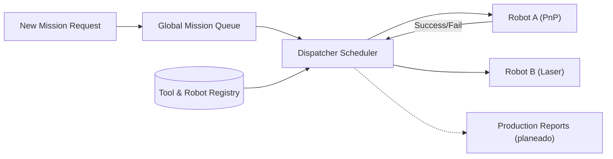

<!-- =============================================================================
HYDRA-UMC-JOB-DISPATCHER - Priority job dispatcher
Copyright (C) JuanenRac (Electro Hobby 3D) <electrohobby3d@gmail.com>
GPL-3.0-or-later - see LICENSE
============================================================================= -->

<p align="center">
  
</p>

# 🗂️ HYDRA-UMC-JOB-DISPATCHER

<p align="center"><a href="README.md">🇺🇸 English</a> | <a href="README_spa.md">🇪🇸 Español</a> | <a href="README_fra.md">🇫🇷 Français</a> | <a href="README_ita.md">🇮🇹 Italiano</a> | <a href="README_deu.md">🇩🇪 Deutsch</a> | <a href="README_zho.md">🇨🇳 简体中文</a> | <a href="README_jpn.md">🇯🇵 日本語</a> | 🇵🇹 <b>Português</b></p>

### ⚙️ Fila de missões por prioridade para frotas de robôs heterogéneas

<p align="center">
  
  
  
  
  
  
</p>

---

> **Estado de segurança (safety e security):** este ecossistema não é um sistema de segurança certificado. Ainda não existe um caminho de E-STOP por hardware, nem limites ou interlocks impostos pelo firmware, nem um comando de movimento verificado; as imagens de firmware são verificadas com CRC-32 e uma assinatura Ed25519, e uma compilação de versão recusa as chaves de desenvolvimento publicadas (as cabeças de ferramenta e as placas de expansão atrás do relé ainda usam os bootloaders do URTC, que aceitam um HMAC-SHA256 de chave partilhada em vez de uma assinatura); TLS e TLS mútuo são opcionais e estão desativados por defeito; nenhuma placa própria foi ainda montada ou testada. Leia a [base de segurança](https://github.com/JuanenRac/HYDRA-UMC-DOCS/blob/main/docs/SECURITY_BASELINE.md) e o [modelo de ameaças](https://github.com/JuanenRac/HYDRA-UMC-DOCS/blob/main/docs/THREAT_MODEL.md) antes de confiar em qualquer afirmação aqui para a segurança de uma pessoa.

---

## 📋 Num relance

| | |
|---|---|
| Versão | `0.2.5` |
| Maturidade | Funcional |
| Testes | 188 (`go test ./...`) |
| Tecnologia | Go / priority queue / HTTP API / SQLite (modernc.org/sqlite, pure Go) |
| Destino | O Raspberry Pi CM5 de uma célula HYDRA-UMC |
| Em hardware real | Ainda não: não há registo de execução em hardware real para esta versão |

**Ir para:** [Visão geral](#-visão-geral) · [Arquitetura](#-arquitetura) · [Funcionalidades](#-funcionalidades) · [Segurança e proteção](#-segurança-e-proteção) · [Interfaces](#-interfaces) · [Configuração](#-configuração) · [Início rápido](#-início-rápido) · [Testes](#-testes) · [Resolução de problemas](#-resolução-de-problemas) · [Estrutura do repositório](#-estrutura-do-repositório) · [Projetos relacionados](#-projetos-relacionados)

## 🚦 Estado do projeto

Cada linha é uma parte deste repositório e a luz diz até onde chega hoje. É escrita com o que o repositório consegue demonstrar (testes, compilações, execuções), não com o que está previsto.

🟢 Feito e verificado · 🟡 Funciona, com limites conhecidos · 🟠 Feito a meio ou ainda por verificar · 🔴 Por fazer ou a não funcionar

| Área | Estado | O que significa aqui |
|---|---|---|
| Software | 🟡 | Funciona para o seu propósito principal; a verificação de honestidade acima lista o que ainda falta |
| Testes | 🟢 | 188 testes automáticos, executados a cada alteração |
| Hardware real | 🔴 | Ainda não: não há registo de execução em hardware real para esta versão |
| Documentação | 🟢 | README em oito idiomas, verificado contra o manifesto a cada alteração |

## 🎯 Visão geral

O **HYDRA-UMC-JOB-DISPATCHER** é o motor de atribuição de tarefas do Orchestrator. Gere uma fila global de missões, distribuindo trabalhos a cada robô com base na sua disponibilidade atual, localização e ferramenta montada (URTC).

Garante que as tarefas de alta prioridade (p. ex. "Correção urgente de defeito") ultrapassam o fluxo normal de produção, e coordena sequências de montagem de várias etapas que exigem que robôs diferentes trabalhem em conjunto.

## 🧩 Papel no HYDRA-UMC

O **HYDRA-UMC-JOB-DISPATCHER** decide que robô recebe que trabalho. Os clientes submetem trabalhos, os robôs registam as ferramentas que levam e pedem trabalho, e o despachante entrega o trabalho de maior prioridade que encaixa. Não move nenhum robô: o que um robô faz com um trabalho é assunto dele e da porta de trabalhos do SDK.

## 🏛️ Arquitetura

<p align="center">
  
</p>

<details>
<summary>Versão em texto do diagrama (Mermaid)</summary>



</details>

**Porque é construído assim**

* **Porque a lógica real vive em `src/` e não na raiz do repositório.** `src/dispatcher` (o motor de escalonamento) e `src/api` (os manipuladores HTTP) contêm a implementação real; `main.go`/`version.go` ficam na raiz como o ponto de entrada que os liga.
* **Porque a atribuição de trabalhos verifica a disponibilidade de ferramenta via URTC.** Um trabalho que precisa de uma cabeça de ferramenta específica só se pode despachar para um robô cuja cabeça controlada por URTC está realmente presente e livre - verificar isto antes do despacho (e não depois de uma recolha falhada) evita que um robô chegue a um posto que não consegue usar. O `src/dispatcher.Engine.DispatchOnce` impõe-no hoje por correspondência exata de `RequiredTool`/`Robot.Tool`; ainda não fala com um URTC real por CAN para confirmar que a cabeça de ferramenta está fisicamente montada (este motor só sabe o que um registo de robô afirma - veja o `POST /robots` de `src/api`).
* **O escalonador, e agora também a persistência, são ambos reais.** O `src/dispatcher` implementa o algoritmo real que o diagrama "FLUXO DO DESPACHANTE" deste README descreve: uma fila global ordenada por prioridade, encaminhamento por ferramenta e dependências de várias etapas (um trabalho fica `blocked` até todos os trabalhos de que `DependsOn` chegarem a `done`). O estado do `Engine` sempre viveu atrás de métodos exportados precisamente para que um armazém de apoio real pudesse substituir o que está por trás sem mudar todos os chamadores - o `NewEngineWithStore` (`src/sqlitestore`) é esse armazém: opcional, SQLite em Go puro, verificado de ponta a ponta contra um binário real terminado e relançado. Veja [`docs/API.md`](docs/API.md#persistence).
* **Porque a API HTTP é JSON/HTTP simples e não gRPC.** É uma superfície de controlo voltada para pessoas/operações (submeter um trabalho, registar um robô, perguntar o que aconteceu) - o `hydra.common.v1` (o contrato gRPC partilhado do ecossistema, veja `HYDRA-UMC-ORCHESTRATOR/proto/`) continua reservado para o tráfego nó a nó, segundo o âmbito documentado desse proto.
* **Como isto se encaixa no resto do ecossistema.** Um serviço irmão sob o HYDRA-UMC-ORCHESTRATOR - converte decisões ao nível da missão em atribuições concretas de trabalhos por robô. (Verificar as atribuições contra a disponibilidade de ferramentas URTC e as rotas do HYDRA-UMC-PATH-PLANNER-3D está planeado, não implementado.)
* **Porque o `POST /jobs/submit` é uma rota nova em vez de mudar o `POST /jobs`.** O `AddJob()`/`POST /jobs` insere sempre e dá erro numa colisão de ID - esse contrato de baixo nível não é tocado. O `SubmitJob()`/`POST /jobs/submit` acrescenta por cima uma deduplicação real e opcional através de `Job.DedupKey`: o mesmo padrão usado em todo o ecossistema (um ponto de entrada protegido acrescentado ao lado de uma primitiva de baixo nível inalterada, e não uma mudança de comportamento colada nela).
* **Porque uma repetição após falha reutiliza o mesmo ID de trabalho em vez de criar um trabalho novo.** A alternativa - criar um trabalho novo em cada repetição - espalharia o histórico de uma unidade lógica de trabalho por vários IDs e não daria ao chamador forma de distinguir "isto falhou uma vez e está a ser repetido" de "isto é trabalho novo sem relação". Repor o trabalho original em `Pending` mantém todo o seu ciclo de vida (incluindo a tentativa falhada) sob um só ID.

**Trabalhos a partir de uma Operation.** `POST /jobs/submit` aceita também a Operation comum do SDK (um corpo com `operation_id`), que é o que o planeador semântico entrega: o id da operação é o id do trabalho e também a sua chave de deduplicação, pelo que enviar de novo a mesma operação dá o mesmo trabalho, e a `priority`, o `required_tool`, a `location` e o `depends_on` dos seus `params` são os do trabalho. Só é aceite uma operação no estado `received`; tudo o resto é um `400`.

## ✨ Funcionalidades

* 📋 **Fila dinâmica:** Priorização e escalonamento inteligentes de missões.
* ⚖️ **Encaminhamento por ferramenta:** Encaminha automaticamente os trabalhos para o robô com a cabeça URTC correta.
* 🧰 **Catálogo de ferramentas configurável (só avisa):** `-tools-file` (uma lista JSON com os nomes dos perfis TOOL_* das cabeças de ferramenta) e/ou `-tools` declaram as ferramentas que a instalação conhece. Um trabalho cujo `RequiredTool`, ou um robô cujo `Tool`, não está no catálogo é aceite na mesma e registado uma vez como aviso (com uma pista se só mudar a maiúscula, porque as ferramentas coincidem exatamente). Sem catálogo nada muda. *(implementado)*
* 🔄 **Missões de várias etapas:** Gere dependências entre tarefas (p. ex. "Pegar" tem de acontecer antes de "Pousar").
* 📡 **Persistência:** estado de missões real e opcional apoiado em SQLite (`-db CAMINHO`, `src/sqlitestore`, Go puro - sem CGO) - a fila sobrevive a um reinício real do processo, verificado de ponta a ponta; sem ele, continua puramente em memória. `GET /health` reporta um armazém degradado em vez de falhar em silêncio. Veja [`docs/API.md`](docs/API.md#persistence).
* 🔁 **Submissão idempotente (v0):** Deduplicação real e opcional por `DedupKey` através de `POST /jobs/submit` - uma submissão repetida de um trabalho em curso ou já concluído devolve-se inalterada, e uma repetição após uma falha real reutiliza o mesmo ID de trabalho em vez de executar o trabalho duas vezes. A ordenação por prioridade é determinista entre execuções repetidas, coberta por um teste de regressão explícito.
* 🧯 **Seguro por defeito, e um robô que deixa de responder não recebe trabalho (v0):** a API escuta em `127.0.0.1:8090` salvo indicação em contrário, e outro endereço exige um token bearer (`-token` / `JOB_DISPATCHER_TOKEN`; então tudo exceto `GET /health` o pede) ou um `-allow-anonymous` explícito; o servidor HTTP tem tempos-limite e os corpos de pedido com mais de 64 KB são recusados com `413`. Um robô calado durante mais de `-robot-timeout` (2 minutos por defeito) não recebe trabalho novo, um trabalho pode indicar uma `location` preferida (`POST /jobs`, `POST /jobs/submit`; preferem-se os robôs dessa localização, nunca se exige), e o último batimento de cada robô é persistido (uma base de dados da versão anterior é migrada no local), pelo que um reinício já não esconde um robô que se calou. *(implementado)*
* 🗂️ **Escritas atómicas, paginação e trabalhos rastreáveis:** uma conclusão, cancelamento, reenfileiramento ou varrimento de batimentos caducados é escrito no SQLite numa só transação (a base de dados funciona em modo WAL); o `GET /jobs` pode ser filtrado e paginado (`status`, `limit`, `offset`, `X-Total-Count`); cada trabalho traz `SubmittedAtMs`, `AssignedAtMs`, `CompletedAtMs` e um contador `Attempt` que o relatório de conclusão pode devolver (`attempt`) para que o relatório tardio de uma atribuição abandonada seja recusado; o `DELETE /robots/{id}` esquece um robô sem trabalho; um batimento de robô com data futura não é considerado fiável. Há uma descrição legível por máquinas em `docs/openapi.yaml`. *(implementado)*
* 🕒 **Porque um trabalho espera:** `GET /dispatch/waiting` lista os trabalhos pendentes pela ordem de despacho com o motivo por que cada um não tem robô (nenhum robô registado, nenhum robô com a ferramenta, robôs adequados ocupados, robôs adequados em silêncio, ou um robô livre para a próxima passagem). É só de leitura; `POST /dispatch` continua a responder a lista simples de atribuições.
* ⏱️ **Tempo estimado de cada trabalho (desligado por predefinição):** com `-eta`, `GET /dispatch/eta` estima quando cada trabalho por concluir começa e termina, em que robô e quando a fila ficará vazia, a partir do tempo que demoraram os últimos trabalhos concluídos da mesma ferramenta (um valor predefinido configurável enquanto não houver nenhum). Um trabalho que não se consegue estimar indica o motivo. Sem `-eta` a rota não existe e mais nada muda; é só de leitura e é testada com um relógio injetado.
* 🧾 **Um evento de produção por cada trabalho que termina (desligado por omissão):** com `-production-events` e um destino (`-production-events-file` para uma linha JSON por evento, `-production-events-url` para um `POST` JSON), cada relatório de que um trabalho terminou entrega um `ProductionEvent` do contrato partilhado do HYDRA-UMC-SDK (robô, hora de fim, bom ou não, tempo de ciclo, trabalho), que os relatórios de produção transformam em OEE. O evento é verificado primeiro contra o contrato; um ciclo que não consegue descrever é ignorado e registado, nunca inventado, e um destino que falha nunca faz falhar a conclusão. Sem o interruptor nada muda; testado com um relógio injetado.
* 🧭 **Robô mais próximo, replaneamento e intervalos (tudo desligado por predefinição):** um ficheiro de configuração (`-config`) guarda os valores afinados e cada secção está desligada, a menos que diga o contrário: `location_costs` envia um trabalho que indica uma localização para o robô com o menor custo declarado até ela, `replan` (`POST /jobs/replan`, ou por si só para um robô que ficou mudo ou avariou) devolve à fila, por ordem, os trabalhos de um robô avariado sem duplicar nem perder nenhum, e `eta_interval` junta a cada estimativa um intervalo de baixo a alto (quartis das durações recentes da mesma ferramenta) ou diz porque não pode. Sem o ficheiro nada muda; testado com relógio injetado e cenários aleatórios com semente fixa.

## 🔒 Segurança e proteção

| Ameaça | Defesa | Onde |
|---|---|---|
| Uma API aberta à rede | Escuta em `127.0.0.1:8090`; qualquer outro endereço exige um token Bearer (`-token` ou `JOB_DISPATCHER_TOKEN`), salvo se `-allow-anonymous` for dado; todas as rotas exceto `GET /health` o pedem, comparado em tempo constante, e a recusa é `401` com `WWW-Authenticate: Bearer` | `main.go`, `src/api/api.go` |
| Corpos grandes e ligações lentas | Um corpo tem no máximo 64 KiB; o cabeçalho tem de chegar em 5 s, o pedido em 15 s, a resposta é escrita em 30 s e uma ligação inativa fecha aos 60 s | `src/api/api.go`, `main.go` |
| Trabalho dado a um robô que deixou de responder ou a uma ferramenta que não existe | Um robô em silêncio durante mais de `-robot-timeout` (2 minutos por predefinição, `0` desliga) não recebe trabalho e os seus trabalhos passam a desconhecidos; um trabalho ou robô que nomeie uma ferramenta fora de `-tools-file` / `-tools` é recusado | `main.go`, `src/dispatcher/tools.go` |
| Uma submissão duplicada e um reinício que perde a fila | A submissão é idempotente pela `DedupKey`; com `-db CAMINHO` a fila fica num ficheiro SQLite em Go puro e sobrevive a um processo morto e relançado, sem ele a fila vive em memória | `src/dispatcher`, `src/sqlitestore` |

**O que nunca faz:** não move nenhum robô, e o encaminhamento por ferramenta compara as cadeias que um robô diz de si: um robô que minta sobre a sua ferramenta não se distingue, porque o URTC não é consultado por CAN.

## 🔌 Interfaces

HTTP em `127.0.0.1:8090` por predefinição; a referência completa é `docs/API.md` e `docs/openapi.yaml`.

| Tópico ou rota | O que leva |
|---|---|
| `/jobs`, `/jobs/submit`, `/jobs/{id}` | listar, submeter e ler trabalhos |
| `/jobs/replan` | devolver à fila os trabalhos de um robô avariado (só se o ficheiro de configuração ativar o replaneamento; caso contrário, 404) |
| `/jobs/complete`, `/jobs/cancel`, `/jobs/requeue`, `/jobs/detect-stale` | terminar, cancelar ou recolocar um trabalho na fila; encontrar os trabalhos de robôs em silêncio |
| `/robots`, `/robots/{id}`, `/dispatch` | registar um robô e as suas ferramentas; pedir o próximo trabalho que encaixa |
| `GET /health` | o serviço está vivo (aberta sem token) |

## ⚙️ Configuração

| Variável | Predefinição | O que define |
|---|---|---|
| `-addr` | `127.0.0.1:8090` | onde o serviço escuta |
| `-token`, `JOB_DISPATCHER_TOKEN` | vazio | o token Bearer da API |
| `-allow-anonymous` | `false` | permitir um endereço não loopback sem token |
| `-robot-timeout` | `2m` | silêncio após o qual um robô não recebe trabalho (`0` = desligado) |
| `-eta`, `JOB_DISPATCHER_ETA=1`, `-eta-default-duration`, `-eta-window` | desligado, `1m`, `20` | ativar `GET /dispatch/eta` (início e fim estimados de cada trabalho por concluir e da fila); a duração assumida até um trabalho da ferramenta terminar (`0` = sem suposição) e quantos trabalhos concluídos recentes por ferramenta entram na média |
| `-config`, `JOB_DISPATCHER_CONFIG` | vazio | um ficheiro JSON com os valores afinados de três comportamentos opcionais, cada um desligado a menos que o ficheiro o ative: `location_costs` (uma tabela de custos entre localizações; o trabalho vai para o robô de menor custo), `replan` (os trabalhos de um robô avariado ou mudo voltam à fila) e `eta_interval` (um intervalo junto a cada estimativa, exige `-eta`) |
| `-production-events`, `JOB_DISPATCHER_PRODUCTION_EVENTS=1`, `-production-events-file`, `-production-events-url`, `-production-events-token` | desligado, vazio, vazio, vazio | entregar um `ProductionEvent` do contrato partilhado por cada trabalho que termina: uma linha JSON por evento no ficheiro e/ou um `POST` JSON para o URL (com o token bearer); o interruptor precisa de pelo menos um destino |
| `-db` | vazio (memória) | caminho do ficheiro SQLite que guarda a fila |
| `-tools-file`, `JOB_DISPATCHER_TOOLS_FILE`, `-tools`, `JOB_DISPATCHER_TOOLS` | vazio | a lista de ferramentas que um trabalho ou robô pode nomear |
| `-max-body-bytes`, `-read-header-timeout`, `-read-timeout`, `-write-timeout`, `-idle-timeout` | `65536`, `5s`, `15s`, `30s`, `60s` | maior corpo de pedido em bytes (um maior recebe `413`) e limites de tempo do servidor HTTP; nenhum aceita zero |

## 🚀 Início rápido

Requer Go 1.21 ou superior (o controlador SQLite é Go puro, sem compilador de C) e Python 3 só para as ferramentas do projeto.

```bash
bash run.sh        # Linux, macOS (run.bat on Windows)
go run . -addr 127.0.0.1:8090 -db jobs.sqlite3
curl http://127.0.0.1:8090/health
```

## 🧪 Testes

188 testes Go correm com `go test ./...`; ficam junto ao código (`src/api`, `src/dispatcher`, `src/sqlitestore` e `main_test.go`) e incluem um processo morto e relançado sobre um ficheiro SQLite. Sem hardware nem rede externa.

A CI executa `HYDRA_UMC_CI=1 python tools/ci_validate.py`, que verifica o manifesto, os documentos, os oito README e as imagens.

## 🏗️ Compilação e publicação

Uma fila de missões por prioridade real, com uma API HTTP, não apenas um esqueleto que compila.

```bash
# Windows
build.bat
run.bat -addr 127.0.0.1:8090

# Linux / macOS
./build.sh
./run.sh -addr 127.0.0.1:8090
```

`build.sh`/`build.bat` nunca alteram a versão (só `python tools/hydra_project_tool.py bump` a sobe) e depois executam `go build`. O `run.sh`/`run.bat` executam diretamente o binário resultante.

```bash
# Registar um robô, submeter um trabalho, despachá-lo e depois marcá-lo como concluído
curl -X POST localhost:8090/robots -d '{"id":"robot-a","tool":"PnP","available":true}'
curl -X POST localhost:8090/jobs   -d '{"id":"job-1","priority":5,"requiredTool":"PnP"}'
curl -X POST localhost:8090/dispatch -d '{}'
curl -X POST localhost:8090/jobs/complete -d '{"id":"job-1","success":true,"robotId":"robot-a"}'
curl localhost:8090/jobs
curl localhost:8090/robots
```

```bash
# Submissão idempotente: um pedido repetido com o mesmo dedupKey nunca executa
# o mesmo trabalho duas vezes, mesmo que o cliente tenha usado outro id de trabalho.
curl -X POST localhost:8090/jobs/submit -d '{"id":"job-2","priority":5,"requiredTool":"PnP","dedupKey":"req-abc"}'
# -> {"ID":"job-2", ..., "result":"created"}
curl -X POST localhost:8090/jobs/submit -d '{"id":"job-2-retry","priority":5,"requiredTool":"PnP","dedupKey":"req-abc"}'
# -> {"ID":"job-2", ..., "result":"duplicate"} - o mesmo trabalho, intocado

# Após uma falha real, uma repetição com o mesmo dedupKey reutiliza o ID de job-2:
curl -X POST localhost:8090/jobs/complete -d '{"id":"job-2","success":false,"robotId":"robot-a"}'
curl -X POST localhost:8090/jobs/submit -d '{"id":"job-2-retry-2","priority":5,"requiredTool":"PnP","dedupKey":"req-abc"}'
# -> {"ID":"job-2", "Status":"pending", ..., "result":"retried"}
```

```bash
go test ./...   # src/dispatcher (algoritmo de escalonamento) +
                 # src/api (idas e voltas HTTP reais via httptest)
```

## 🩺 Resolução de problemas

| Vê | Porque | Faça |
|---|---|---|
| the service refuses to start | O endereço não é loopback e não foi dado token | Dê `-token` (ou `JOB_DISPATCHER_TOKEN`) ou `-allow-anonymous` se o aceitar |
| `401` | O pedido não traz token Bearer ou traz um errado | Envie `Authorization: Bearer <token>` |
| a job stays queued | Nenhum robô registado leva a ferramenta nomeada, ou o robô está em silêncio | Registe um robô com essa ferramenta e mantenha-o a pedir `/dispatch`; verifique `-robot-timeout` |
| the queue is empty after a restart | O serviço correu sem `-db` | Arranque-o com `-db` a apontar para um ficheiro SQLite |

## 📂 Estrutura do repositório

<p align="center">
  
</p>

<details>
<summary>Versão em texto da árvore</summary>

```text
HYDRA-UMC-JOB-DISPATCHER/
├── src/
│   ├── dispatcher/                              a fila, o encaminhamento por ferramenta, etapas, recuperação
│   ├── api/                                     a interface HTTP, token, limites
│   └── sqlitestore/                             fila durável opcional (SQLite em Go puro)
├── docs/                                        a referência da API e o ficheiro OpenAPI
├── systemd/                                     unidade de serviço para o CM5
├── tools/                                       executor de compilação e testes, subida de versão, validador de CI, geradores e verificações de README e imagens
├── images/                                      faixa e imagens do README
├── .github/                                     fluxo de CI e modelos de questões
├── hydra-umc.project.json                       manifesto: versão, maturidade, família
├── CHANGELOG.md                                 o que mudou em cada versão
├── build.sh build.bat                           scripts de compilação (nunca mudam a versão)
├── build-test.sh build-test.bat                 scripts de compilação (nunca mudam a versão)
├── test.sh test.bat                             executam os testes
├── main.go / version.go                         ponto de entrada, opções e a versão
├── main_test.go                                 testes do ponto de entrada
├── server_limits.go / server_limits_test.go     os limites de tempo e tamanho do servidor HTTP e os seus testes
├── go.mod / go.sum                              módulo Go e somas
├── bump_version.py / bump_manifest_version.py   subida de versão explícita
├── run.sh run.bat                               arrancar o serviço
└── SECURITY.md SUPPORT.md CONTRIBUTING.md CODE_OF_CONDUCT.md LICENSE LICENSE.md
```

</details>

## 🗺️ Roteiro e limites conhecidos

**Limites conhecidos hoje**

* **Fase 1:** Sincronização determinista do enxame sobre TSN e redução de jitter abaixo do milissegundo.
* **Fase 2:** Planeamento de caminhos 3D com evitação dinâmica de obstáculos em células multirrobô.
* **Fase 3:** Otimização do despacho de trabalhos multirrobô com a disponibilidade de recursos em tempo real.
* **Fase 4:** Estimativa de duração de trabalhos guiada por IA para melhor escalonamento e coordenação de frotas de robôs heterogéneas.

## 🌍 Idiomas

Este README e os documentos do repositório existem em oito idiomas: inglês, espanhol, alemão, francês, italiano, japonês, chinês e português (Portugal). São escritos em conjunto e a CI verifica que os oito ficheiros têm as mesmas secções e as mesmas ligações. Este repositório não tem ecrã nem catálogo de mensagens próprios, por isso não há textos de interface para traduzir.

## 🔗 Projetos relacionados

Este projeto faz parte do ecossistema de robótica HYDRA-UMC do mesmo autor (JuanenRac / Electro Hobby 3D). Vale a pena conhecê-los, porque um pedido pode ser, na verdade, sobre um destes e não sobre este repositório.

**Projeto-mãe**
- **[HYDRA-UMC-ORCHESTRATOR](https://github.com/JuanenRac/HYDRA-UMC-ORCHESTRATOR)** — hub de integração com um contrato real gRPC/Protobuf de relatórios de saúde e uma máquina de estados de missões; o pai de que este repositório é um serviço de orquestração específico, dentro da sua própria camada de coordenação de enxame.

**Projetos irmãos** — os outros serviços de orquestração da própria camada de coordenação de enxame do HYDRA-UMC-ORCHESTRATOR
- **[HYDRA-UMC-SWARM-SYNC](https://github.com/JuanenRac/HYDRA-UMC-SWARM-SYNC)** — sincronização real de estado CRDT LWW-Element-Map, testada por propriedades para a convergência de várias células.
- **[HYDRA-UMC-PATH-PLANNER-3D](https://github.com/JuanenRac/HYDRA-UMC-PATH-PLANNER-3D)** — planeador real de trajetórias 3D baseado em RRT com validação real de colisões com obstáculos e espaço de trabalho.
- **[HYDRA-UMC-NODE-HEALING](https://github.com/JuanenRac/HYDRA-UMC-NODE-HEALING)** — vigilante real de saúde da frota por gRPC com repetição/recuo e deteção de identidade incoerente.

**Diretamente relacionados**
- **[URTC](https://github.com/JuanenRac/URTC)** — firmware da placa física Universal Robot Tool Controller, mais de 25 perfis de ferramenta por barramento CAN — atribui trabalhos conforme qual das cabeças de ferramenta do próprio URTC está realmente disponível.
- **[HYDRA-UMC-PRODUCTION-REPORTS](https://github.com/JuanenRac/HYDRA-UMC-PRODUCTION-REPORTS)** — cálculo real de OEE/disponibilidade sobre o histórico do DATALAKE, com exportação CSV reproduzível — o destino diagramado dos registos de conclusão de missões; este despachante é a fonte real pretendida dos seus dados `production_event` de OEE quando as conclusões estiverem ligadas para os escrever (ainda não implementado, acompanhado do lado desse projeto).

**Também fazem parte do ecossistema**

*Hardware e plataforma centrais*
- **[HYDRA-UMC](https://github.com/JuanenRac/HYDRA-UMC)** — o desenho da placa-mãe do braço robótico: anfitrião CM5 + STM32H745 de dois núcleos, pensado para orquestrar até 8 braços de ferramenta por CAN-OTA/SPI-OTA (firmware numa fase inicial; ainda sem placa montada).
- **[HYDRA-UMC-OS](https://github.com/JuanenRac/HYDRA-UMC-OS)** — camada de produto reproduzível do Raspberry Pi OS para o CM5: agente só de leitura, configuração/perfis validados, aprovisionamento Wi-Fi de primeiro contacto.
- **[HYDRA-UMC-SDK](https://github.com/JuanenRac/HYDRA-UMC-SDK)** — o contrato JSON-Schema partilhado e a fronteira de software de controlo de trabalhos contra a qual cada bridge valida os seus comandos (não é uma função de segurança certificada).
- **[HYDRA-UMC-CONNECTOR-HUB](https://github.com/JuanenRac/HYDRA-UMC-CONNECTOR-HUB)** — registo declarativo de manifestos de adaptador e validador para conectores de máquinas externas; estende a ideia de contrato do SDK a máquinas externas sem substituir os projetos de gateway industrial.

*Backend central e clientes*
- **[HYDRA-UMC-SERVER](https://github.com/JuanenRac/HYDRA-UMC-SERVER)** — o back-end headless real (REST/WebSocket) com que todos os clientes de controlo realmente comunicam.
- **[HYDRA-UMC-STUDIO](https://github.com/JuanenRac/HYDRA-UMC-STUDIO)** — painel web de controlo com visualização 3D em tempo real de vários robôs.
- **[HYDRA-UMC-SUITE](https://github.com/JuanenRac/HYDRA-UMC-SUITE)** — centro de comando de enxame para desktop (PySide6) para vários servidores ao mesmo tempo, empacotado como executável independente.
- **[HYDRA-UMC-ANDROID-CONTROL](https://github.com/JuanenRac/HYDRA-UMC-ANDROID-CONTROL)** — aplicação Android nativa de controlo, com início de sessão biométrico e um companheiro Wear OS emparelhado.
- **[HYDRA-UMC-IOS-CONTROL](https://github.com/JuanenRac/HYDRA-UMC-IOS-CONTROL)** — aplicação de controlo para iOS/iPadOS (Flutter) com sincronização WebSocket em tempo real.
- **[HYDRA-UMC-DSI](https://github.com/JuanenRac/HYDRA-UMC-DSI)** — interface tátil nativa para o ecrã tátil DSI de 7" integrado, executada no próprio CM5.
- **[HYDRA-UMC-EDITOR-URDF](https://github.com/JuanenRac/HYDRA-UMC-EDITOR-URDF)** — criador/editor gráfico de URDF para desktop que envia os modelos concluídos para o catálogo do STUDIO.
- **[HYDRA-UMC-EDITOR-STL](https://github.com/JuanenRac/HYDRA-UMC-EDITOR-STL)** — editor de modelos STL para desktop que transforma/substitui/remove/adiciona peças reais no mesmo catálogo de modelos que o HYDRA-UMC-EDITOR-URDF também edita.
- **[HYDRA-UMC-BRIDGE-AMR](https://github.com/JuanenRac/HYDRA-UMC-BRIDGE-AMR)** — fronteira de coordenação para frotas AGV/AMR através de um publicador MQTT VDA 5050 (testado apenas contra uma frota emulada).
- **[HYDRA-UMC-BRIDGE-CNC](https://github.com/JuanenRac/HYDRA-UMC-BRIDGE-CNC)** — coordenador de células CNC de alto nível com acesso ao estado GRBL e aos bytes de controlo (testado apenas contra um emulador).
- **[HYDRA-UMC-BRIDGE-DROIDS](https://github.com/JuanenRac/HYDRA-UMC-BRIDGE-DROIDS)** — fronteira de coordenação para droides com patas/humanoides, com um emissor de comandos para o Boston Dynamics Spot (testado apenas contra um emulador).
- **[HYDRA-UMC-BRIDGE-LASER](https://github.com/JuanenRac/HYDRA-UMC-BRIDGE-LASER)** — coordenador de células laser que lê 3 sinais GPIO (chave, caixa e interlock) (testado apenas contra um chip simulado; não pode armar nem disparar um laser).
- **[HYDRA-UMC-BRIDGE-OPENPNP](https://github.com/JuanenRac/HYDRA-UMC-BRIDGE-OPENPNP)** — coordenador seguro de fluxo de placa de alto nível para pick-and-place com OpenPnP.
- **[HYDRA-UMC-BRIDGE-PRINTER3D](https://github.com/JuanenRac/HYDRA-UMC-BRIDGE-PRINTER3D)** — fronteira de coordenação segura para impressoras 3D Moonraker/Klipper, com comandos de trabalho reais protegidos por portas.
- **[HYDRA-UMC-BRIDGE-ROS2](https://github.com/JuanenRac/HYDRA-UMC-BRIDGE-ROS2)** — coordenador com um transporte ROS 2 baseado em rclpy importado sob demanda (ainda não executado contra uma instalação ROS 2).
- **[HYDRA-UMC-BRIDGE-UAV](https://github.com/JuanenRac/HYDRA-UMC-BRIDGE-UAV)** — fronteira de coordenação para UAV com câmara, com um emissor de comandos MAVLink (testado apenas contra um emulador).

*Plataforma de ferramentas URTC*
- **[URTC-FLASHER](https://github.com/JuanenRac/URTC-FLASHER)** — ferramenta gráfica de gravação para desktop das placas URTC, por CAN-OTA e também SWD/JTAG de chip completo.
- **[URTC-TESTER](https://github.com/JuanenRac/URTC-TESTER)** — ferramenta de diagnóstico CAN em tempo real para desktop das placas URTC, com um painel por perfil de ferramenta.
- **[URTC-WEB-STUDIO](https://github.com/JuanenRac/URTC-WEB-STUDIO)** — alternativa no navegador ao URTC-TESTER através da Web Serial API, sem instalação local.
- **[URTC-GATEWAY](https://github.com/JuanenRac/URTC-GATEWAY)** — gateway à frente do barramento CAN do URTC: lista de identificadores permitidos, limite de taxa e chave de sessão; software testado num computador, ainda não num barramento real.

*Nó de IA de visão (Hailo-8)*
- **[HYDRA-UMC-VISION-NODE](https://github.com/JuanenRac/HYDRA-UMC-VISION-NODE)** — centro de integração do pipeline de visão Hailo-8, com uma verificação real de prontidão de hardware por fase.
- **[HYDRA-UMC-DETECTION-HEF](https://github.com/JuanenRac/HYDRA-UMC-DETECTION-HEF)** — registo real de modelos compilados com verificação segura de carga por arquitetura Hailo e soma de verificação.
- **[HYDRA-UMC-VISION-STREAMER](https://github.com/JuanenRac/HYDRA-UMC-VISION-STREAMER)** — pipeline GStreamer real e gerador de configuração MediaMTX com uma fronteira de integração HailoRT real.
- **[HYDRA-UMC-VISUAL-SERVOING-API](https://github.com/JuanenRac/HYDRA-UMC-VISUAL-SERVOING-API)** — lei de correção de servovisão baseada em posição com autorização condicionada ao estado da zona; ainda sem estimativa de pose por câmara.
- **[HYDRA-UMC-SAFETY-ZONES](https://github.com/JuanenRac/HYDRA-UMC-SAFETY-ZONES)** — lógica v0 de violação de zonas, atualidade da calibração e pedido de E-STOP que lê as posições dos objetos de um ficheiro; nenhum detetor a alimenta e ainda não há E-STOP físico ligado.

*Nó de IA cognitiva (Hailo-10)*
- **[HYDRA-UMC-COGNITIVE-NODE](https://github.com/JuanenRac/HYDRA-UMC-COGNITIVE-NODE)** — centro de integração do pipeline cognitivo do Hailo-10 (orquestração de LLM/VLA/voz).
- **[HYDRA-UMC-VLA-ENGINE](https://github.com/JuanenRac/HYDRA-UMC-VLA-ENGINE)** — codificação/descodificação real de tokens de ação e geração de trajetórias para um modelo Visão-Linguagem-Ação.
- **[HYDRA-UMC-VOICE-UI](https://github.com/JuanenRac/HYDRA-UMC-VOICE-UI)** — front-end de voz real (VAD + analisador de intenções) com um relé para o relógio limitado e protegido por confirmação.
- **[HYDRA-UMC-SEMANTIC-PLANNER](https://github.com/JuanenRac/HYDRA-UMC-SEMANTIC-PLANNER)** — decomposição real de tarefas baseada em regras e recuperação semântica de erros sobre os códigos de erro do MCU.
- **[HYDRA-UMC-DOCS-QA](https://github.com/JuanenRac/HYDRA-UMC-DOCS-QA)** — pesquisa real de documentos TF-IDF só com a biblioteca padrão sobre a documentação Markdown deste ecossistema.
- **[HYDRA-UMC-LOCAL-TECHNICIAN](https://github.com/JuanenRac/HYDRA-UMC-LOCAL-TECHNICIAN)** — técnico de manutenção de IA local, protegido por políticas, para o próprio ecossistema: observa, diagnostica e propõe correções; os dois níveis de maior risco não estão implementados de propósito.

*Gémeo digital e simulação*
- **[HYDRA-UMC-TWIN](https://github.com/JuanenRac/HYDRA-UMC-TWIN)** — centro de integração do motor de gémeo digital, com um contrato real de sincronização de compatibilidade de versões.
- **[HYDRA-UMC-HIL-BRIDGE](https://github.com/JuanenRac/HYDRA-UMC-HIL-BRIDGE)** — encaminhador hardware-in-the-loop com um interlock de software de colisão entre a simulação e o hardware real (testado sem hardware real).
- **[HYDRA-UMC-PHYSICS-REPLICA](https://github.com/JuanenRac/HYDRA-UMC-PHYSICS-REPLICA)** — cinemática direta real e validação de limites de juntas sobre um subconjunto real de URDF.
- **[HYDRA-UMC-SYNTHETIC-DATA-GEN](https://github.com/JuanenRac/HYDRA-UMC-SYNTHETIC-DATA-GEN)** — gerador procedural real de cenas 2D com exportação de anotações YOLO/COCO.

*Dados e análise*
- **[HYDRA-UMC-DATALAKE](https://github.com/JuanenRac/HYDRA-UMC-DATALAKE)** — armazém real de séries temporais sobre sqlite3 com uma API HTTP real de ingestão/consulta.
- **[HYDRA-UMC-ANOMALY-DETECTOR](https://github.com/JuanenRac/HYDRA-UMC-ANOMALY-DETECTOR)** — detetor real de anomalias por FFT e linha de base estatística, com monitorização de deriva.
- **[HYDRA-UMC-TELEMETRY-COLLECTOR](https://github.com/JuanenRac/HYDRA-UMC-TELEMETRY-COLLECTOR)** — pipeline real de ingestão CAN/WebSocket para o DATALAKE, com deduplicação por sequência.

*Gateway industrial*
- **[HYDRA-UMC-GATEWAY-INDUSTRIAL](https://github.com/JuanenRac/HYDRA-UMC-GATEWAY-INDUSTRIAL)** — centro de integração que retransmite para protocolos industriais, com uma camada real de lista de comandos permitidos e contrapressão.
- **[HYDRA-UMC-OPCUA-SERVER](https://github.com/JuanenRac/HYDRA-UMC-OPCUA-SERVER)** — espaço de endereços OPC-UA real, verificado com uma sessão de cliente real do protocolo binário.
- **[HYDRA-UMC-MQTT-BROKER](https://github.com/JuanenRac/HYDRA-UMC-MQTT-BROKER)** — broker MQTT real com autenticação opcional por cliente e ACL de tópicos.
- **[HYDRA-UMC-MTCONNECT-ADAPTER](https://github.com/JuanenRac/HYDRA-UMC-MTCONNECT-ADAPTER)** — endpoints XML MTConnect `/probe` e `/current` reais com saída em modo degradado.

*Ferramentas complementares e operações do ecossistema*
- **[HYDRA-UMC-DASHBOARD-AI](https://github.com/JuanenRac/HYDRA-UMC-DASHBOARD-AI)** — painéis de Resumos Inteligentes e Realce de Anomalias sobre o DATALAKE/ANOMALY-DETECTOR, com um recurso estatístico honesto.
- **[HYDRA-UMC-TOOL-CLI](https://github.com/JuanenRac/HYDRA-UMC-TOOL-CLI)** — CLI da frota com um contrato de códigos de saída real e estável, um cliente vivo genuíno da API do HYDRA-UMC-SERVER.
- **[HYDRA-UMC-WATCH](https://github.com/JuanenRac/HYDRA-UMC-WATCH)** — aplicação companheira WearOS com padrões de alerta tátil e um relé de voz para o telemóvel emparelhado (ainda não executada num relógio físico).
- **[URTC-SMART-RACK](https://github.com/JuanenRac/URTC-SMART-RACK)** — firmware de um rack de montagem de placas com descodificação real do ID da ferramenta e lógica de pré-aquecimento Smart Idle.
- **[URTC-VISION-TOOL](https://github.com/JuanenRac/URTC-VISION-TOOL)** — firmware mais um companheiro de visão em Python real para uma cabeça de ferramenta de inspeção térmica/RGB.
- **[HYDRA-UMC-UPDATER](https://github.com/JuanenRac/HYDRA-UMC-UPDATER)** — ferramenta administrativa de desktop que descobre, clona e atualiza todos os repositórios deste ecossistema.
- **[HYDRA-UMC-OS-REBUILDER](https://github.com/JuanenRac/HYDRA-UMC-OS-REBUILDER)** — ferramenta de desktop para Windows/Linux que constrói uma imagem do CM5 pronta a gravar com as versões mais recentes do ecossistema, com configuração de primeiro arranque de Wi-Fi/utilizador/SSH ao estilo do Raspberry Pi Imager.
- **[HYDRA-UMC-OPS-AGENT](https://github.com/JuanenRac/HYDRA-UMC-OPS-AGENT)** — coordenador de incidentes de manutenção: um papel de borda de poucos privilégios recolhe um inventário/estado higienizado, um papel de plano de controlo mostra-o só de leitura e pede a um fornecedor de IA que sugira um diagnóstico; nunca aplica um patch nem implanta nada.
- **[HYDRA-UMC-DEV-SERVER](https://github.com/JuanenRac/HYDRA-UMC-DEV-SERVER)** — anfitrião de desenvolvimento reproduzível (Raspberry Pi 5 / CM5) que guarda o código-fonte do ecossistema e executa tarefas limitadas de compilação/teste numa fila durável; um papel de desenvolvimento dedicado, explicitamente não um CM5 operacional.

## 📚 Documentação

Onde ler mais:

* [docs/API.md](docs/API.md) - cada rota, os seus campos e os seus erros
* [docs/openapi.yaml](docs/openapi.yaml) - a mesma API como ficheiro OpenAPI
* [Base de segurança do ecossistema](https://github.com/JuanenRac/HYDRA-UMC-DOCS/blob/main/docs/SECURITY_BASELINE.md)
* [Modelo de ameaças do ecossistema](https://github.com/JuanenRac/HYDRA-UMC-DOCS/blob/main/docs/THREAT_MODEL.md)
* [Registo de alterações deste repositório](CHANGELOG.md)
* [Licença deste repositório](LICENSE.md)

## 🤝 Contribuir e comunidade

* Antes de um pull request execute `HYDRA_UMC_CI=1 py -3 tools/ci_validate.py` (ou `HYDRA_UMC_CI=1 python3 tools/ci_validate.py`): tem de imprimir `CI_VALIDATION=PASS`. Não execute `build.sh` nem `build.bat` para esta verificação; compilar não é verificar.
* Os oito README são escritos a partir de uma única fonte em HYDRA-UMC-DOCS; não os edite à mão. Altere a fonte e escreva-os de novo com `tools/make_readmes.py`.
* Não afirme num README o que não foi executado: diga «simulado» ou «não testado em hardware» quando for a verdade.
* Consulte [CONTRIBUTING.md](CONTRIBUTING.md), o [código de conduta](CODE_OF_CONDUCT.md), [SECURITY.md](SECURITY.md) e [SUPPORT.md](SUPPORT.md).

## 👤 AUTOR

**JuanenRac (Electro Hobby 3D)** · electrohobby3d@gmail.com

## 📜 LICENÇA

GPL-3.0-or-later - [LICENSE](LICENSE).
