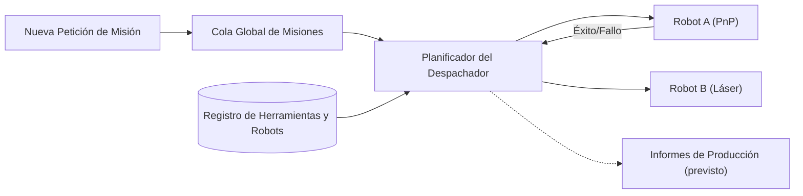

<!-- =============================================================================
HYDRA-UMC-JOB-DISPATCHER - Priority job dispatcher
Copyright (C) JuanenRac (Electro Hobby 3D) <electrohobby3d@gmail.com>
GPL-3.0-or-later - see LICENSE
============================================================================= -->

<p align="center">
  
</p>

# 🗂️ HYDRA-UMC-JOB-DISPATCHER

<p align="center"><a href="README.md">🇺🇸 English</a> | 🇪🇸 <b>Español</b> | <a href="README_fra.md">🇫🇷 Français</a> | <a href="README_ita.md">🇮🇹 Italiano</a> | <a href="README_deu.md">🇩🇪 Deutsch</a> | <a href="README_zho.md">🇨🇳 简体中文</a> | <a href="README_jpn.md">🇯🇵 日本語</a> | <a href="README_por.md">🇵🇹 Português</a></p>

### ⚙️ Cola de Misiones Basada en Prioridades para Flotas de Robots Heterogéneas

<p align="center">
  
  
  
  
  
  
</p>

---

> **Estado de seguridad física y de ciberseguridad:** este ecosistema no es un sistema de seguridad certificado. Todavía no existe una ruta de E-STOP por hardware, ni límites ni enclavamientos aplicados por el firmware, ni un comando de movimiento verificado; las imágenes de firmware se comprueban con CRC-32 y una firma Ed25519, y una compilación de versión rechaza las claves de desarrollo publicadas (los cabezales de herramienta y las placas de expansión detrás del relé siguen con cargadores de URTC, que usan un HMAC-SHA256 de clave compartida en lugar de una firma); TLS y TLS mutuo son opcionales y están desactivados por defecto; aún no se ha poblado ni probado ninguna placa propia. Lee la [línea base de seguridad](https://github.com/JuanenRac/HYDRA-UMC-DOCS/blob/main/docs/SECURITY_BASELINE.md) y el [modelo de amenazas](https://github.com/JuanenRac/HYDRA-UMC-DOCS/blob/main/docs/THREAT_MODEL.md) antes de fiarte de cualquier afirmación de aquí para la seguridad de una persona.

---

## 📋 De un vistazo

| | |
|---|---|
| Versión | `0.2.5` |
| Madurez | Funcional |
| Tests | 188 (`go test ./...`) |
| Tecnología | Go / priority queue / HTTP API / SQLite (modernc.org/sqlite, pure Go) |
| Destino | La Raspberry Pi CM5 de una celda HYDRA-UMC |
| En hardware real | Todavía no: no consta ninguna ejecución en hardware real para esta versión |

**Ir a:** [Resumen](#-resumen) · [Arquitectura](#-arquitectura) · [Funciones](#-funciones) · [Seguridad y protección](#-seguridad-y-protección) · [Interfaces](#-interfaces) · [Configuración](#-configuración) · [Inicio rápido](#-inicio-rápido) · [Pruebas](#-pruebas) · [Resolución de problemas](#-resolución-de-problemas) · [Estructura del repositorio](#-estructura-del-repositorio) · [Proyectos relacionados](#-proyectos-relacionados)

## 🚦 Estado del proyecto

Cada línea es una parte de este repositorio y la luz dice hasta dónde llega hoy. Se escribe con lo que el repositorio puede demostrar (pruebas, compilaciones, ejecuciones), no con lo previsto.

🟢 Hecho y verificado · 🟡 Funciona, con límites conocidos · 🟠 Hecho a medias o sin verificar · 🔴 Sin hacer o sin funcionar

| Área | Estado | Qué significa aquí |
|---|---|---|
| Software | 🟡 | Funciona para su propósito principal; la comprobación de honestidad de arriba lista lo que aún falta |
| Pruebas | 🟢 | 188 pruebas automáticas, ejecutadas en cada cambio |
| Hardware real | 🔴 | Todavía no: no consta ninguna ejecución en hardware real para esta versión |
| Documentación | 🟢 | README en ocho idiomas, comprobado contra el manifiesto en cada cambio |

## 🎯 Resumen

**HYDRA-UMC-JOB-DISPATCHER** es el motor de asignación de tareas del Orquestador. Gestiona una cola global de misiones, distribuyendo trabajos a robots individuales en función de su disponibilidad actual, ubicación y herramienta instalada (URTC).

Asegura que las tareas de alta prioridad (ej. "Reparación de Defecto de Emergencia") omitan el flujo de producción normal, y coordina secuencias de ensamblaje multi-paso que requieren que diferentes robots trabajen en tándem.

## 🧩 Papel en HYDRA-UMC

**HYDRA-UMC-JOB-DISPATCHER** decide qué robot recibe qué trabajo. Los clientes envían trabajos, los robots registran las herramientas que llevan y piden trabajo, y el despachador entrega el trabajo de mayor prioridad que encaja. No mueve ningún robot: lo que un robot hace con un trabajo es asunto suyo y de la puerta de trabajos del SDK.

## 🏛️ Arquitectura

<p align="center">
  
</p>

<details>
<summary>Versión en texto del diagrama (Mermaid)</summary>



</details>

**Por qué está hecho así**

* **Por qué la lógica real vive bajo `src/` y no en la raíz del repo.** `src/dispatcher` (el motor de planificación) y `src/api` (los handlers HTTP) contienen la implementación real; `main.go`/`version.go` siguen en la raíz como el punto de entrada que los conecta.
* **Por qué la asignación de trabajos comprueba la disponibilidad de herramienta vía URTC.** Un trabajo que necesita un cabezal de herramienta concreto solo es asignable a un robot cuyo cabezal controlado por URTC esté realmente presente e inactivo - comprobar esto antes de asignar (no después de una recogida fallida) evita que un robot llegue a una estación que en realidad no puede usar. `src/dispatcher.Engine.DispatchOnce` ya aplica esto hoy comparando `RequiredTool` contra `Robot.Tool` de forma exacta; todavía no habla con un URTC real por CAN para confirmar que el cabezal está físicamente conectado (el motor solo conoce lo que declara el registro del robot vía `POST /robots`).
* **El planificador, y ahora también la persistencia, son reales.** `src/dispatcher` implementa el algoritmo real que describe el diagrama "DISPATCHER FLOW" del README: una cola global ordenada por prioridad, enrutamiento consciente de herramienta, y dependencias multi-etapa (un trabajo se queda `blocked` hasta que todos sus `DependsOn` llegan a `done`). El estado de `Engine` siempre se mantuvo detrás de métodos exportados precisamente para que un almacén real pudiera sustituir lo que hay detrás de esos métodos más adelante sin cambiar a cada llamador - `NewEngineWithStore` (`src/sqlitestore`) es ese almacén: opcional, SQLite en Go puro, verificado de extremo a extremo contra un proceso real terminado y relanzado. Ver [`docs/API.md`](docs/API.md#persistence).
* **Por qué la API HTTP es JSON/HTTP plano, no gRPC.** Es una superficie de control orientada a humanos/operación (enviar un trabajo, registrar un robot, preguntar qué pasó) - `hydra.common.v1` (el contrato gRPC compartido del ecosistema, ver `HYDRA-UMC-ORCHESTRATOR/proto/`) queda reservado para el tráfico nodo-a-nodo, según el alcance ya documentado de ese proto.
* **Cómo encaja en el resto del ecosistema.** Un servicio hermano bajo HYDRA-UMC-ORCHESTRATOR - convierte decisiones a nivel de misión en asignaciones concretas de trabajo por robot. (Contrastar las asignaciones con la disponibilidad de herramienta de URTC y las rutas de HYDRA-UMC-PATH-PLANNER-3D está previsto, no implementado.)
* **Por qué `POST /jobs/submit` es una ruta nueva en vez de cambiar `POST /jobs`.** `AddJob()`/`POST /jobs` siempre insertan y fallan ante una colisión de ID - ese contrato de bajo nivel queda intacto. `SubmitJob()`/`POST /jobs/submit` añade deduplicación real y opcional encima vía `Job.DedupKey`: el mismo patrón usado en todo el ecosistema (un punto de entrada con verja añadido junto a una primitiva de bajo nivel sin tocar, no un cambio de comportamiento incrustado en ella).
* **Por qué un reintento tras un fallo reutiliza el mismo ID de job en vez de crear uno nuevo.** La alternativa - generar un job nuevo en cada reintento - dispersaría el historial de una única unidad lógica de trabajo entre varios IDs y no daría a quien llama forma de distinguir "esto falló una vez y se está reintentando" de "esto es trabajo nuevo sin relación". Reiniciar el job original a `Pending` mantiene todo su ciclo de vida (incluido el intento fallido) bajo un único ID.

**Trabajos desde una Operation.** `POST /jobs/submit` también acepta la Operation común del SDK (un cuerpo con `operation_id`), que es lo que entrega el planificador semántico: el id de la operación es el id del trabajo y también su clave de deduplicación, de modo que enviar de nuevo la misma operación es el mismo trabajo, y la `priority`, `required_tool`, `location` y `depends_on` de sus `params` son los del trabajo. Solo se acepta una operación en el estado `received`; cualquier otra es un `400`.

## ✨ Funciones

* 📋 **Colas Dinámicas:** Priorización e itineración inteligente de misiones.
* ⚖️ **Enrutamiento Consciente de Herramientas:** Enruta automáticamente los trabajos al robot con el cabezal URTC correcto.
* 🧰 **Catálogo de herramientas configurable (solo avisa):** `-tools-file` (una lista JSON con los nombres de los perfiles TOOL_* de los cabezales) y/o `-tools` declaran las herramientas que conoce la instalación. Un trabajo cuyo `RequiredTool`, o un robot cuyo `Tool`, no está en el catálogo se acepta igualmente y se registra una vez como aviso (con una pista si solo cambia la mayúscula, porque las herramientas coinciden exactamente). Sin catálogo nada cambia. *(implementado)*
* 🔄 **Misiones Multi-Etapa:** Gestiona dependencias entre tareas (ej. "Pick" debe ocurrir antes de "Place").
* 📡 **Persistencia:** estado de misión real y opcional respaldado por SQLite (`-db PATH`, `src/sqlitestore`, Go puro - sin CGO) - la cola sobrevive a un reinicio real del proceso, verificado de extremo a extremo; sin configurar, todo permanece en memoria. `GET /health` reporta un almacén degradado en vez de fallar en silencio. Ver [`docs/API.md`](docs/API.md#persistence).
* 🔁 **Envío Idempotente (v0):** Deduplicación real y opcional basada en `DedupKey` vía `POST /jobs/submit` - un reenvío de un job en curso o ya terminado se devuelve sin cambios, y un reintento tras un fallo real reutiliza el mismo ID de job en vez de ejecutar el trabajo dos veces. El orden por prioridad es determinista entre ejecuciones repetidas, cubierto por un test de regresión explícito.
* 🧯 **Seguro por defecto, y un robot que deja de responder no recibe trabajo (v0):** la API escucha en `127.0.0.1:8090` salvo que se indique otra cosa, y otra dirección exige un token bearer (`-token` / `JOB_DISPATCHER_TOKEN`; entonces todo salvo `GET /health` lo pide) o un `-allow-anonymous` explícito; el servidor HTTP tiene tiempos límite y los cuerpos de petición de más de 64 KB se rechazan con `413`. Un robot callado durante más de `-robot-timeout` (2 minutos por defecto) no recibe trabajo nuevo, un trabajo puede indicar una `location` preferida (`POST /jobs`, `POST /jobs/submit`; se prefieren los robots de esa ubicación, nunca se exige), y el último latido de cada robot se persiste (una base de datos de la versión anterior se migra en el sitio), así que un reinicio ya no oculta un robot que se calló. *(implementado)*
* 🗂️ **Escrituras atómicas, paginación y trabajos trazables:** una finalización, cancelación, reencolado o barrido de latidos caducados se escribe en SQLite en una sola transacción (la base funciona en modo WAL); `GET /jobs` se puede filtrar y paginar (`status`, `limit`, `offset`, `X-Total-Count`); cada trabajo lleva `SubmittedAtMs`, `AssignedAtMs`, `CompletedAtMs` y un contador `Attempt` que el informe de finalización puede devolver (`attempt`) para que se rechace el informe tardío de una asignación abandonada; `DELETE /robots/{id}` olvida un robot sin trabajo; no se fía de un latido de robot con fecha futura. Hay una descripción legible por máquinas en `docs/openapi.yaml`. *(implementado)*
* 🕒 **Por qué espera un trabajo:** `GET /dispatch/waiting` lista los trabajos pendientes en orden de despacho con el motivo por el que cada uno no tiene robot (ningún robot registrado, ningún robot con la herramienta, robots adecuados ocupados, robots adecuados en silencio, o un robot libre para la próxima pasada). Es de solo lectura; `POST /dispatch` sigue respondiendo la lista simple de asignaciones.
* ⏱️ **Tiempo estimado de cada trabajo (apagado por defecto):** con `-eta`, `GET /dispatch/eta` estima cuándo empieza y termina cada trabajo sin acabar, en qué robot y cuándo estará vacía la cola, a partir de lo que tardaron los últimos trabajos terminados de la misma herramienta (un valor por defecto configurable mientras no haya ninguno). Un trabajo que no se puede estimar dice por qué. Sin `-eta` la ruta no existe y nada más cambia; es de solo lectura y se prueba con un reloj inyectado.
* 🧾 **Un evento de producción por cada trabajo que termina (apagado por defecto):** con `-production-events` y un destino (`-production-events-file` para una línea JSON por evento, `-production-events-url` para un `POST` JSON), cada informe de que un trabajo terminó entrega un `ProductionEvent` del contrato compartido de HYDRA-UMC-SDK (robot, hora de fin, bueno o no, tiempo de ciclo, trabajo), que los informes de producción convierten en OEE. El evento se comprueba antes contra el contrato; un ciclo que no puede describir se omite y se registra, nunca se inventa, y un destino que falla nunca hace fallar el cierre del trabajo. Sin el interruptor no cambia nada; probado con un reloj inyectado.
* 🧭 **Robot más cercano, replanificación y rangos (todo apagado por defecto):** un fichero de configuración (`-config`) guarda los valores afinados y cada sección está apagada salvo que diga lo contrario: `location_costs` manda un trabajo que nombra una ubicación al robot con menor coste declarado hasta ella, `replan` (`POST /jobs/replan`, o por sí solo para un robot que dejó de contestar o falló) devuelve a la cola, en orden, los trabajos de un robot caído sin duplicar ni perder ninguno, y `eta_interval` añade un rango de menor a mayor (cuartiles de las duraciones recientes de la misma herramienta) junto a cada estimación, o dice por qué no puede. Sin el fichero nada cambia; probado con reloj inyectado y escenarios aleatorios con semilla.

## 🔒 Seguridad y protección

| Amenaza | Defensa | Dónde |
|---|---|---|
| Una API abierta a la red | Escucha en `127.0.0.1:8090`; cualquier otra dirección exige un token Bearer (`-token` o `JOB_DISPATCHER_TOKEN`) salvo que se dé `-allow-anonymous`; todas las rutas salvo `GET /health` lo piden, comparado en tiempo constante, y el rechazo es `401` con `WWW-Authenticate: Bearer` | `main.go`, `src/api/api.go` |
| Cuerpos grandes y conexiones lentas | Un cuerpo mide como máximo 64 KiB; la cabecera debe llegar en 5 s, la petición en 15 s, la respuesta se escribe en 30 s y una conexión inactiva se cierra a los 60 s | `src/api/api.go`, `main.go` |
| Trabajo dado a un robot que dejó de contestar o a una herramienta que no existe | Un robot callado más de `-robot-timeout` (2 minutos por defecto, `0` lo apaga) no recibe trabajo y sus trabajos pasan a desconocidos; un trabajo o robot que nombre una herramienta fuera de `-tools-file` / `-tools` se rechaza | `main.go`, `src/dispatcher/tools.go` |
| Un envío duplicado y un reinicio que pierde la cola | El envío es idempotente por la `DedupKey`; con `-db RUTA` la cola se guarda en un fichero SQLite en Go puro y sobrevive a un proceso matado y relanzado, sin ello la cola vive en memoria | `src/dispatcher`, `src/sqlitestore` |

**Lo que nunca hace:** no mueve ningún robot, y el encaminado por herramienta compara las cadenas que un robot dice de sí mismo: un robot que miente sobre su herramienta no se distingue, porque no se pregunta a URTC por CAN.

## 🔌 Interfaces

HTTP en `127.0.0.1:8090` por defecto; la referencia completa es `docs/API.md` y `docs/openapi.yaml`.

| Topic o ruta | Qué lleva |
|---|---|
| `/jobs`, `/jobs/submit`, `/jobs/{id}` | listar, enviar y leer trabajos |
| `/jobs/replan` | devolver a la cola los trabajos de un robot caído (solo si el fichero de configuración activa la replanificación; si no, 404) |
| `/jobs/complete`, `/jobs/cancel`, `/jobs/requeue`, `/jobs/detect-stale` | terminar, cancelar o reencolar un trabajo; encontrar los trabajos de robots callados |
| `/robots`, `/robots/{id}`, `/dispatch` | registrar un robot y sus herramientas; pedir el siguiente trabajo que encaje |
| `GET /health` | ¿está vivo el servicio? (abierta sin token) |

## ⚙️ Configuración

| Variable | Por defecto | Qué fija |
|---|---|---|
| `-addr` | `127.0.0.1:8090` | dónde escucha el servicio |
| `-token`, `JOB_DISPATCHER_TOKEN` | vacío | el token Bearer de la API |
| `-allow-anonymous` | `false` | permitir una dirección no loopback sin token |
| `-robot-timeout` | `2m` | silencio tras el cual un robot no recibe trabajo (`0` = apagado) |
| `-eta`, `JOB_DISPATCHER_ETA=1`, `-eta-default-duration`, `-eta-window` | apagado, `1m`, `20` | activar `GET /dispatch/eta` (inicio y fin estimados de cada trabajo sin acabar y de la cola); la duración supuesta hasta que termine un trabajo de la herramienta (`0` = sin suposición) y cuántos trabajos terminados recientes por herramienta se promedian |
| `-config`, `JOB_DISPATCHER_CONFIG` | vacío | un fichero JSON con los valores afinados de tres comportamientos opcionales, cada uno apagado salvo que el fichero lo active: `location_costs` (una tabla de costes entre ubicaciones; el trabajo va al robot de menor coste), `replan` (los trabajos de un robot caído o mudo vuelven a la cola) y `eta_interval` (un rango junto a cada estimación, necesita `-eta`) |
| `-production-events`, `JOB_DISPATCHER_PRODUCTION_EVENTS=1`, `-production-events-file`, `-production-events-url`, `-production-events-token` | apagado, vacío, vacío, vacío | entregar un `ProductionEvent` del contrato compartido por cada trabajo que termina: una línea JSON por evento en el fichero y/o un `POST` JSON a la URL (con el token bearer); el interruptor necesita al menos un destino |
| `-db` | vacío (memoria) | ruta del fichero SQLite que guarda la cola |
| `-tools-file`, `JOB_DISPATCHER_TOOLS_FILE`, `-tools`, `JOB_DISPATCHER_TOOLS` | vacío | la lista de herramientas que un trabajo o robot puede nombrar |
| `-max-body-bytes`, `-read-header-timeout`, `-read-timeout`, `-write-timeout`, `-idle-timeout` | `65536`, `5s`, `15s`, `30s`, `60s` | mayor cuerpo de petición en bytes (uno mayor recibe `413`) y los límites de tiempo del servidor HTTP; ninguno admite cero |

## 🚀 Inicio rápido

Requiere Go 1.21 o superior (el controlador de SQLite es Go puro, sin compilador de C) y Python 3 solo para las herramientas del proyecto.

```bash
bash run.sh        # Linux, macOS (run.bat on Windows)
go run . -addr 127.0.0.1:8090 -db jobs.sqlite3
curl http://127.0.0.1:8090/health
```

## 🧪 Pruebas

188 pruebas de Go se ejecutan con `go test ./...`; están junto al código (`src/api`, `src/dispatcher`, `src/sqlitestore` y `main_test.go`) e incluyen un proceso que se mata y se relanza sobre un fichero SQLite. Sin hardware ni red externa.

El CI ejecuta `HYDRA_UMC_CI=1 python tools/ci_validate.py`, que comprueba el manifiesto, los documentos, los ocho README y las imágenes.

## 🏗️ Compilación y publicación

Una cola de misiones con prioridad real y API HTTP, no solo un esqueleto
que compila.

```bash
# Windows
build.bat
run.bat -addr 127.0.0.1:8090

# Linux / macOS
./build.sh
./run.sh -addr 127.0.0.1:8090
```

`build.sh`/`build.bat` nunca cambian la versión (solo `python tools/hydra_project_tool.py bump` la sube) y luego ejecutan
`go build`. `run.sh`/`run.bat` ejecutan directamente el binario resultante.

```bash
# Registrar un robot, enviar un trabajo, despacharlo y marcarlo como hecho
curl -X POST localhost:8090/robots -d '{"id":"robot-a","tool":"PnP","available":true}'
curl -X POST localhost:8090/jobs   -d '{"id":"job-1","priority":5,"requiredTool":"PnP"}'
curl -X POST localhost:8090/dispatch -d '{}'
curl -X POST localhost:8090/jobs/complete -d '{"id":"job-1","success":true,"robotId":"robot-a"}'
curl localhost:8090/jobs
curl localhost:8090/robots
```

```bash
# Envío idempotente: una peticion reintentada con el mismo dedupKey
# nunca ejecuta el mismo job dos veces, aunque el cliente use un id distinto.
curl -X POST localhost:8090/jobs/submit -d '{"id":"job-2","priority":5,"requiredTool":"PnP","dedupKey":"req-abc"}'
# -> {"ID":"job-2", ..., "result":"created"}
curl -X POST localhost:8090/jobs/submit -d '{"id":"job-2-retry","priority":5,"requiredTool":"PnP","dedupKey":"req-abc"}'
# -> {"ID":"job-2", ..., "result":"duplicate"} - mismo job, sin cambios

# Tras un fallo real, un reintento con el mismo dedupKey reutiliza el ID de job-2:
curl -X POST localhost:8090/jobs/complete -d '{"id":"job-2","success":false,"robotId":"robot-a"}'
curl -X POST localhost:8090/jobs/submit -d '{"id":"job-2-retry-2","priority":5,"requiredTool":"PnP","dedupKey":"req-abc"}'
# -> {"ID":"job-2", "Status":"pending", ..., "result":"retried"}
```

```bash
go test ./...   # src/dispatcher (algoritmo de planificacion) +
                 # src/api (round-trips HTTP reales via httptest)
```

## 🩺 Resolución de problemas

| Ves | Porque | Haz |
|---|---|---|
| the service refuses to start | La dirección no es loopback y no se dio token | Da `-token` (o `JOB_DISPATCHER_TOKEN`) o `-allow-anonymous` si lo aceptas |
| `401` | La petición no trae token Bearer o trae uno erróneo | Envía `Authorization: Bearer <token>` |
| a job stays queued | Ningún robot registrado lleva la herramienta que nombra el trabajo, o el robot está callado | Registra un robot con esa herramienta y haz que siga pidiendo `/dispatch`; revisa `-robot-timeout` |
| the queue is empty after a restart | El servicio corrió sin `-db` | Arráncalo con `-db` apuntando a un fichero SQLite |

## 📂 Estructura del repositorio

<p align="center">
  
</p>

<details>
<summary>Versión en texto del árbol</summary>

```text
HYDRA-UMC-JOB-DISPATCHER/
├── src/
│   ├── dispatcher/                              la cola, el encaminado por herramienta, etapas, recuperación
│   ├── api/                                     la interfaz HTTP, token, límites
│   └── sqlitestore/                             cola duradera opcional (SQLite en Go puro)
├── docs/                                        la referencia de la API y el fichero OpenAPI
├── systemd/                                     unidad de servicio para la CM5
├── tools/                                       ejecutor de compilación y pruebas, subida de versión, validador de CI, generadores y comprobaciones de README e imágenes
├── images/                                      banner y las imágenes del README
├── .github/                                     flujo de CI y plantillas de incidencias
├── hydra-umc.project.json                       manifiesto: versión, madurez, familia
├── CHANGELOG.md                                 qué cambió en cada versión
├── build.sh build.bat                           scripts de compilación (nunca cambian la versión)
├── build-test.sh build-test.bat                 scripts de compilación (nunca cambian la versión)
├── test.sh test.bat                             ejecutan las pruebas
├── main.go / version.go                         punto de entrada, opciones y la versión
├── main_test.go                                 pruebas del punto de entrada
├── server_limits.go / server_limits_test.go     los límites de tiempo y tamaño del servidor HTTP, y sus pruebas
├── go.mod / go.sum                              módulo de Go y sumas
├── bump_version.py / bump_manifest_version.py   subida de versión explícita
├── run.sh run.bat                               arrancar el servicio
└── SECURITY.md SUPPORT.md CONTRIBUTING.md CODE_OF_CONDUCT.md LICENSE LICENSE.md
```

</details>

## 🗺️ Hoja de ruta y límites conocidos

**Límites conocidos hoy**

* **Fase 1:** Sincronización determinista de enjambre sobre TSN y reducción de jitter sub-ms.
* **Fase 2:** Planificación de trayectorias 3D con evitación dinámica de obstáculos en celdas multi-robot.
* **Fase 3:** Optimización del despacho de trabajos multi-robot utilizando disponibilidad de recursos en tiempo real.
* **Fase 4:** Estimación de duración de trabajos impulsada por IA para una mejor planificación y coordinación de flotas heterogéneas.

## 🌍 Idiomas

Este README y los documentos del repositorio existen en ocho idiomas: inglés, español, alemán, francés, italiano, japonés, chino y portugués (Portugal). Se escriben a la vez y el CI comprueba que los ocho ficheros tengan las mismas secciones y los mismos enlaces. Este repositorio no tiene pantalla ni catálogo de mensajes propios, así que no hay cadenas de interfaz que traducir.

## 🔗 Proyectos relacionados

Este proyecto es parte del ecosistema de robótica HYDRA-UMC del mismo autor (JuanenRac / Electro Hobby 3D). Vale la pena conocerlo, ya que una petición podría en realidad ser sobre alguno de estos en vez de sobre este repositorio.

**Proyecto Padre**
- **[HYDRA-UMC-ORCHESTRATOR](https://github.com/JuanenRac/HYDRA-UMC-ORCHESTRATOR)** — nodo de integración con un contrato real de informe de salud gRPC/Protobuf y una máquina de estados de misión; el padre del que este repositorio es un servicio de orquestación específico, dentro de su propia capa de coordinación de enjambre.

**Proyectos Hermanos** — los demás servicios de orquestación de la propia capa de coordinación de enjambre de HYDRA-UMC-ORCHESTRATOR
- **[HYDRA-UMC-SWARM-SYNC](https://github.com/JuanenRac/HYDRA-UMC-SWARM-SYNC)** — sincronización de estado real mediante CRDT LWW-Element-Map, con pruebas de propiedades para convergencia multi-celda.
- **[HYDRA-UMC-PATH-PLANNER-3D](https://github.com/JuanenRac/HYDRA-UMC-PATH-PLANNER-3D)** — planificador de rutas 3D real basado en RRT, con validación real de colisión de obstáculos/espacio de trabajo.
- **[HYDRA-UMC-NODE-HEALING](https://github.com/JuanenRac/HYDRA-UMC-NODE-HEALING)** — watchdog de salud de flota real basado en gRPC, con reintento/backoff y detección de discrepancia de identidad.

**Directamente Relacionados**
- **[URTC](https://github.com/JuanenRac/URTC)** — firmware para la placa física del Universal Robot Tool Controller, más de 25 perfiles de herramienta por bus CAN — asigna trabajos según cuál de los propios cabezales de herramienta de URTC está realmente disponible.
- **[HYDRA-UMC-PRODUCTION-REPORTS](https://github.com/JuanenRac/HYDRA-UMC-PRODUCTION-REPORTS)** — cálculo real de OEE/disponibilidad sobre el histórico de DATALAKE, con exportación CSV reproducible — el destino previsto para los registros de finalización de misión; este despachador es la fuente real prevista de sus propios datos OEE `production_event` una vez que las finalizaciones estén conectadas para escribirlos (aún no implementado, seguimiento en el propio proyecto).

**También Forma Parte del Ecosistema**

*Hardware y Plataforma Base*
- **[HYDRA-UMC](https://github.com/JuanenRac/HYDRA-UMC)** — el diseño de la placa madre del brazo robótico: host CM5 + coprocesador STM32H745 de doble núcleo, pensado para coordinar hasta 8 brazos herramienta por CAN-OTA/SPI-OTA (firmware en fase temprana; todavía no hay ninguna placa poblada).
- **[HYDRA-UMC-OS](https://github.com/JuanenRac/HYDRA-UMC-OS)** — capa de producto reproducible sobre Raspberry Pi OS para el CM5: agente de solo lectura, config/perfiles validados, aprovisionamiento WiFi de primer contacto.
- **[HYDRA-UMC-SDK](https://github.com/JuanenRac/HYDRA-UMC-SDK)** — el contrato JSON-Schema compartido y la barrera de software de puerta de trabajos contra la que cada bridge valida sus comandos (no es una función de seguridad certificada).
- **[HYDRA-UMC-CONNECTOR-HUB](https://github.com/JuanenRac/HYDRA-UMC-CONNECTOR-HUB)** — registro declarativo y validador de manifiestos de adaptador para conectores de máquinas externas; extiende la propia idea de contrato del SDK a máquinas externas sin sustituir a los proyectos de pasarela industrial.

*Backend Central y Clientes*
- **[HYDRA-UMC-SERVER](https://github.com/JuanenRac/HYDRA-UMC-SERVER)** — el backend headless real (REST/WebSocket) con el que habla de verdad cada cliente de control.
- **[HYDRA-UMC-STUDIO](https://github.com/JuanenRac/HYDRA-UMC-STUDIO)** — panel de control web con visualización 3D multi-robot en tiempo real.
- **[HYDRA-UMC-SUITE](https://github.com/JuanenRac/HYDRA-UMC-SUITE)** — centro de mando de enjambre de escritorio (PySide6) para varios servidores a la vez, empaquetado como ejecutable independiente.
- **[HYDRA-UMC-ANDROID-CONTROL](https://github.com/JuanenRac/HYDRA-UMC-ANDROID-CONTROL)** — app nativa de control para Android con inicio de sesión biométrico y un compañero Wear OS emparejado.
- **[HYDRA-UMC-IOS-CONTROL](https://github.com/JuanenRac/HYDRA-UMC-IOS-CONTROL)** — app de control para iOS/iPadOS (Flutter) con sincronización en tiempo real por WebSocket.
- **[HYDRA-UMC-DSI](https://github.com/JuanenRac/HYDRA-UMC-DSI)** — interfaz táctil nativa para la pantalla táctil DSI de 7" a bordo, embebida en el propio CM5.
- **[HYDRA-UMC-EDITOR-URDF](https://github.com/JuanenRac/HYDRA-UMC-EDITOR-URDF)** — creador/editor gráfico de URDF de escritorio que envía los modelos terminados al propio catálogo de STUDIO.
- **[HYDRA-UMC-EDITOR-STL](https://github.com/JuanenRac/HYDRA-UMC-EDITOR-STL)** — editor de escritorio de modelos STL, que transforma/reemplaza/quita/añade piezas reales en el mismo catálogo de modelos que también edita HYDRA-UMC-EDITOR-URDF.
- **[HYDRA-UMC-BRIDGE-AMR](https://github.com/JuanenRac/HYDRA-UMC-BRIDGE-AMR)** — barrera de coordinación para flotas AGV/AMR mediante un publicador MQTT VDA 5050 (probado solo contra una flota emulada).
- **[HYDRA-UMC-BRIDGE-CNC](https://github.com/JuanenRac/HYDRA-UMC-BRIDGE-CNC)** — coordinador de alto nivel para celdas CNC con acceso a estado/bytes de control GRBL (probado solo contra un emulador).
- **[HYDRA-UMC-BRIDGE-DROIDS](https://github.com/JuanenRac/HYDRA-UMC-BRIDGE-DROIDS)** — barrera de coordinación para droides con patas/humanoides, con un emisor de comandos para Boston Dynamics Spot (probado solo contra un emulador).
- **[HYDRA-UMC-BRIDGE-LASER](https://github.com/JuanenRac/HYDRA-UMC-BRIDGE-LASER)** — coordinador de celdas láser que lee 3 señales GPIO de llave/carcasa/enclavamiento (probado solo contra un chip simulado; no puede armar ni disparar un láser).
- **[HYDRA-UMC-BRIDGE-OPENPNP](https://github.com/JuanenRac/HYDRA-UMC-BRIDGE-OPENPNP)** — coordinador de alto nivel seguro para el flujo de placas de pick-and-place OpenPnP.
- **[HYDRA-UMC-BRIDGE-PRINTER3D](https://github.com/JuanenRac/HYDRA-UMC-BRIDGE-PRINTER3D)** — barrera de coordinación segura para impresoras 3D Moonraker/Klipper, con comandos de trabajo reales y controlados.
- **[HYDRA-UMC-BRIDGE-ROS2](https://github.com/JuanenRac/HYDRA-UMC-BRIDGE-ROS2)** — coordinador con un transporte ROS 2 rclpy importado de forma perezosa (todavía no ejecutado contra una instalación de ROS 2).
- **[HYDRA-UMC-BRIDGE-UAV](https://github.com/JuanenRac/HYDRA-UMC-BRIDGE-UAV)** — barrera de coordinación para UAV equipados con cámara, con un emisor de comandos MAVLink (probado solo contra un emulador).

*Plataforma de Herramientas URTC*
- **[URTC-FLASHER](https://github.com/JuanenRac/URTC-FLASHER)** — herramienta de escritorio con GUI para flashear placas URTC, CAN-OTA más SWD/JTAG de chip completo.
- **[URTC-TESTER](https://github.com/JuanenRac/URTC-TESTER)** — herramienta de escritorio de diagnóstico CAN-bus en vivo para placas URTC, un panel por perfil de herramienta.
- **[URTC-WEB-STUDIO](https://github.com/JuanenRac/URTC-WEB-STUDIO)** — alternativa basada en navegador a URTC-TESTER mediante la Web Serial API, sin instalación local.
- **[URTC-GATEWAY](https://github.com/JuanenRac/URTC-GATEWAY)** — pasarela delante del bus CAN de URTC: lista de identificadores permitidos, límite de tasa y clave de sesión; software probado en ordenador, aún no en un bus real.

*Nodo IA de Visión (Hailo-8)*
- **[HYDRA-UMC-VISION-NODE](https://github.com/JuanenRac/HYDRA-UMC-VISION-NODE)** — nodo de integración para el pipeline de visión Hailo-8, con una comprobación real de disponibilidad de hardware por etapa.
- **[HYDRA-UMC-DETECTION-HEF](https://github.com/JuanenRac/HYDRA-UMC-DETECTION-HEF)** — registro real de modelos compilados con verificación de carga segura por arquitectura Hailo/checksum.
- **[HYDRA-UMC-VISION-STREAMER](https://github.com/JuanenRac/HYDRA-UMC-VISION-STREAMER)** — generador real de pipeline GStreamer + config MediaMTX, con una frontera de integración HailoRT real.
- **[HYDRA-UMC-VISUAL-SERVOING-API](https://github.com/JuanenRac/HYDRA-UMC-VISUAL-SERVOING-API)** — ley de corrección Position-Based Visual Servoing con autorización condicionada al estado de zona; todavía sin estimación de pose por cámara.
- **[HYDRA-UMC-SAFETY-ZONES](https://github.com/JuanenRac/HYDRA-UMC-SAFETY-ZONES)** — lógica v0 de invasión de zona, vigencia de calibración y solicitud de E-STOP que toma las posiciones de los objetos de un fichero; ningún detector la alimenta y todavía no hay un E-STOP físico conectado.

*Nodo IA Cognitivo (Hailo-10)*
- **[HYDRA-UMC-COGNITIVE-NODE](https://github.com/JuanenRac/HYDRA-UMC-COGNITIVE-NODE)** — nodo de integración para el pipeline cognitivo Hailo-10 (orquestación de LLM/VLA/voz).
- **[HYDRA-UMC-VLA-ENGINE](https://github.com/JuanenRac/HYDRA-UMC-VLA-ENGINE)** — codificación/decodificación real de tokens de acción y generación de trayectoria para un modelo Vision-Language-Action.
- **[HYDRA-UMC-VOICE-UI](https://github.com/JuanenRac/HYDRA-UMC-VOICE-UI)** — front-end de voz real (VAD + analizador de intención) con un relé a Watch acotado y con confirmación.
- **[HYDRA-UMC-SEMANTIC-PLANNER](https://github.com/JuanenRac/HYDRA-UMC-SEMANTIC-PLANNER)** — descomposición real de tareas basada en reglas y recuperación semántica de errores sobre códigos de error del MCU.
- **[HYDRA-UMC-DOCS-QA](https://github.com/JuanenRac/HYDRA-UMC-DOCS-QA)** — búsqueda real de documentos TF-IDF (solo librería estándar) sobre los propios documentos Markdown de este ecosistema.
- **[HYDRA-UMC-LOCAL-TECHNICIAN](https://github.com/JuanenRac/HYDRA-UMC-LOCAL-TECHNICIAN)** — técnico de mantenimiento con IA local y con puertas de política para el propio ecosistema - observa, diagnostica y propone arreglos; los dos niveles de riesgo más altos están deliberadamente sin implementar todavía.

*Gemelo Digital y Simulación*
- **[HYDRA-UMC-TWIN](https://github.com/JuanenRac/HYDRA-UMC-TWIN)** — nodo de integración para el motor de gemelo digital, con un contrato real de sincronización por compatibilidad de versión.
- **[HYDRA-UMC-HIL-BRIDGE](https://github.com/JuanenRac/HYDRA-UMC-HIL-BRIDGE)** — enrutador hardware-in-the-loop con un enclavamiento de software por colisión entre simulación y hardware real (probado sin hardware real).
- **[HYDRA-UMC-PHYSICS-REPLICA](https://github.com/JuanenRac/HYDRA-UMC-PHYSICS-REPLICA)** — cinemática directa real y validación de límites articulares sobre un subconjunto real de URDF.
- **[HYDRA-UMC-SYNTHETIC-DATA-GEN](https://github.com/JuanenRac/HYDRA-UMC-SYNTHETIC-DATA-GEN)** — generador real de escenas 2D procedurales con exportación de anotaciones YOLO/COCO.

*Datos y Analítica*
- **[HYDRA-UMC-DATALAKE](https://github.com/JuanenRac/HYDRA-UMC-DATALAKE)** — almacén de series temporales real respaldado por sqlite3, con una API HTTP real de ingesta/consulta.
- **[HYDRA-UMC-ANOMALY-DETECTOR](https://github.com/JuanenRac/HYDRA-UMC-ANOMALY-DETECTOR)** — detector de anomalías real basado en FFT + línea base estadística, con monitorización de deriva.
- **[HYDRA-UMC-TELEMETRY-COLLECTOR](https://github.com/JuanenRac/HYDRA-UMC-TELEMETRY-COLLECTOR)** — pipeline real de ingesta CAN/WebSocket hacia DATALAKE, con deduplicación por secuencia.

*Pasarela Industrial*
- **[HYDRA-UMC-GATEWAY-INDUSTRIAL](https://github.com/JuanenRac/HYDRA-UMC-GATEWAY-INDUSTRIAL)** — nodo de integración que retransmite a protocolos industriales, con una capa real de lista blanca de comandos/contrapresión.
- **[HYDRA-UMC-OPCUA-SERVER](https://github.com/JuanenRac/HYDRA-UMC-OPCUA-SERVER)** — espacio de direcciones OPC-UA real, verificado con una sesión de cliente real del protocolo binario.
- **[HYDRA-UMC-MQTT-BROKER](https://github.com/JuanenRac/HYDRA-UMC-MQTT-BROKER)** — broker MQTT real con autenticación por cliente opcional y ACL de tópicos.
- **[HYDRA-UMC-MTCONNECT-ADAPTER](https://github.com/JuanenRac/HYDRA-UMC-MTCONNECT-ADAPTER)** — endpoints XML reales `/probe` y `/current` de MTConnect, con salida en modo degradado.

*Herramientas Complementarias y Operaciones del Ecosistema*
- **[HYDRA-UMC-DASHBOARD-AI](https://github.com/JuanenRac/HYDRA-UMC-DASHBOARD-AI)** — paneles de Resúmenes Inteligentes y Resaltado de Anomalías sobre DATALAKE/ANOMALY-DETECTOR, con un respaldo estadístico honesto.
- **[HYDRA-UMC-TOOL-CLI](https://github.com/JuanenRac/HYDRA-UMC-TOOL-CLI)** — CLI de flota con un contrato real y estable de códigos de salida, cliente real y en vivo de la propia API de HYDRA-UMC-SERVER.
- **[HYDRA-UMC-WATCH](https://github.com/JuanenRac/HYDRA-UMC-WATCH)** — app compañera de WearOS con patrones de alerta háptica y un relé de voz al teléfono emparejado (todavía no ejecutada en un reloj físico).
- **[URTC-SMART-RACK](https://github.com/JuanenRac/URTC-SMART-RACK)** — firmware para un rack de montaje de placas con decodificación real de ID de herramienta y lógica de precalentamiento Smart Idle.
- **[URTC-VISION-TOOL](https://github.com/JuanenRac/URTC-VISION-TOOL)** — firmware más un compañero de visión real en Python para un cabezal de inspección térmica/RGB.
- **[HYDRA-UMC-UPDATER](https://github.com/JuanenRac/HYDRA-UMC-UPDATER)** — herramienta administrativa de escritorio que descubre, clona y actualiza cada repositorio de este ecosistema.
- **[HYDRA-UMC-OS-REBUILDER](https://github.com/JuanenRac/HYDRA-UMC-OS-REBUILDER)** — herramienta de escritorio Windows/Linux que construye una imagen de la CM5 lista para grabar, precargada con las versiones más actuales del ecosistema, con configuración de primer arranque de Wi-Fi/usuario/SSH al estilo de Raspberry Pi Imager.
- **[HYDRA-UMC-OPS-AGENT](https://github.com/JuanenRac/HYDRA-UMC-OPS-AGENT)** — coordinador de incidencias de mantenimiento: un rol edge de bajo privilegio recopila un snapshot de inventario/salud saneado, un rol control-plane lo renderiza de solo lectura y pide a un proveedor de IA que sugiera un diagnóstico - nunca aplica un parche ni despliega nada.
- **[HYDRA-UMC-DEV-SERVER](https://github.com/JuanenRac/HYDRA-UMC-DEV-SERVER)** — host de desarrollo reproducible (Raspberry Pi 5 / CM5) que almacena el código del ecosistema y ejecuta tareas acotadas de compilación/pruebas bajo una cola duradera; un rol de desarrollo dedicado, explícitamente distinto de un CM5 operativo.

## 📚 Documentación

Dónde leer más:

* [docs/API.md](docs/API.md) - cada ruta, sus campos y sus errores
* [docs/openapi.yaml](docs/openapi.yaml) - la misma API como fichero OpenAPI
* [Base de seguridad del ecosistema](https://github.com/JuanenRac/HYDRA-UMC-DOCS/blob/main/docs/SECURITY_BASELINE.md)
* [Modelo de amenazas del ecosistema](https://github.com/JuanenRac/HYDRA-UMC-DOCS/blob/main/docs/THREAT_MODEL.md)
* [Historial de cambios de este repositorio](CHANGELOG.md)
* [Licencia de este repositorio](LICENSE.md)

## 🤝 Contribuir y comunidad

* Antes de un pull request ejecuta `HYDRA_UMC_CI=1 py -3 tools/ci_validate.py` (o `HYDRA_UMC_CI=1 python3 tools/ci_validate.py`): debe imprimir `CI_VALIDATION=PASS`. No ejecutes `build.sh` ni `build.bat` para esta comprobación; compilar no es comprobar.
* Los ocho README se escriben desde una sola fuente en HYDRA-UMC-DOCS; no los edites a mano. Cambia la fuente y vuelve a escribirlos con `tools/make_readmes.py`.
* No afirmes en un README lo que no se ha ejecutado: di «simulado» o «sin probar en hardware» cuando esa sea la verdad.
* Mira [CONTRIBUTING.md](CONTRIBUTING.md), el [código de conducta](CODE_OF_CONDUCT.md), [SECURITY.md](SECURITY.md) y [SUPPORT.md](SUPPORT.md).

## 👤 AUTOR

**JuanenRac (Electro Hobby 3D)** · electrohobby3d@gmail.com

## 📜 LICENCIA

GPL-3.0-or-later - [LICENSE](LICENSE).
