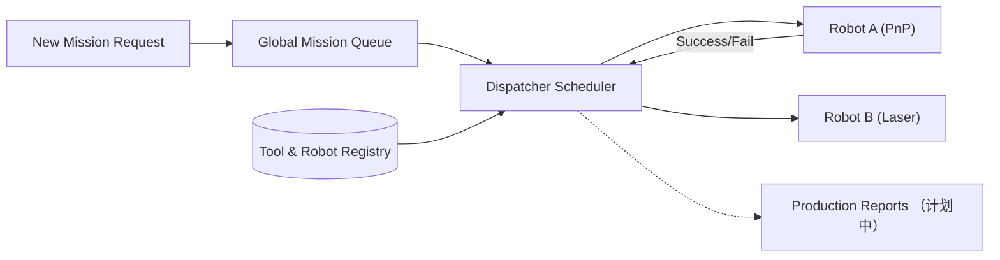

<!-- =============================================================================
HYDRA-UMC-JOB-DISPATCHER - Priority job dispatcher
Copyright (C) JuanenRac (Electro Hobby 3D) <electrohobby3d@gmail.com>
GPL-3.0-or-later - see LICENSE
============================================================================= -->

<p align="center">
  
</p>

# 🗂️ HYDRA-UMC-JOB-DISPATCHER

<p align="center"><a href="README.md">🇺🇸 English</a> | <a href="README_spa.md">🇪🇸 Español</a> | <a href="README_fra.md">🇫🇷 Français</a> | <a href="README_ita.md">🇮🇹 Italiano</a> | <a href="README_deu.md">🇩🇪 Deutsch</a> | 🇨🇳 <b>简体中文</b> | <a href="README_jpn.md">🇯🇵 日本語</a> | <a href="README_por.md">🇵🇹 Português</a></p>

### ⚙️ 面向异构机器人车队的基于优先级的任务队列

<p align="center">
  
  
  
  
  
  
</p>

---

> **安全与安防现状:**本生态系统不是经认证的安全系统。目前尚无硬件 E-STOP 通路,没有由固件强制执行的限位或联锁,也没有经过验证的运动指令;固件映像使用 CRC-32 和 Ed25519 签名校验,发布构建会拒绝已公开的开发密钥(中继之后的工具头和扩展板仍运行 URTC 的引导程序,它们使用共享密钥的 HMAC-SHA256 而不是签名);TLS 与双向 TLS 均为可选项,默认关闭;自制电路板尚未组装或测试。在依赖此处任何说法来保障人身安全之前,请先阅读[安全基线](https://github.com/JuanenRac/HYDRA-UMC-DOCS/blob/main/docs/SECURITY_BASELINE.md)和[威胁模型](https://github.com/JuanenRac/HYDRA-UMC-DOCS/blob/main/docs/THREAT_MODEL.md)。

---

## 📋 速览

| | |
|---|---|
| 版本 | `0.2.5` |
| 成熟度 | 可用 |
| 测试 | 188 (`go test ./...`) |
| 技术栈 | Go / priority queue / HTTP API / SQLite (modernc.org/sqlite, pure Go) |
| 目标 | HYDRA-UMC 工作单元的 Raspberry Pi CM5 |
| 真实硬件 | 尚未：此版本没有在真实硬件上运行的记录 |

**跳转：** [概述](#-概述) · [架构](#-架构) · [功能](#-功能) · [安全与防护](#-安全与防护) · [接口](#-接口) · [配置](#-配置) · [快速开始](#-快速开始) · [测试](#-测试) · [故障排除](#-故障排除) · [仓库结构](#-仓库结构) · [相关项目](#-相关项目)

## 🚦 项目状态

每一行是本仓库的一个部分，灯号表示它今天做到了哪一步。内容依据仓库能够展示的证据（测试、构建、运行），而不是计划。

🟢 已完成并验证 · 🟡 可用，有已知限制 · 🟠 部分完成或尚未验证 · 🔴 未完成或不可用

| 领域 | 状态 | 在这里的含义 |
|---|---|---|
| 软件 | 🟡 | 主要用途可用；上面的诚实性检查列出了仍然缺少的内容 |
| 测试 | 🟢 | 188 项自动测试，每次变更都会运行 |
| 真实硬件 | 🔴 | 尚未：此版本没有在真实硬件上运行的记录 |
| 文档 | 🟢 | 八种语言的 README，每次变更都会与清单核对 |

## 🎯 概述

**HYDRA-UMC-JOB-DISPATCHER** 是编排器的任务分配引擎。它管理一个全局任务
队列，根据每个机器人当前的可用性、位置和所安装的工具（URTC），将任务分
发给各个机器人。

它确保高优先级任务（例如"紧急缺陷修复"）能够绕过正常的生产流程，并协调
需要不同机器人协同工作的多步骤装配序列。

## 🧩 在 HYDRA-UMC 中的角色

**HYDRA-UMC-JOB-DISPATCHER** 决定哪个机器人接哪个任务。客户端提交任务，机器人登记自带的工具并索取任务，调度器把适合的最高优先级任务交出去。它不移动机器人：机器人如何处理任务是其自身和 SDK 任务关口的事。

## 🏛️ 架构

<p align="center">
  
</p>

<details>
<summary>图表的文本版本（Mermaid）</summary>



</details>

**为什么这样构建**

* **为何真正的逻辑位于 `src/` 之下，而非仓库根目录。** `src/dispatcher`（调度引擎）和 `src/api`（HTTP 处理器）包含实际实现；`main.go`/`version.go` 仍留在仓库根目录，作为将它们连接起来的入口点。
* **为何任务分配会通过 URTC 检查工具可用性。** 需要特定刀头的任务只能被分发给实际装有相应 URTC 控制刀头且处于空闲状态的机器人——在分发前（而非在拾取失败后）进行此项检查，可以避免机器人到达一个它实际上无法使用的工位。`src/dispatcher.Engine.DispatchOnce` 现在已通过精确匹配 `RequiredTool`/`Robot.Tool` 来实现这一点；它尚未通过 CAN 与真实的 URTC 通信以确认刀头确实已物理连接（引擎只知道机器人注册时声明的内容——见 `src/api` 的 `POST /robots`）。
* **调度器如今真实可用，持久化现在也是。** `src/dispatcher` 实现了 README 中 "DISPATCHER FLOW" 图所描述的真实算法：一个按优先级排序的全局队列、工具感知的路由，以及多阶段依赖关系（一个任务会保持 `blocked` 状态，直到其 `DependsOn` 中的每个任务都达到 `done`）。`Engine` 的状态一直保持在导出的方法背后，正是为了日后能用真实的存储替换这些方法背后的内容，而无需改动每个调用者——`NewEngineWithStore`(`src/sqlitestore`)正是这个存储：可选、纯 Go 实现的 SQLite,针对一个真实的、被终止后重新启动的进程完成了端到端验证。详见 [`docs/API.md`](docs/API.md#persistence)。
* **为何 HTTP API 是普通的 JSON/HTTP，而非 gRPC。** 这是一个面向人员/运维的控制平面（提交任务、注册机器人、查询发生了什么）——`hydra.common.v1`（生态系统共享的 gRPC 契约，见 `HYDRA-UMC-ORCHESTRATOR/proto/`）仍保留给节点对节点的流量，符合该 proto 自身已文档化的范围。
* **这如何融入生态系统的其余部分。** 作为 HYDRA-UMC-ORCHESTRATOR 下的同级服务——将任务级决策转化为具体的、按机器人分配的工作。（对照 URTC 工具可用性和 HYDRA-UMC-PATH-PLANNER-3D 路线检查分配，目前仅为计划，尚未实现。）
* **为何 `POST /jobs/submit` 是一个新路由，而不是修改 `POST /jobs`。** `AddJob()`/`POST /jobs` 始终执行插入，并在 ID 冲突时报错——这个底层契约保持不变。`SubmitJob()`/`POST /jobs/submit` 通过 `Job.DedupKey` 在其之上叠加了真实的、可选的去重——这与整个生态系统中使用的模式相同（在不变的底层原语旁边添加一个受保护的新入口点，而不是把行为改动强加在它身上）。
* **为何失败后的重试复用同一个任务 ID，而不是新建一个。** 另一种做法——每次重试都生成一个新任务——会把同一个逻辑工作单元的历史分散到多个 ID 上，调用方也无法分辨“这次失败了一次、正在重试”和“这是一项无关的新工作”。将原始任务重置为 `Pending`，可以让它整个生命周期（包括失败的那次尝试）都保留在同一个 ID 之下。

**由 Operation 创建作业。** `POST /jobs/submit` 也接受 SDK 通用的 Operation（带有 `operation_id` 的请求体），这正是语义规划器交付的内容：操作的 id 既是作业的 id，也是它的去重键，因此重复提交同一个操作得到的还是同一个作业；其 `params` 中的 `priority`、`required_tool`、`location` 和 `depends_on` 就是作业的对应值。只接受状态为 `received` 的操作，其他情况返回 `400`。

## ✨ 功能

* 📋 **动态队列：** 智能任务优先级排序与调度。
* ⚖️ **工具感知路由：** 自动将任务路由到装有正确 URTC 刀头的机器人。
* 🧰 **可配置的工具目录（仅告警）：** `-tools-file`（工具头 TOOL_* 配置文件名称的 JSON 列表）和/或 `-tools` 声明安装环境所知的工具。`RequiredTool` 或 `Tool` 不在目录中的作业/机器人仍会被接受，并只记录一次警告（因为工具名称必须完全匹配，仅大小写不同时会给出提示）。没有目录时一切照旧。*(已实现)*
* 🔄 **多阶段任务：** 管理任务之间的依赖关系（例如"抓取"必须先于"放置"发生）。
* 📡 **持久化：** 真实的、可选的 SQLite 持久化任务状态(`-db PATH`、`src/sqlitestore`,纯 Go,无需 CGO)——队列在真实的进程重启后依然存活,已端到端验证;未设置时则保持纯内存运行。`GET /health` 会报告存储降级,而不是静默失败。详见 [`docs/API.md`](docs/API.md#persistence)。
* 🔁 **幂等提交（v0）：** 通过 `POST /jobs/submit` 实现真实的、可选的基于 `DedupKey` 的去重——重新提交一个进行中或已完成的任务会原样返回，而在真实失败后的重试会复用同一个任务 ID，而不是把工作执行两次。优先级顺序在重复运行之间是确定性的，由一个明确的回归测试覆盖。
* 🧯 **默认安全，停止响应的机器人不会再被派活（v0）：** API 默认只监听 `127.0.0.1:8090`，使用其他地址需要 bearer 令牌（`-token` / `JOB_DISPATCHER_TOKEN`；设置后除 `GET /health` 外的所有路由都要求它）或显式的 `-allow-anonymous`；HTTP 服务器有超时限制，超过 64 KB 的请求体会被以 `413` 拒绝。静默时间超过 `-robot-timeout`（默认 2 分钟）的机器人不会再被分配新工作，作业可以指定首选的 `location`（`POST /jobs`、`POST /jobs/submit`；优先选择该位置的机器人，但不是硬性要求），每个机器人的最后一次心跳都会被持久化（上一版本的数据库会就地迁移），因此重启不再会掩盖已经沉默的机器人。*（已实现）*
* 🗂️ **原子写入、分页与可追踪的任务：** 完成、取消、重新排队或清扫过期心跳都在一个事务中写入 SQLite（数据库使用 WAL 模式）；`GET /jobs` 可以过滤并分页（`status`、`limit`、`offset`、`X-Total-Count`）；每个任务带有 `SubmittedAtMs`、`AssignedAtMs`、`CompletedAtMs` 以及完成报告可回传的 `Attempt` 计数器（`attempt`），因此被放弃的分配迟到的报告会被拒绝；`DELETE /robots/{id}` 会忘记没有任务的机器人；日期在未来的机器人心跳不被信任。机器可读的描述见 `docs/openapi.yaml`。 *(已实现)*
* 🕒 **作业为什么在等待:** `GET /dispatch/waiting` 按派发顺序列出待处理作业，并给出每个作业没有机器人的原因(没有注册机器人、没有带该工具的机器人、匹配的机器人都在忙、匹配的机器人长时间没有回应，或有机器人空闲、等待下一轮派发)。它是只读的；`POST /dispatch` 仍然返回原来的分配列表。
* ⏱️ **每个作业的预计时间(默认关闭):** 加上 `-eta` 后,`GET /dispatch/eta` 会根据同一工具最近已完成作业的耗时(尚无记录时使用可配置的默认值),估算每个未完成作业何时开始和结束、由哪台机器人执行,以及队列何时清空。无法估算的作业会说明原因。不加 `-eta` 时该路由不存在,其他一切不变;它是只读的,并用注入的时钟进行测试。
* 🧾 **每个结束的作业都会生成一个生产事件(默认关闭):** 加上 `-production-events` 和目标(`-production-events-file` 每个事件一行 JSON,`-production-events-url` 发送 JSON `POST`)后,每次收到作业结束的报告都会交出一个 HYDRA-UMC-SDK 共享合约的 `ProductionEvent`(机器人、结束时间、是否合格、周期时间、作业),生产报告会据此计算 OEE。事件先按合约检查;合约无法描述的周期会被跳过并记录,绝不捏造,目标出错也不会使结束操作失败。不加开关则一切不变;用注入的时钟进行测试。
* 🧭 **最近的机器人、重新规划与区间(默认全部关闭):** 配置文件(`-config`)保存调好的数值,每个部分除非另行说明否则关闭:`location_costs` 把指明位置的作业交给到该位置声明成本最低的机器人,`replan`(`POST /jobs/replan`,对静默或故障的机器人也会自动进行)按顺序把故障机器人的作业放回队列,不重复也不丢失,`eta_interval` 在每个估计旁加上从低到高的区间(同一工具最近时长的四分位数),或说明为何无法给出。没有该文件时一切照旧;已用注入时钟和固定种子的随机场景测试。

## 🔒 安全与防护

| 威胁 | 防御 | 位置 |
|---|---|---|
| 对网络开放的 API | 默认监听 `127.0.0.1:8090`；其他地址需要 Bearer 令牌（`-token` 或 `JOB_DISPATCHER_TOKEN`），除非给出 `-allow-anonymous`；除 `GET /health` 外所有路由都要求它，以恒定时间比较，拒绝时返回带 `WWW-Authenticate: Bearer` 的 `401` | `main.go`, `src/api/api.go` |
| 大请求体和慢连接 | 请求体最大 64 KiB；头部须在 5 秒内到达，请求在 15 秒内，响应在 30 秒内写出，空闲连接 60 秒后关闭 | `src/api/api.go`, `main.go` |
| 把任务交给不再应答的机器人或不存在的工具 | 沉默超过 `-robot-timeout`（默认 2 分钟，`0` 关闭）的机器人不再分到任务，其任务变为未知；指名 `-tools-file` / `-tools` 之外工具的任务或机器人会被拒绝 | `main.go`, `src/dispatcher/tools.go` |
| 重复提交以及丢失队列的重启 | 提交通过 `DedupKey` 保持幂等；使用 `-db 路径` 时队列保存在纯 Go 的 SQLite 文件中，进程被杀掉再启动后仍在，不用则队列只在内存中 | `src/dispatcher`, `src/sqlitestore` |

**它绝不做的事：** 它不移动机器人，按工具路由只比较机器人自述的字符串：谎报工具的机器人无法识别，因为不会通过 CAN 去问 URTC。

## 🔌 接口

默认在 `127.0.0.1:8090` 提供 HTTP；完整参考见 `docs/API.md` 和 `docs/openapi.yaml`。

| 主题或路由 | 内容 |
|---|---|
| `/jobs`, `/jobs/submit`, `/jobs/{id}` | 列出、提交和读取任务 |
| `/jobs/replan` | 把故障机器人的作业放回队列(仅当配置文件开启重新规划时;否则 404) |
| `/jobs/complete`, `/jobs/cancel`, `/jobs/requeue`, `/jobs/detect-stale` | 完成、取消或重新排队任务；找出沉默机器人的任务 |
| `/robots`, `/robots/{id}`, `/dispatch` | 登记机器人及其工具；索取下一个合适的任务 |
| `GET /health` | 服务是否存活（无需令牌） |

## ⚙️ 配置

| 变量 | 默认值 | 设置内容 |
|---|---|---|
| `-addr` | `127.0.0.1:8090` | 服务的监听位置 |
| `-token`, `JOB_DISPATCHER_TOKEN` | 空 | API 的 Bearer 令牌 |
| `-allow-anonymous` | `false` | 允许非回环地址且无令牌 |
| `-robot-timeout` | `2m` | 沉默多久后机器人不再分到任务（`0` = 关闭） |
| `-eta`, `JOB_DISPATCHER_ETA=1`, `-eta-default-duration`, `-eta-window` | 关闭、`1m`、`20` | 启用 `GET /dispatch/eta`(每个未完成作业和队列的预计开始与结束);在该工具有作业完成之前假定的时长(`0` = 不假定),以及每个工具取平均的最近已完成作业数 |
| `-config`, `JOB_DISPATCHER_CONFIG` | 空 | 含三项可选行为调好数值的 JSON 文件,除非文件开启否则各自关闭:`location_costs`(位置之间的成本表;作业交给成本最低的机器人)、`replan`(故障或静默机器人的作业回到队列)和 `eta_interval`(每个估计旁的区间,需要 `-eta`) |
| `-production-events`, `JOB_DISPATCHER_PRODUCTION_EVENTS=1`, `-production-events-file`, `-production-events-url`, `-production-events-token` | 关闭、空、空、空 | 为每个结束的作业交出一个共享合约的 `ProductionEvent`:文件中每个事件一行 JSON,和/或向 URL 发送 JSON `POST`(带 bearer 令牌);开关至少需要一个目标 |
| `-db` | 空（内存） | 保存队列的 SQLite 文件路径 |
| `-tools-file`, `JOB_DISPATCHER_TOOLS_FILE`, `-tools`, `JOB_DISPATCHER_TOOLS` | 空 | 任务或机器人可指名的工具列表 |
| `-max-body-bytes`, `-read-header-timeout`, `-read-timeout`, `-write-timeout`, `-idle-timeout` | `65536`, `5s`, `15s`, `30s`, `60s` | 请求体的最大字节数（更大的返回 `413`）以及 HTTP 服务器的时间限制；都不接受 0 |

## 🚀 快速开始

需要 Go 1.21 或更高版本（SQLite 驱动是纯 Go，无需 C 编译器）；Python 3 仅用于项目工具。

```bash
bash run.sh        # Linux, macOS (run.bat on Windows)
go run . -addr 127.0.0.1:8090 -db jobs.sqlite3
curl http://127.0.0.1:8090/health
```

## 🧪 测试

运行 `go test ./...` 会执行 188 个 Go 测试；它们位于代码旁（`src/api`、`src/dispatcher`、`src/sqlitestore` 和 `main_test.go`），包括在 SQLite 文件上杀掉并重启进程的测试；不需要硬件和外部网络。

CI 运行 `HYDRA_UMC_CI=1 python tools/ci_validate.py`，检查清单、文档、八个 README 和图片。

## 🏗️ 构建与发布

一个带有优先级和 HTTP API 的真实任务队列，而不只是一个能编译的骨架。

```bash
# Windows
build.bat
run.bat -addr 127.0.0.1:8090

# Linux / macOS
./build.sh
./run.sh -addr 127.0.0.1:8090
```

`build.sh`/`build.bat` 不会更改版本号（只有 `python tools/hydra_project_tool.py bump` 才会提升），然后执行 `go build`。`run.sh`/`run.bat` 直接执行生成的二进
制文件。

```bash
# 注册一个机器人，提交一个任务，调度它，然后标记为完成
curl -X POST localhost:8090/robots -d '{"id":"robot-a","tool":"PnP","available":true}'
curl -X POST localhost:8090/jobs   -d '{"id":"job-1","priority":5,"requiredTool":"PnP"}'
curl -X POST localhost:8090/dispatch -d '{}'
curl -X POST localhost:8090/jobs/complete -d '{"id":"job-1","success":true,"robotId":"robot-a"}'
curl localhost:8090/jobs
curl localhost:8090/robots
```

```bash
# 幂等提交：使用相同 dedupKey 的重试请求永远不会让同一个任务执行两次，
# 即使客户端使用了不同的 id 也是如此。
curl -X POST localhost:8090/jobs/submit -d '{"id":"job-2","priority":5,"requiredTool":"PnP","dedupKey":"req-abc"}'
# -> {"ID":"job-2", ..., "result":"created"}
curl -X POST localhost:8090/jobs/submit -d '{"id":"job-2-retry","priority":5,"requiredTool":"PnP","dedupKey":"req-abc"}'
# -> {"ID":"job-2", ..., "result":"duplicate"} - 同一个任务，未改变

# 真实失败后，使用相同 dedupKey 的重试会复用 job-2 的 ID：
curl -X POST localhost:8090/jobs/complete -d '{"id":"job-2","success":false,"robotId":"robot-a"}'
curl -X POST localhost:8090/jobs/submit -d '{"id":"job-2-retry-2","priority":5,"requiredTool":"PnP","dedupKey":"req-abc"}'
# -> {"ID":"job-2", "Status":"pending", ..., "result":"retried"}
```

```bash
go test ./...   # src/dispatcher（调度算法）+
                 # src/api（通过 httptest 的真实 HTTP 往返测试）
```

## 🩺 故障排除

| 你看到 | 原因 | 处理 |
|---|---|---|
| the service refuses to start | 地址不是回环地址且没有给令牌 | 给出 `-token`（或 `JOB_DISPATCHER_TOKEN`），或在接受风险时用 `-allow-anonymous` |
| `401` | 请求没有 Bearer 令牌或令牌错误 | 发送 `Authorization: Bearer <token>` |
| a job stays queued | 没有已登记的机器人带有该任务指名的工具，或机器人沉默 | 登记带有该工具的机器人并让它持续请求 `/dispatch`；检查 `-robot-timeout` |
| the queue is empty after a restart | 服务运行时没有 `-db` | 启动时用 `-db` 指向一个 SQLite 文件 |

## 📂 仓库结构

<p align="center">
  
</p>

<details>
<summary>目录树的文本版本</summary>

```text
HYDRA-UMC-JOB-DISPATCHER/
├── src/
│   ├── dispatcher/                              队列、按工具路由、阶段、恢复
│   ├── api/                                     HTTP 接口、令牌、限制
│   └── sqlitestore/                             可选的持久队列（纯 Go 的 SQLite）
├── docs/                                        API 参考与 OpenAPI 文件
├── systemd/                                     CM5 的服务单元
├── tools/                                       构建与测试运行器、版本提升、CI 校验、README 与图片的生成和检查
├── images/                                      横幅图与 README 的图片
├── .github/                                     CI 工作流和 Issue 模板
├── hydra-umc.project.json                       清单：版本、成熟度、系列
├── CHANGELOG.md                                 每个版本的变化
├── build.sh build.bat                           构建脚本（从不改变版本）
├── build-test.sh build-test.bat                 构建脚本（从不改变版本）
├── test.sh test.bat                             运行测试
├── main.go / version.go                         入口、选项和版本
├── main_test.go                                 入口的测试
├── server_limits.go / server_limits_test.go     HTTP 服务器的时间与大小限制及其测试
├── go.mod / go.sum                              Go 模块与校验和
├── bump_version.py / bump_manifest_version.py   显式的版本提升
├── run.sh run.bat                               启动服务
└── SECURITY.md SUPPORT.md CONTRIBUTING.md CODE_OF_CONDUCT.md LICENSE LICENSE.md
```

</details>

## 🗺️ 路线图与已知限制

**当前已知限制**

* **第一阶段：** 基于 TSN 的确定性集群同步与亚毫秒级抖动降低。
* **第二阶段：** 多机器人单元中带动态避障的 3D 路径规划。
* **第三阶段：** 利用实时资源可用性进行多机器人任务分发优化。
* **第四阶段：** AI 驱动的任务时长估算，以实现更优的调度和异构机器人车队协调。

## 🌍 语言

本 README 和仓库文档提供八种语言：英语、西班牙语、德语、法语、意大利语、日语、中文和葡萄牙语（葡萄牙）。它们同时编写，并由 CI 检查八个文件拥有相同的章节和相同的链接。 本仓库没有自己的界面或消息目录，因此没有需要翻译的界面文字。

## 🔗 相关项目

本项目是同一作者(JuanenRac / Electro Hobby 3D)打造的 HYDRA-UMC 机器人生态系统的一部分。值得了解,因为某个请求实际上可能是关于这些项目之一,而非本仓库本身。

**父项目**
- **[HYDRA-UMC-ORCHESTRATOR](https://github.com/JuanenRac/HYDRA-UMC-ORCHESTRATOR)** — 具备真实 gRPC/Protobuf 健康报告契约与任务状态机的集成中枢;本仓库是其自身集群协调层中一个具体编排服务所属的父项目。

**兄弟项目** —— HYDRA-UMC-ORCHESTRATOR 自身集群协调层中的其他编排服务
- **[HYDRA-UMC-SWARM-SYNC](https://github.com/JuanenRac/HYDRA-UMC-SWARM-SYNC)** — 经过多单元收敛属性测试的真实 CRDT LWW-Element-Map 状态同步。
- **[HYDRA-UMC-PATH-PLANNER-3D](https://github.com/JuanenRac/HYDRA-UMC-PATH-PLANNER-3D)** — 具备真实障碍物/工作空间碰撞校验的真实基于 RRT 的三维路径规划器。
- **[HYDRA-UMC-NODE-HEALING](https://github.com/JuanenRac/HYDRA-UMC-NODE-HEALING)** — 具备重试/退避与身份不匹配检测的真实基于 gRPC 的车队健康看门狗。

**直接相关**
- **[URTC](https://github.com/JuanenRac/URTC)** — 面向实体 Universal Robot Tool Controller 板卡的固件，通过 CAN 总线支持 25 种以上工具配置 —— 根据 URTC 自身哪个工具头实际可用来分配作业。
- **[HYDRA-UMC-PRODUCTION-REPORTS](https://github.com/JuanenRac/HYDRA-UMC-PRODUCTION-REPORTS)** — 基于 DATALAKE 历史数据的真实 OEE/可用率计算，支持可复现的 CSV 导出 —— 任务完成日志的设想目标;一旦完成事件被接入以写入数据,本调度器将成为其自身 OEE `production_event` 数据的真实来源(尚未实现,由该项目自身跟踪)。

**生态系统中的其他项目**

*核心硬件与平台*
- **[HYDRA-UMC](https://github.com/JuanenRac/HYDRA-UMC)** — 机器人手臂主板设计——CM5 主机 + 双核 STM32H745,目标是通过 CAN-OTA/SPI-OTA 协调最多 8 条工具臂(固件处于早期阶段,尚无已组装的电路板)。
- **[HYDRA-UMC-OS](https://github.com/JuanenRac/HYDRA-UMC-OS)** — 面向 CM5 的可复现 Raspberry Pi OS 产品层——只读代理、经过验证的配置/配置文件、WiFi 首次配网。
- **[HYDRA-UMC-SDK](https://github.com/JuanenRac/HYDRA-UMC-SDK)** — 每个桥接都据此校验自身指令的共享 JSON-Schema 契约与软件作业门限边界(并非经认证的安全功能)。
- **[HYDRA-UMC-CONNECTOR-HUB](https://github.com/JuanenRac/HYDRA-UMC-CONNECTOR-HUB)** — 面向外部机器连接器的声明式适配器清单注册与校验工具；把 SDK 自身的契约理念扩展到外部机器，而不取代工业网关类项目。

*核心后端与客户端*
- **[HYDRA-UMC-SERVER](https://github.com/JuanenRac/HYDRA-UMC-SERVER)** — 每个控制客户端真正通信的真实无头后端(REST/WebSocket)。
- **[HYDRA-UMC-STUDIO](https://github.com/JuanenRac/HYDRA-UMC-STUDIO)** — 具有实时多机器人 3D 可视化的网页控制面板。
- **[HYDRA-UMC-SUITE](https://github.com/JuanenRac/HYDRA-UMC-SUITE)** — 面向多台服务器的桌面(PySide6)集群指挥中心，打包为独立可执行文件。
- **[HYDRA-UMC-ANDROID-CONTROL](https://github.com/JuanenRac/HYDRA-UMC-ANDROID-CONTROL)** — 具有生物识别登录和配对 Wear OS 伴侣应用的原生 Android 控制应用。
- **[HYDRA-UMC-IOS-CONTROL](https://github.com/JuanenRac/HYDRA-UMC-IOS-CONTROL)** — 具有实时 WebSocket 同步的 iOS/iPadOS 控制应用(Flutter)。
- **[HYDRA-UMC-DSI](https://github.com/JuanenRac/HYDRA-UMC-DSI)** — 面向机载 7 英寸 DSI 触摸屏的原生触控界面，直接嵌入 CM5 本体。
- **[HYDRA-UMC-EDITOR-URDF](https://github.com/JuanenRac/HYDRA-UMC-EDITOR-URDF)** — 将完成的模型推送到 STUDIO 自身目录的桌面版图形化 URDF 创建/编辑工具。
- **[HYDRA-UMC-EDITOR-STL](https://github.com/JuanenRac/HYDRA-UMC-EDITOR-STL)** — 桌面 STL 模型编辑器，在 HYDRA-UMC-EDITOR-URDF 编辑的同一模型目录中变换/替换/移除/添加真实部件。
- **[HYDRA-UMC-BRIDGE-AMR](https://github.com/JuanenRac/HYDRA-UMC-BRIDGE-AMR)** — 通过 VDA 5050 MQTT 发布者为 AGV/AMR 车队提供的协调边界(仅针对仿真车队测试)。
- **[HYDRA-UMC-BRIDGE-CNC](https://github.com/JuanenRac/HYDRA-UMC-BRIDGE-CNC)** — 具备 GRBL 状态/控制字节访问能力的高层 CNC 单元协调器(仅针对模拟器测试)。
- **[HYDRA-UMC-BRIDGE-DROIDS](https://github.com/JuanenRac/HYDRA-UMC-BRIDGE-DROIDS)** — 面向足式/人形机器人的协调边界,带有 Boston Dynamics Spot 指令发送器(仅针对模拟器测试)。
- **[HYDRA-UMC-BRIDGE-LASER](https://github.com/JuanenRac/HYDRA-UMC-BRIDGE-LASER)** — 读取 3 路钥匙/外壳/联锁 GPIO 信号的激光单元协调器(仅针对模拟芯片测试;无法使激光器上膛或发射)。
- **[HYDRA-UMC-BRIDGE-OPENPNP](https://github.com/JuanenRac/HYDRA-UMC-BRIDGE-OPENPNP)** — 面向 OpenPnP 贴片机板级流程的安全高层协调器。
- **[HYDRA-UMC-BRIDGE-PRINTER3D](https://github.com/JuanenRac/HYDRA-UMC-BRIDGE-PRINTER3D)** — 面向 Moonraker/Klipper 3D 打印机的安全协调边界，具备真实的受控作业指令。
- **[HYDRA-UMC-BRIDGE-ROS2](https://github.com/JuanenRac/HYDRA-UMC-BRIDGE-ROS2)** — 带有惰性导入 rclpy ROS 2 传输层的协调器(尚未在 ROS 2 环境中运行)。
- **[HYDRA-UMC-BRIDGE-UAV](https://github.com/JuanenRac/HYDRA-UMC-BRIDGE-UAV)** — 面向搭载摄像头的无人机的协调边界,带有 MAVLink 指令发送器(仅针对模拟器测试)。

*URTC 工具平台*
- **[URTC-FLASHER](https://github.com/JuanenRac/URTC-FLASHER)** — 面向 URTC 板卡的桌面图形烧录工具，支持 CAN-OTA 以及全芯片 SWD/JTAG。
- **[URTC-TESTER](https://github.com/JuanenRac/URTC-TESTER)** — 面向 URTC 板卡的桌面实时 CAN 总线诊断工具，每种工具配置对应一个面板。
- **[URTC-WEB-STUDIO](https://github.com/JuanenRac/URTC-WEB-STUDIO)** — 通过 Web Serial API 实现的浏览器版 URTC-TESTER 替代方案，无需本地安装。
- **[URTC-GATEWAY](https://github.com/JuanenRac/URTC-GATEWAY)** — URTC CAN 总线前的网关：允许的标识符列表、速率限制和会话密钥；软件已在计算机上测试，尚未在真实总线上测试。

*视觉 AI 节点(Hailo-8)*
- **[HYDRA-UMC-VISION-NODE](https://github.com/JuanenRac/HYDRA-UMC-VISION-NODE)** — 面向 Hailo-8 视觉流水线的集成中枢，具备逐阶段的真实硬件就绪检测。
- **[HYDRA-UMC-DETECTION-HEF](https://github.com/JuanenRac/HYDRA-UMC-DETECTION-HEF)** — 具备 Hailo 架构/校验和安全加载验证的真实编译模型注册表。
- **[HYDRA-UMC-VISION-STREAMER](https://github.com/JuanenRac/HYDRA-UMC-VISION-STREAMER)** — 具备真实 HailoRT 集成边界的真实 GStreamer 流水线 + MediaMTX 配置生成器。
- **[HYDRA-UMC-VISUAL-SERVOING-API](https://github.com/JuanenRac/HYDRA-UMC-VISUAL-SERVOING-API)** — 以区域状态为授权条件的 Position-Based Visual Servoing 修正律;尚无摄像头位姿估计。
- **[HYDRA-UMC-SAFETY-ZONES](https://github.com/JuanenRac/HYDRA-UMC-SAFETY-ZONES)** — 从文件读取物体位置的 v0 区域入侵、校准新鲜度与 E-STOP 请求逻辑;没有检测器为其供数,也尚未连接任何物理 E-STOP。

*认知 AI 节点(Hailo-10)*
- **[HYDRA-UMC-COGNITIVE-NODE](https://github.com/JuanenRac/HYDRA-UMC-COGNITIVE-NODE)** — 面向 Hailo-10 认知流水线(LLM/VLA/语音编排)的集成中枢。
- **[HYDRA-UMC-VLA-ENGINE](https://github.com/JuanenRac/HYDRA-UMC-VLA-ENGINE)** — 面向 Vision-Language-Action 模型的真实动作 token 编解码与轨迹生成。
- **[HYDRA-UMC-VOICE-UI](https://github.com/JuanenRac/HYDRA-UMC-VOICE-UI)** — 具备受限、需确认的 Watch 中继的真实语音前端(VAD + 意图解析)。
- **[HYDRA-UMC-SEMANTIC-PLANNER](https://github.com/JuanenRac/HYDRA-UMC-SEMANTIC-PLANNER)** — 基于真实规则的任务分解，以及针对 MCU 错误码的语义化错误恢复。
- **[HYDRA-UMC-DOCS-QA](https://github.com/JuanenRac/HYDRA-UMC-DOCS-QA)** — 面向本生态系统自身 Markdown 文档的真实纯标准库 TF-IDF 文档检索。
- **[HYDRA-UMC-LOCAL-TECHNICIAN](https://github.com/JuanenRac/HYDRA-UMC-LOCAL-TECHNICIAN)** — 面向生态系统自身的本地、按策略门控的 AI 维护技师——观察、诊断并提出修复建议;两个最高风险等级目前特意尚未实现。

*数字孪生与仿真*
- **[HYDRA-UMC-TWIN](https://github.com/JuanenRac/HYDRA-UMC-TWIN)** — 面向数字孪生引擎的集成中枢，具备真实的版本兼容性同步契约。
- **[HYDRA-UMC-HIL-BRIDGE](https://github.com/JuanenRac/HYDRA-UMC-HIL-BRIDGE)** — 在仿真与真实硬件之间带有软件碰撞联锁的硬件在环路由器(未在真实硬件上测试)。
- **[HYDRA-UMC-PHYSICS-REPLICA](https://github.com/JuanenRac/HYDRA-UMC-PHYSICS-REPLICA)** — 面向真实 URDF 子集的真实正向运动学与关节限位校验。
- **[HYDRA-UMC-SYNTHETIC-DATA-GEN](https://github.com/JuanenRac/HYDRA-UMC-SYNTHETIC-DATA-GEN)** — 具备 YOLO/COCO 标注导出功能的真实程序化 2D 场景生成器。

*数据与分析*
- **[HYDRA-UMC-DATALAKE](https://github.com/JuanenRac/HYDRA-UMC-DATALAKE)** — 具备真实数据摄入/查询 HTTP API 的真实 sqlite3 时序数据存储。
- **[HYDRA-UMC-ANOMALY-DETECTOR](https://github.com/JuanenRac/HYDRA-UMC-ANOMALY-DETECTOR)** — 具备漂移监测能力的真实 FFT + 统计基线异常检测器。
- **[HYDRA-UMC-TELEMETRY-COLLECTOR](https://github.com/JuanenRac/HYDRA-UMC-TELEMETRY-COLLECTOR)** — 面向 DATALAKE 的真实 CAN/WebSocket 数据摄入管道，支持序列去重。

*工业网关*
- **[HYDRA-UMC-GATEWAY-INDUSTRIAL](https://github.com/JuanenRac/HYDRA-UMC-GATEWAY-INDUSTRIAL)** — 中继至工业协议的集成中枢，具备真实的指令白名单/背压控制层。
- **[HYDRA-UMC-OPCUA-SERVER](https://github.com/JuanenRac/HYDRA-UMC-OPCUA-SERVER)** — 经真实二进制协议客户端会话验证的真实 OPC-UA 地址空间。
- **[HYDRA-UMC-MQTT-BROKER](https://github.com/JuanenRac/HYDRA-UMC-MQTT-BROKER)** — 具备可选按客户端认证与主题 ACL 的真实 MQTT 代理。
- **[HYDRA-UMC-MTCONNECT-ADAPTER](https://github.com/JuanenRac/HYDRA-UMC-MTCONNECT-ADAPTER)** — 具备降级模式输出的真实 MTConnect `/probe` 与 `/current` XML 端点。

*辅助工具与生态系统运维*
- **[HYDRA-UMC-DASHBOARD-AI](https://github.com/JuanenRac/HYDRA-UMC-DASHBOARD-AI)** — 基于 DATALAKE/ANOMALY-DETECTOR 的智能摘要与异常高亮面板，具备诚实的统计回退机制。
- **[HYDRA-UMC-TOOL-CLI](https://github.com/JuanenRac/HYDRA-UMC-TOOL-CLI)** — 具备真实、稳定退出码契约的车队 CLI，是 HYDRA-UMC-SERVER 自身 API 的真实在线客户端。
- **[HYDRA-UMC-WATCH](https://github.com/JuanenRac/HYDRA-UMC-WATCH)** — 带有触觉提醒模式与配对手机语音中继的 WearOS 伴侣应用(尚未在实体手表上运行)。
- **[URTC-SMART-RACK](https://github.com/JuanenRac/URTC-SMART-RACK)** — 面向板卡安装机架的固件，具备真实的工具 ID 解码与 Smart Idle 预热逻辑。
- **[URTC-VISION-TOOL](https://github.com/JuanenRac/URTC-VISION-TOOL)** — 面向热成像/RGB 检测工具头的固件及真实 Python 视觉伴侣程序。
- **[HYDRA-UMC-UPDATER](https://github.com/JuanenRac/HYDRA-UMC-UPDATER)** — 发现、克隆并更新本生态系统中每个仓库的管理类桌面工具。
- **[HYDRA-UMC-OS-REBUILDER](https://github.com/JuanenRac/HYDRA-UMC-OS-REBUILDER)** —— 构建即刻可烧录、预装生态系统最新版本的 CM5 镜像的 Windows/Linux 桌面工具,具备类似 Raspberry Pi Imager 风格的首次启动 Wi-Fi/用户/SSH 配置。
- **[HYDRA-UMC-OPS-AGENT](https://github.com/JuanenRac/HYDRA-UMC-OPS-AGENT)** — 维护事件协调器：一个低权限的边缘角色采集经过脱敏的库存/健康快照，一个控制面角色以只读方式渲染它，并请求某个 AI 提供方给出诊断建议——从不应用补丁，也从不部署任何内容。
- **[HYDRA-UMC-DEV-SERVER](https://github.com/JuanenRac/HYDRA-UMC-DEV-SERVER)** — 可复现的开发主机（Raspberry Pi 5 / CM5），保存整个生态系统的源代码，并在持久队列下运行有界的构建/测试任务；这是专用的开发角色，明确区别于运行中的 CM5。

## 📚 文档

更多阅读：

* [docs/API.md](docs/API.md) - 每条路由、其字段和错误
* [docs/openapi.yaml](docs/openapi.yaml) - 同一 API 的 OpenAPI 文件
* [生态系统的安全基线](https://github.com/JuanenRac/HYDRA-UMC-DOCS/blob/main/docs/SECURITY_BASELINE.md)
* [生态系统的威胁模型](https://github.com/JuanenRac/HYDRA-UMC-DOCS/blob/main/docs/THREAT_MODEL.md)
* [本仓库的更新日志](CHANGELOG.md)
* [本仓库的许可证](LICENSE.md)

## 🤝 参与贡献与社区

* 提交 pull request 之前，请运行 `HYDRA_UMC_CI=1 py -3 tools/ci_validate.py`（或 `HYDRA_UMC_CI=1 python3 tools/ci_validate.py`）：它必须输出 `CI_VALIDATION=PASS`。此检查不要运行 `build.sh` 或 `build.bat`；构建不是检查。
* 八个 README 由 HYDRA-UMC-DOCS 中的同一个源生成；请勿手工编辑。修改源文件，再用 `tools/make_readmes.py` 重新生成。
* 不要在 README 中声称尚未运行过的内容：属实时请写“仅模拟”或“尚未在硬件上试过”。
* 请参阅 [CONTRIBUTING.md](CONTRIBUTING.md)、[行为准则](CODE_OF_CONDUCT.md)、[SECURITY.md](SECURITY.md) 和 [SUPPORT.md](SUPPORT.md)。

## 👤 作者

**JuanenRac (Electro Hobby 3D)** · electrohobby3d@gmail.com

## 📜 许可证

GPL-3.0-or-later - [LICENSE](LICENSE).
